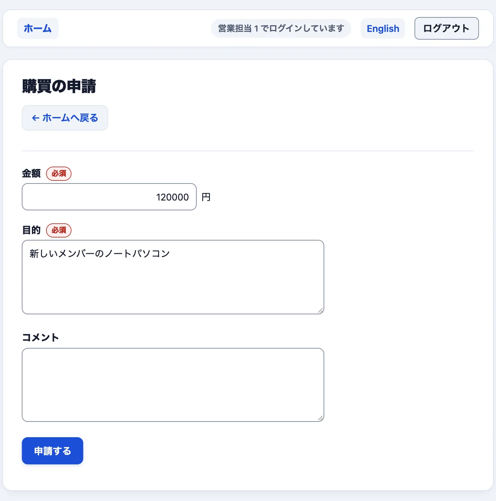
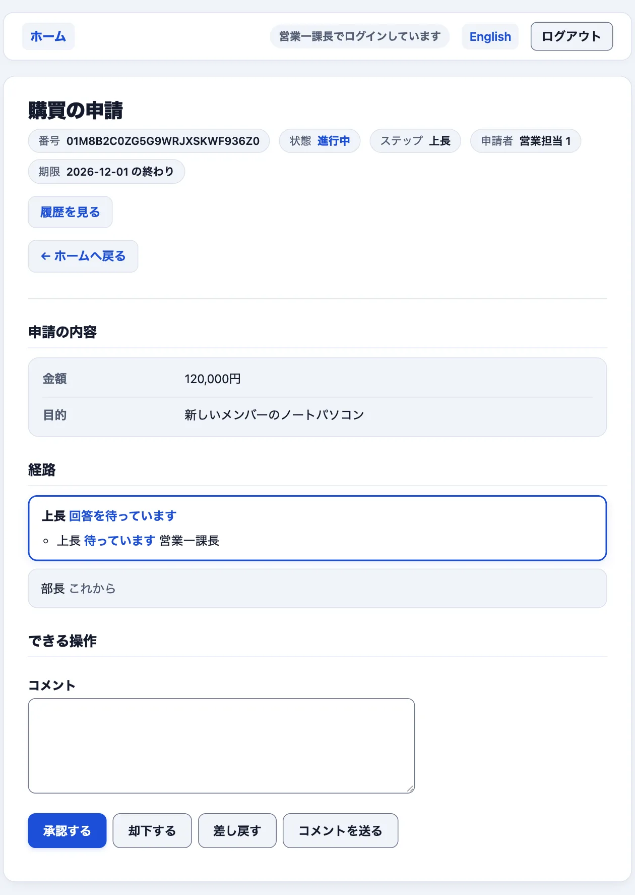
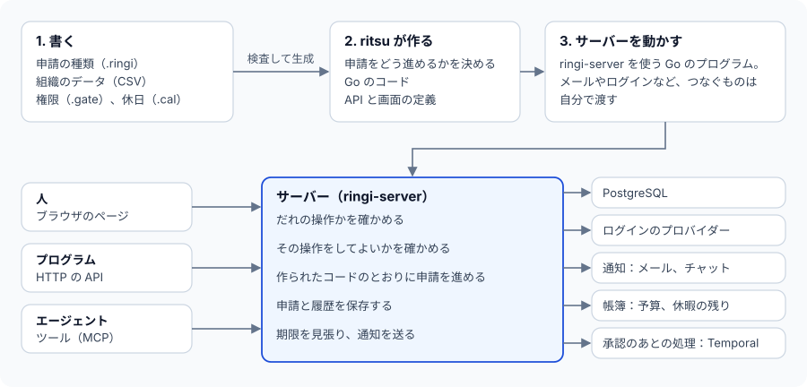

# ringi-server

ringi-server は、会社の申請と承認（稟議）のシステムを作るための Go のフレームワークです。

購買、経費、休暇などの申請の種類ごとに、入力する項目と承認の決まりを一つのファイルに書きます。ringi-server を使うと、そのファイルのとおりに動くサーバーができます。社員はブラウザで申請して承認し、サーバーは承認者を探し、通知を送り、期限を管理し、履歴を残します。

英語版は [README.md](README.md) です。

## 書くもの

購買の申請の、主なところです。差し戻しや取り下げの決まりは省きました。

```ringi title="project/purchase.ringi"
form
  金額(amount)  : money[JPY] "金額"  range >=1JPY <=10_000_000JPY
  目的(purpose) : long text "目的"  count >=1 <=500

route
  上長(manager)  上長
  部長(head)     部長

who
  上長(manager)   = manager of requester
  部長(dept_head) = head of requester.department

every stage
  due in 3 business days at end of day
  remind after 2 business days at 09:00
  when late expire
```

| 書く場所 | 内容 |
|---|---|
| `form` | 申請する人が入力する項目。金額は 1 円から 10,000,000 円まで、目的は 500 字まで |
| `route` | 承認の順。まず上長、次に部長 |
| `who` | 承認する人の決め方。申請した人の上長と、申請した人の部の長。だれになるかは、承認の順が回ってきた日の、会社の組織のデータで決まる |
| `every stage` | 期限。3 営業日目の終わりまでに答えてもらう。2 営業日たっても答えがなければ催促し、期限を過ぎた申請は終わりにする |

ファイルは、ringi という言語で書きます。[ritsu](https://github.com/i2y/ritsu) というコマンドがこのファイルを検査して、申請を進める Go のコードを作ります。金額によって承認する人を増やす、二人のうち一人が答えればよい、差し戻しは二回まで、といった決まりも書けます（[ringi で書けること](https://i2y.github.io/ritsu/ja/ringi/language/)）。

## 動くもの

このファイルから、次のページができます。ページを作るコードは書きません。

| 申請する人 | 承認する人 |
|---|---|
|  |  |

ボタンは、その人が押してよいときにだけ出ます。承認する人には承認、却下、差し戻しのボタンが、申請した人には取り下げるボタンが出ます。

## 自分で書くもの、書かなくてよいもの

自分で書くのは、会社ごとに違うことだけです。

| 書くもの | 書き方 |
|---|---|
| 申請の種類。入力する項目、承認の順、期限、差し戻しの決まり | `.ringi` のファイル |
| 会社の人、チーム、役職 | CSV のファイル |
| 会社の営業日と休日 | `.cal` のファイル。最初からあるものを直す |
| だれが何をしてよいか。見てよい人、管理する人 | `.gate` のファイル。最初からあるものを直す |
| 通知の送り方 | Go のコード |
| 予算や休暇の残り、承認のあとの処理 | `.book` と `.flow` のファイルと、Go のコード。使うときだけ |

次のことは、サーバーがします。

- 申請、承認、差し戻し、取り下げ、管理のためのページを出す。日本語と英語があり、スマートフォンでも使える
- 承認する人を組織のデータから探し、順に回す
- 期限を営業日で数え、催促し、期限切れにする
- 通知を送り、失敗したら届くまでやり直す
- ログインした人が、その操作をしてよいかを毎回確かめる
- ボタンの二度押し、二人の同時の操作、古いページからの操作があっても、申請を正しく保つ
- 申請、履歴、添付ファイルを PostgreSQL に保存する
- 同じ操作ができる HTTP API と、エージェントのツールを出す

できないこともあります。

- ブラウザの上で申請の種類を組み立てる画面はありません。決まりはファイルに書き、検査し、Git で管理します。
- サーバーが出すページの色やロゴは変えられません。見た目を自分で決めたいときは、API を使う画面を作ります（[自分の画面を作る](docs/screens.ja.md)）。

## しくみ



1. 申請の種類、組織のデータ、権限を、ファイルに書きます。
2. ritsu が、書いたものに食い違いや抜けがないかを検査し、申請をどう進めるかを決める Go のコードを作ります。
3. ringi-server が、そのコードをサーバーとして動かします。次にだれへ回すか、いつ終わるかは、サーバーが自分で決めるのではなく、作られたコードに尋ねます。

本番で動かすのに要るのは、PostgreSQL と、会社のログイン（OpenID Connect のサービス）です。サーバーは一つの実行ファイルで、何台でも動かせます。承認のあとの処理を Temporal で動かすときだけ、Temporal も要ります。

## 試す

Go 1.26 以降があれば、五つの申請の例（経費、購買、休暇、アカウント、契約）を動かせます。

```sh
git clone https://github.com/i2y/ringi-server
cd ringi-server/examples
go run ./cmd/server -dev-login
```

ブラウザで <http://127.0.0.1:8080/> を開くと、架空の会社の人が並びます。「営業担当 1」を選んで経費を申請し、ログアウトして「営業一課長」を選ぶと、その申請を承認できます。申請はメモリに置くので、サーバーを止めると消えます。

## 次に読むもの

| したいこと | 読むもの |
|---|---|
| 自分の会社の申請を作り始める | [1. 動かして、申請を承認する](docs/start.ja.md)、[2. 申請の種類を書き換える](docs/change.ja.md)、[3. 通知をメールで送る](docs/mail.ja.md) |
| どう動くのか、言葉の意味を知る | [しくみと言葉](docs/concepts.ja.md) |
| 社員に使い方を伝える | [申請する](docs/use/requester.ja.md)、[承認する](docs/use/approver.ja.md)、[管理する](docs/use/admin.ja.md) |
| 申請の種類を増やす、変える | [申請の種類を足す、変える](docs/types.ja.md)、[フォームの選択肢を一覧から読む](docs/lists.ja.md) |
| 自分の会社の人、営業日、権限を入れる | [組織のデータを用意する](docs/organization.ja.md)、[営業日と祝日を決める](docs/calendar.ja.md)、[だれが何をしてよいかを決める](docs/permissions.ja.md) |
| 会社のログイン、通知、予算、承認のあとの処理とつなぐ | [ログインをつなぐ](docs/sign-in.ja.md)、[通知の送り方を変える](docs/notices.ja.md)、[予算や休暇の残りを確かめる](docs/books.ja.md)、[承認のあとの処理を始める](docs/flows.ja.md) |
| 自分の画面、プログラム、エージェントから使う | [プログラムから API を呼ぶ](docs/api.ja.md)、[エージェントに申請と承認をさせる](docs/agents.ja.md)、[承認の経路でエージェントに確かめさせる](docs/agent-steps.ja.md)、[自分の画面を作る](docs/screens.ja.md)、[自分のプログラムに組み込む](docs/embedding.ja.md) |
| 社員に使ってもらうサーバーを動かす | [用意して起動する](docs/operations.ja.md)、[バックアップと版の上げ方](docs/maintenance.ja.md)、[監視する、困ったとき](docs/troubleshooting.ja.md) |
| フラグ、上限、エラーの意味を調べる | [フラグと設定](docs/reference.ja.md)、[受け付けない理由](docs/refusals.ja.md)、[部品とパッケージ](docs/parts.ja.md) |

これらの文書は、[サイト](https://i2y.github.io/ringi-server/ja/)でも読めます。

## 版

ringi-server と ritsu は、次の組み合わせで使います。

| ringi-server | ritsu | 約束の版 | 新しいこと |
|---|---|---|---|
| v0.1.0 | 0.56.0 | 3 | 最初の版 |

約束は、ritsu が作るコードとサーバーが受け渡すものの形で、番号が付いています。番号の合わないコードを渡すと、サーバーはそのことを表示して、起動しません。版の上げ方は、[版を上げる](docs/maintenance.ja.md#版を上げる)にあります。

## ライセンス

MIT OR Apache-2.0（[LICENSE-MIT](LICENSE-MIT)、[LICENSE-APACHE](LICENSE-APACHE)）です。
