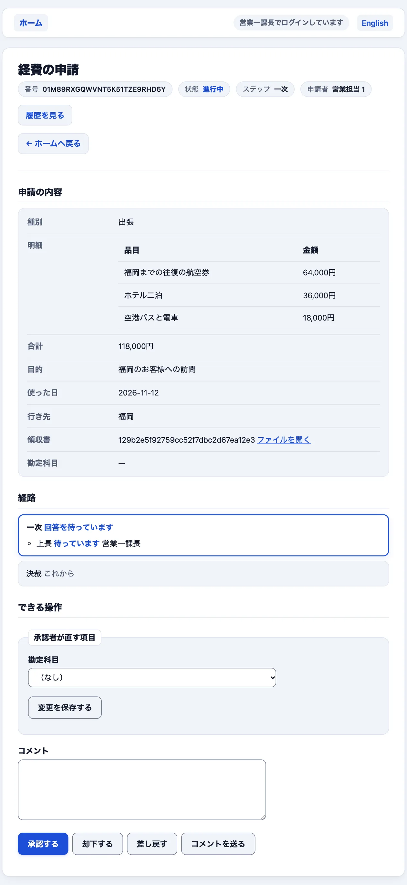

# ringi-server

ringi-server は、組織の申請と承認（経費、購買、休暇、アカウント、契約など）のための Go のフレームワークです。申請の種類は、[ritsu](https://github.com/i2y/ritsu) の言語の一つである ringi で書きます。書くのは、フォーム、だれがどの順で承認するか、期限、差し戻しや却下や取り下げのときにどうなるかです。ritsu はそれを検査し、申請を一つ一つどう進めるかを決める Go のコードを生成します。ringi-server は、そのコードを、人とプログラムとエージェントが使うサーバーとして動かします。

英語版は [README.md](README.md) です。

| 承認者を待っている申請 | 承認者が見る申請 |
|---|---|
|  |  |

## できること

- **英語と日本語のページ。** 申請する、承認する、自分の申請の状況を見る、をブラウザで行えます。ページは、JavaScript がなくても、キーボードだけでも、スクリーンリーダーでも、幅の狭い画面でも使えます。
- **どこから使っても同じ規則。** ページ、HTTP API、エージェントのツールは、ログインしている人として同じ操作を実行します。ボタンは、その人が押せるときにだけ出ます。受け付けないときは、その理由を、該当するフィールドのところに、その人の言語で示します。
- **承認のまわりの仕事。** 期限と催促の時刻が来れば処理し、次の承認者へ回し、通知を送り、予算や休暇の帳簿を呼び、flow を始め、エージェントに尋ねます。失敗した処理は成功するまでやり直し、二度実行しても一度分にしかなりません。
- **管理。** 管理者は、申請の種類の版を切り替え、組織の新しいデータを確かめて取り込み、だれが、いつ、なぜ、何を変えたかを読めます。ページでも API でもできます。
- **データベースは一つ。** 申請とその履歴、添付ファイル、タイマーは PostgreSQL に入ります。一つのデータベースで複数のプロセスを動かせます。ほかに動かすものは要りません（申請の種類が Temporal の flow を始める場合を除きます）。
- **約束どおりかを確かめる試験。** ritsu は、申請の種類ごとにテストベクタを書きます。このフレームワークには、サーバーをそのすべてと突き合わせるパッケージがあります。

## しくみ


規則は、使う組織が書きます。ritsu はそこから、Go のパッケージと、サーバーが守る約束（OpenAPI の記述、画面、テストベクタ）を生成します。プロジェクトのコマンドは、生成されたパッケージと、組織ごとに違う部品をサーバーに渡します。残りはサーバーの仕事です。サーバー自身は、承認について何も決めません。その人がしてよいかを gate に尋ね、出来事を生成されたコードに渡し、コードが返した結果を保存します。

## 5 分で試す

Go 1.26 以降が要ります。ritsu の五つの例（経費、購買、休暇、アカウント、契約。それぞれ英語と日本語があります）を動かします。申請はメモリに置きます。

```sh
cd examples
go run ./cmd/server -dev-login
```

ブラウザで <http://localhost:8080/> を開きます。ログインのページに、架空の組織の人が並びます。

1. e1201（営業担当 1）を選び、領収書を付けて経費を申請します。
2. ログアウトして、e1101（営業一課長）を選びます。ホームに、承認を待っている申請が出ます。
3. その申請を開いて、承認します。

`-dev-login` は本人を確かめないので、自分のコンピューターのアドレスでしか動きません。人にログインしてもらう方法は、[ログイン](#ログイン)にあります。

`pages.sh` は、同じことを curl で、JavaScript のないブラウザと同じように行います。別の端末で、`examples/` で実行します（jq も要ります）。

```sh
./pages.sh
```

次のように表示されます。ID は毎回変わります。

```
1. e1203 (Sales staff 3) signs in, opens the form of a leave request and sends it:
   303 http://127.0.0.1:8080/pages/tickets/01M7KSVDS42R2WGTT04B6HRP2B?lang=en
2. e1101 (the manager of Section 1A) signs in; the start page and the list say what waits:
   Leave request (1)
   href="/pages/tickets/01M7KSVDS42R2WGTT04B6HRP2B?lang=en"
3. e1101 opens the card and approves:
   303 http://127.0.0.1:8080/pages/tickets/01M7KSVDS42R2WGTT04B6HRP2B?lang=en
4. The same card sent again, as a second press of the button sends it, is answered as the first was:
   303 http://127.0.0.1:8080/pages/tickets/01M7KSVDS42R2WGTT04B6HRP2B?lang=en
5. The same card sent with another comment is refused: the request changed after it was shown:
   409
      The request changed after this page was shown. Here it is as it is now: check it, and try again.
6. The ticket, as the API returns it to e1203 with the same cookie:
   approved
   submitted  e1203  Two days before the holidays.
   approved  e1101  Enjoy the holidays.
   ticket approved
```

出された申請を、API とコードではチケット（ticket）と呼びます。申請の種類は kind です。API と管理を curl で一通り試す手順は、[docs/api.ja.md](docs/api.ja.md) にあります。

## 自分のプロジェクトを始める

`ritsu ringi init` は、プロジェクトの最初のファイルを書きます。申請の種類、それを出す組織、gate、ritsu がそこから生成するコード、このフレームワークで動くサーバー、試験です。ritsu（[入れ方](https://github.com/i2y/ritsu/blob/main/README.ja.md#入れ方)）と Go 1.26 以降が要ります。

```sh
ritsu ringi init shinsei --module example.com/acme/shinsei --lang ja
```

```
shinsei に 49 個のファイルを書きました（モジュール example.com/acme/shinsei）。project/ に申請の種類と組織と gate、go/ と requests/ にそこから ritsu が生成したコード、cmd/server/ にフレームワーク github.com/i2y/ringi-server v0.1.0 のサーバー、それと試験です。次に:
  cd shinsei
  go mod tidy
  go test ./...
  go run ./cmd/server -dev-login
を走らせ、ブラウザで http://127.0.0.1:8080/pages/ を開きます。続きは README.ja.md にあります
```

`--module` は Go のモジュールのパスで、`go mod init` に渡すものと同じです。`--lang ja` を付けると、申請の種類と組織と gate の名前が日本語になり、README.ja.md も書きます。

| パス | 中身 |
|---|---|
| `project/` | ritsu が読む規則。`purchase.ringi` は購買の申請で、金額と目的を入れ、申請した人の上長、次に部長が承認する。期限と催促もある。組織は `shared/company.ringi` と `org/`（三つの部、二つの課、十人）、gate は `shared/company.gate`、営業日のカレンダーは `shared/office.cal` |
| `go/`、`requests/` | ritsu が `project/` から生成するもの。Go のパッケージと、約束 |
| `generate.go` | `ritsu gen` を実行する `//go:generate` の行 |
| `shinsei.go`、`gate.go`、`notify.go` | プロジェクトがサーバーに渡すもの。生成されたパッケージと組織、sekisho が生成した gate を呼ぶコード、通知をログに書く Notifier |
| `cmd/server/` | サーバー。パッケージ `serve` に、上のものを渡す |
| `*_test.go` | 試験。ベクタを API に流す `TestVectors`、gate の `TestGate`、ページで申請して承認する `TestPages` |

書かれたファイルは、利用者のものです。`init` は、どのファイルも一度だけ書きます。すでにあるファイルがあれば、その名前を挙げて、何も書きません。`project/` を変えたら、`go generate ./...` が `go/` と `requests/` だけを書き直します。申請の種類や flow の足し方は、プロジェクトの README にあります。

二つのオプションで、なくても動くものを足せます。

- `--mcp` は、エージェントが呼ぶツール（モジュール `mcp`）を、サーバーの `/mcp` に置きます。ログインはページと同じです。
- `--temporal` は、二つ目の申請の種類として経費を足します。承認されると、申請した人に払い戻す flow が始まります。flow は、モジュール `temporal` を使って Temporal で動かします。`temporal server start-dev` で、プロジェクトがつなぐ先の `localhost:7233` に Temporal のサーバーが起動します。

```sh
ritsu ringi init shinsei --module example.com/acme/shinsei --lang ja --mcp --temporal
```

```
shinsei に 82 個のファイルを書きました（モジュール example.com/acme/shinsei）。project/ に申請の種類二つ（一つは flow を持つ）と組織と gate、go/ と requests/ にそこから ritsu が生成したコード、cmd/server/ にフレームワーク github.com/i2y/ringi-server v0.1.0 のサーバー（/mcp にエージェントのツール）、cmd/worker/ に flow のワーカー、それと試験です。次に:
  cd shinsei
  go mod tidy
  go test ./...
を走らせ、Temporal の開発用サーバーを起動し（temporal server start-dev）、別々の端末で
  go run ./cmd/worker
  go run ./cmd/server -dev-login
を走らせ、ブラウザで http://127.0.0.1:8080/pages/ を開きます。続きは README.ja.md にあります
```

## ログイン

だれがリクエストを送ったかを見つける方法は、サーバーごとに一つです。パッケージ `serve` は、どのサーバーにも次の三つを用意します。フラグで選びます。

| フラグ | だれのリクエストか | 用途 |
|---|---|---|
| なし | ヘッダー `X-Person`（と `X-Roles`）の人 | 自分のコンピューターで、curl で API を試す |
| `-dev-login` | ページで選んだ人 | 自分のコンピューターで、ページを試す |
| `-oidc-…` | 組織の OpenID Connect のプロバイダーでログインした人 | 人に使ってもらう |

上の二つは本人を確かめません。自分のコンピューターのアドレスでしか動かず、プロキシが転送したリクエストは受け付けません。人に使ってもらうときは、プロバイダーの設定を渡します。

```sh
export RINGI_OIDC_CLIENT_SECRET='プロバイダーが発行したシークレット'
export RINGI_SESSION_KEYS="$(head -c 32 /dev/urandom | base64)"
go run ./cmd/server -addr :8443 -tls-cert server.crt -tls-key server.key \
  -oidc-issuer https://id.example.com \
  -oidc-client-id ringi \
  -oidc-redirect-url https://ringi.example.com:8443/login/callback
```

プロバイダーには、このサーバーを、シークレットを持つ認可コードフローのクライアントとして登録します。リダイレクト URI は上のもの、スコープは `openid email profile` です。ログインした人は、プロバイダーが確認済みとしているメールアドレスで、組織のデータから探します。役割は、`-oidc-roles-claim` で指定したクレームから取ります。詳しくは [oidc/README.ja.md](oidc/README.ja.md) に、人に使ってもらうサーバーの動かし方は [docs/operations.ja.md](docs/operations.ja.md) にあります。

## プロジェクトが用意するもの

プロジェクトのコマンドは、自分の部品をサーバーに渡し、残りをパッケージ `serve` に任せます。例のコマンド [examples/cmd/server/main.go](examples/cmd/server/main.go) は、次のように渡しています。

```go
	return st.Serve(ctx, server.Config{
		Packages:     []*server.Package{pkg, pkg2},
		Gate:         &examples.Gate{Log: log},
		Organization: examples.Organization(),
		Notifier:     notices,
		Flows:        examples.LogFlows{Log: log},
		Agents:       agents,
		Books:        books,
		Logger:       log,
	}, func(srv *server.Server) { agents.Server, notices.Server = srv, srv })
```

どの部品も、メソッドが数個のインターフェースです。

| 部品 | インターフェース | フレームワークにあるもの |
|---|---|---|
| だれが何をしてよいか | `Gate` | sekisho が生成した gate を呼ぶコード。`ritsu ringi init` が書く（[examples/gate.go](examples/gate.go)）。試すだけなら `server.AllowAll` |
| 組織のデータ | `OrgSource` | `orgfiles`。ritsu が読むのと同じファイルを読む |
| 通知 | `Notifier` | なし。メールやチャットへの送信を書くまでは、ログに出る |
| 帳簿 | `Books` | chobo が生成したクライアントを呼ぶコードの例（[examples/books.go](examples/books.go)） |
| flow とエージェントのステップ | `Flows`、`Agents` | モジュール `temporal` |
| だれがログインしたか | `Authenticator` | `oidc`。人をログインさせるプロキシの後ろでは `web.ProxyHeader`。自分のコンピューターで試すときは `devlogin` |
| 申請を置く場所 | `Store` | `postgres`。試験用の `memstore` |
| 添付ファイル | `Files` | PostgreSQL、ディレクトリ（`web.NewDiskFiles`）、メモリ |
| 履歴の写し | `AuditLog` | なし。`servertest` に試験用のものがある |

それぞれの部品が守ることは、[DESIGN.ja.md](DESIGN.ja.md) の 2.3 にあります。たとえば Notifier は、同じキーの通知を一度だけ送らなければなりません。自分のルートを足す方法と、パッケージ `serve` を使わずにサーバーを作る方法は、[docs/embedding.ja.md](docs/embedding.ja.md) にあります。

## 文書

| したいこと | 読むもの |
|---|---|
| 申請の種類を書く | ritsu にある ringi の[ページ](https://i2y.github.io/ritsu/ja/ringi/)と[リファレンス](https://github.com/i2y/ritsu/blob/main/crates/ringi/docs/reference.md)（英語） |
| API を呼ぶ、curl で管理する | [docs/api.ja.md](docs/api.ja.md) |
| 人に使ってもらうサーバーを動かす | [docs/operations.ja.md](docs/operations.ja.md) |
| ルートを足す、自分のプログラムに組み込む | [docs/embedding.ja.md](docs/embedding.ja.md) |
| ページ、画面、添付ファイルを知る | [web/README.ja.md](web/README.ja.md)、[screens/README.ja.md](screens/README.ja.md)、[screens/page/README.ja.md](screens/page/README.ja.md) |
| 人にログインしてもらう | [oidc/README.ja.md](oidc/README.ja.md) |
| エージェントに申請と承認をさせる | [mcp/README.ja.md](mcp/README.ja.md) |
| flow とエージェントのステップを動かす | [temporal/README.ja.md](temporal/README.ja.md) |
| サーバーが何をするかと、その理由を正確に知る | [DESIGN.ja.md](DESIGN.ja.md) |
| フレームワークを直す、自分の Store を試験する | [CONTRIBUTING.ja.md](CONTRIBUTING.ja.md) |

## パッケージとモジュール

本体は、ルートのモジュールにあります。別のライブラリに依存する三つは、別のモジュールです。

| パッケージ、モジュール | 中身 |
|---|---|
| `server`（ルート） | 申請、タイマー、これから送るもの、管理、HTTP の API（`Server` は `http.Handler`）、同じ操作の Go の関数（`Do`、`Try`、`Waiting`、`Mine`、`Can` など） |
| `serve` | サーバーのコマンドライン。どのサーバーにもあるフラグとその検査、フラグが指す Store、ログイン、HTTP サーバー |
| `web` | API の手前に置く、ページと画面と添付ファイル |
| `screens`、`screens/page` | ritsu が生成した画面（A2UI）にサーバーのデータを入れたもの。同じ画面の、素の HTML のページ |
| `oidc`、`devlogin` | ログイン |
| `postgres`、`memstore` | 申請と添付ファイルを置く場所 |
| `orgfiles` | 組織のデータをファイルから読む |
| `servertest`、`conformance` | 試験用の部品と、サーバーを約束と突き合わせる試験 |
| `temporal/`（モジュール） | Temporal で動かす flow とエージェントのステップ |
| `mcp/`（モジュール） | Model Context Protocol で、エージェントが呼ぶツール |
| `examples/`（モジュール。公開しない） | このフレームワークで動かす ritsu の五つの例と、それを試すサーバー |

## 版

サーバーが動かすのは、ritsu の特定の版が生成したコードです。二つの版は組で使います。

| ringi-server | ritsu | 約束の版 | 新しいこと |
|---|---|---|---|
| v0.1.0 | 0.56.0 | 3 | 最初の版 |

`ritsu ringi init` が書く `go.mod` は、生成したコードに合う版を要求します。モジュール `mcp` と `temporal` も同じ版です。約束の版が違うパッケージを渡されたサーバーは、リクエストを受ける前に、そう表示して止まります。動いているサーバーの版の上げ方は、[docs/operations.ja.md](docs/operations.ja.md#版を上げる) にあります。

## ライセンス

MIT OR Apache-2.0（[LICENSE-MIT](LICENSE-MIT)、[LICENSE-APACHE](LICENSE-APACHE)）です。
