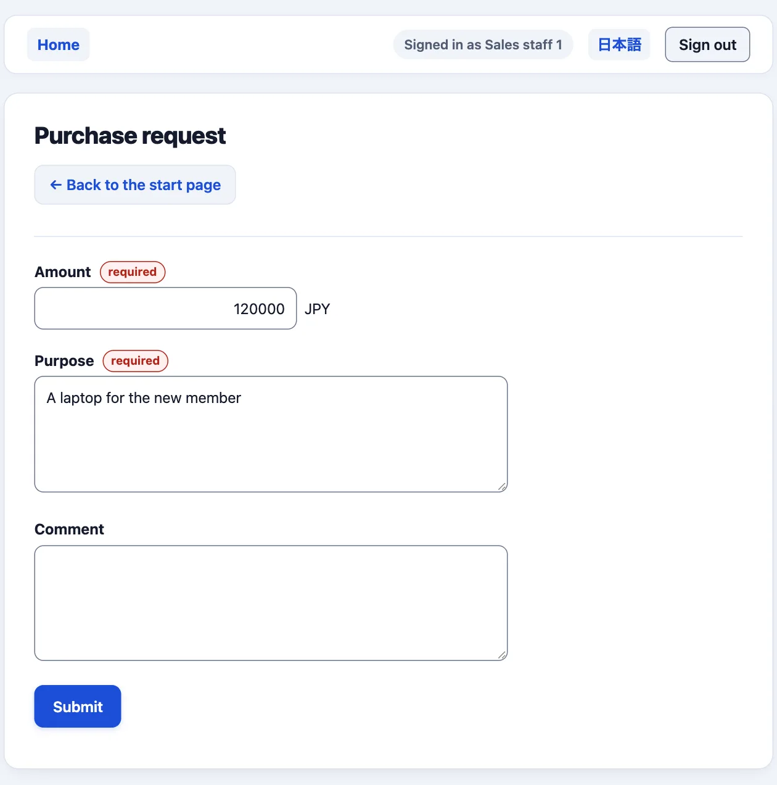

# ringi-server

ringi-server is a Go framework for building a company's system of requests and approvals. *Ringi* is the
Japanese word for deciding by passing a request from one approver to the next.

For each kind of request, such as purchases, expenses and leave, you write one file that says what to
fill in and who approves it. With ringi-server, that file becomes a server that does what it says. Staff
make requests and approve them in a browser. The server finds the approvers, sends the notices, watches
the deadlines, and keeps the history.

Japanese: [README.ja.md](README.ja.md).

## What you write

This is the main part of a purchase request. The lines about sending a request back and withdrawing it
are left out here.

```ringi title="project/purchase.ringi"
form
  amount  : money[JPY] "Amount"  range >=1JPY <=10_000_000JPY
  purpose : long text "Purpose"  count >=1 <=500

route
  manager  manager
  head     dept_head

who
  manager   = manager of requester
  dept_head = head of requester.department

every stage
  due in 3 business days at end of day
  remind after 2 business days at 09:00
  when late expire
```

| Part | What it says |
|---|---|
| `form` | What the requester fills in: an amount from 1 to 10,000,000 yen, and a purpose of up to 500 characters |
| `route` | The order of the approvals: the manager, then the head of the department |
| `who` | How each approver is found: the manager of the person who makes the request, and the head of their department. Who that is comes from your organization's data on the day the request reaches them |
| `every stage` | The deadline: an answer by the end of the third business day. If there is none after two business days, the approver is reminded. A request past its deadline ends |

The file is in a language called ringi. The command [ritsu](https://github.com/i2y/ritsu) checks it, and
makes from it the Go code that takes a request through its approvals. The file can also say that a larger
amount takes one more approver, that one of two approvers is enough, or that a request may be sent back
twice ([what you can write in ringi](https://i2y.github.io/ritsu/ringi/language/)).

## What you get

These pages come from the file above. You write no code for them.

| The requester | The approver |
|---|---|
|  |  |

A button is on the page only when that person may press it. The approver has the buttons that approve,
reject and send back. The requester has the one that withdraws.

## What you write, and what you do not

You write what differs from one organization to another.

| What you write | How |
|---|---|
| The kinds of request: what to fill in, the order of the approvals, the deadlines, what may be sent back | `.ringi` files |
| Your people, teams and positions | CSV files |
| Your business days and holidays | A `.cal` file. You change the one you start with |
| Who may do what: who may see a request, who administers them | A `.gate` file. You change the one you start with |
| How notices are sent | Go code |
| What is left of a budget or of days of leave, and the work after an approval | `.book` and `.flow` files and Go code, only when you use them |

The server does the rest:

- It has the pages for requesting, approving, sending back, withdrawing and administering, in English
  and Japanese, on phones too.
- It finds the approvers in the organization's data, and passes a request from one to the next.
- It counts deadlines in business days, reminds people, and ends what is past its deadline.
- It sends the notices, and tries again until they arrive.
- It checks, at every operation, that the person signed in may do it.
- It keeps a request right when a button is pressed twice, when two people act at the same time, and
  when someone acts on a page that is out of date.
- It keeps the requests, their history and their attachments in PostgreSQL.
- It has an HTTP API and tools for agents, with the same operations.

Some things it cannot do:

- There is no screen to put a request type together in a browser. The rules are files that you write,
  check, and keep in Git.
- The colours and the logo of the server's pages cannot be changed. To have a look of your own, you make
  screens that use the API ([Make screens of your own](docs/screens.md)).

## How it works


1. You write the request types, the organization's data and the permissions as files.
2. ritsu checks that they fit together and leave nothing out, and makes Go code that decides how each
   request goes on.
3. ringi-server runs that code as a server. The server does not decide whom a request goes to next, or
   when it ends: it asks the code that was made. ritsu can also build that code into one module of
   WebAssembly, which the server runs in its place ([Run the request types as Wasm](docs/embedding.md#4-run-the-request-types-as-wasm)).
   In that form a new version reaches a running server as one file, a bundle, signed with a key the
   server lists: an administrator uploads it, the server checks it, and another administrator approves
   it ([Add a version to a running server](docs/bundles.md), [Sign the bundles](docs/signing.md)).

For real use it needs PostgreSQL and your organization's sign-in (a service of OpenID Connect). The server
is one executable file, and you can run as many of it as you like. Temporal is needed only when it runs
the work after an approval.

## Try it

With Go 1.26 or later, you can run five examples (expenses, purchases, leave, accounts and contracts).

```sh
git clone https://github.com/i2y/ringi-server
cd ringi-server/examples
go run ./cmd/server -dev-login
```

Open <http://127.0.0.1:8080/> in a browser, and the people of a made-up company are listed. Choose
"Sales staff 1" and make an expense request, then sign out, choose "Manager of Section 1A", and approve
it. The requests are in memory, and are gone when the server stops.

## What to read next

| What you want | What to read |
|---|---|
| Start on your own organization's requests | [1. Run it, and approve a request](docs/start.md), [2. Change the request type](docs/change.md), [3. Send the notices by mail](docs/mail.md) |
| Know how it works, and what its words mean | [How it works, and its words](docs/concepts.md) |
| Tell your staff how to use it | [Making a request](docs/use/requester.md), [Approving a request](docs/use/approver.md), [Administering](docs/use/admin.md) |
| Add request types, or change them | [Add and change request types](docs/types.md), [Add a version to a running server](docs/bundles.md), [Choose from a list in a form](docs/lists.md) |
| Put in your own people, business days and permissions | [Prepare the organization's data](docs/organization.md), [Set the business days](docs/calendar.md), [Decide who may do what](docs/permissions.md) |
| Connect your sign-in, notices, budgets and the work after an approval | [Connect the sign-in](docs/sign-in.md), [Change how notices are sent](docs/notices.md), [Check budgets and days of leave](docs/books.md), [Start work after an approval](docs/flows.md) |
| Use it from screens, programs and agents of your own | [Call the API from a program](docs/api.md), [Let agents make and approve requests](docs/agents.md), [Have an agent check requests](docs/agent-steps.md), [Make screens of your own](docs/screens.md), [Embed it in a program of your own](docs/embedding.md) |
| Have an agent set up and change a project on the framework | [The Agent Skill of ringi-server](skills/README.md) |
| Run a server your staff use | [Prepare it and start it](docs/operations.md), [Backups and raising versions](docs/maintenance.md), [Watch it, and when something is wrong](docs/troubleshooting.md) |
| Look up flags, limits and errors | [Flags and settings](docs/reference.md), [Why something is refused](docs/refusals.md), [Parts and packages](docs/parts.md) |

These documents are on [the site](https://i2y.github.io/ringi-server/) too.

## Versions

ringi-server and ritsu go together like this.

| ringi-server | ritsu | Contract | What is new |
|---|---|---|---|
| v0.1.0 | 0.56.0 | 3 | The first version |

The contract is the form of what ritsu's code and the server pass to each other, and it has a number. A
server given code of another number says so, and does not start. [Raising
versions](docs/maintenance.md#raising-versions) says how to go from one to the next.

## License

MIT OR Apache-2.0 ([LICENSE-MIT](LICENSE-MIT), [LICENSE-APACHE](LICENSE-APACHE)).
