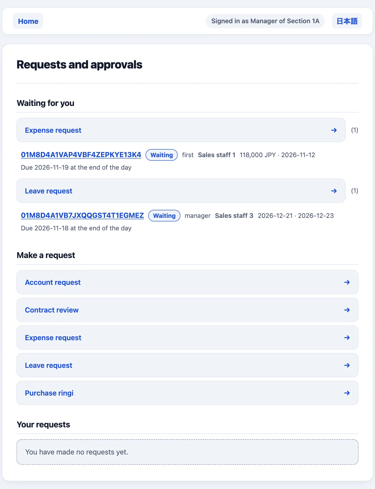
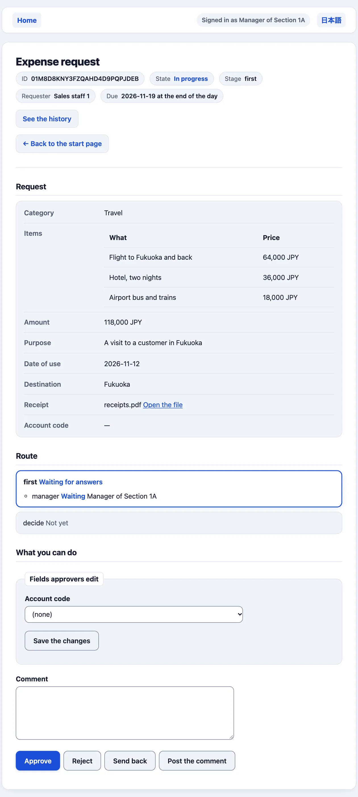
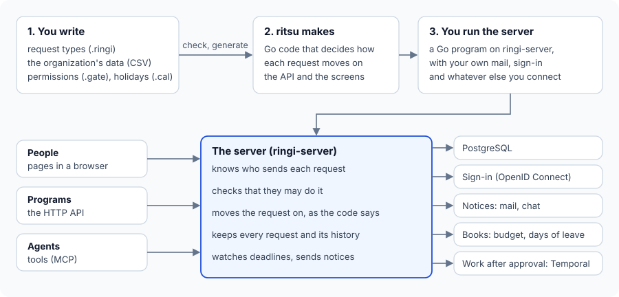

# ringi-server

ringi-server is a Go framework for an organization's requests and approvals: expenses, purchases,
leave, accounts, contracts. You describe each request type in ringi, one of the languages of
[ritsu](https://github.com/i2y/ritsu): its form, who approves it and in which order, the deadlines,
and what happens when it is sent back, rejected or withdrawn. ritsu checks the description and
generates the Go code that decides what happens to each request. ringi-server runs that code as a
server that people, programs and agents use.

Japanese: [README.ja.md](README.ja.md).

| What waits for an approver | The approver's card |
|---|---|
|  |  |

## What you get

- **Pages in English and Japanese.** People make requests, approve them and follow their own. The
  pages work without JavaScript, with a keyboard, with a screen reader and on a narrow screen.
- **One set of rules everywhere.** The pages, the HTTP API and the agents' tools run the same
  operations, as the person who is signed in. A button is on a page exactly when that person may
  press it, and a refusal says why, at the field it is about, in the person's language.
- **The work around an approval.** The server watches deadlines and reminders, passes a request to
  the next approver, sends notices, calls the books that hold a budget or leave, starts flows, and
  asks agents. What fails is tried again until it is done, and doing it twice counts as once.
- **Administration.** On pages or through the API, administrators switch the versions of a request
  type, check and import new data of the organization, and read who changed what, when and why.
- **One database.** Requests, their history, the attachments and the timers are in PostgreSQL.
  Several processes can serve the same database. Nothing else has to run, unless your request types
  start flows on Temporal.
- **Tests against the contract.** ritsu writes test vectors for your request types, and a package of
  this framework checks your server against every one of them.

## How it fits together



You write the rules. ritsu generates from them a Go package and the contract a server keeps: an
OpenAPI description, the screens, and test vectors. Your command gives the generated package to the
server, with the parts that differ in your organization, and the server does the rest. It decides no
approval by itself: it asks the gate whether the person may do it, gives the event to the generated
code, and saves what that code returns.

## Try it in five minutes

You need Go 1.26 or later. This runs ritsu's five examples (expense, purchase, leave, account and
contract, each in English and in Japanese), with the requests kept in memory:

```sh
cd examples
go run ./cmd/server -dev-login
```

Open <http://localhost:8080/> in a browser. The sign-in page lists the people of a fictional
organization.

1. Choose e1201 (Sales staff 1), and make an expense request with a receipt.
2. Sign out, and choose e1101 (the manager of Section 1A). The start page shows what waits for you.
3. Open the request, and approve it.

`-dev-login` checks no one, so the server takes it only on an address of your own computer.
[Signing in](#signing-in) says how people sign in for real.

`pages.sh` does the same with curl, as a browser without JavaScript does. In another terminal, in
`examples/` (it needs jq too):

```sh
./pages.sh
```

It prints this; the IDs differ each time.

```
1. e1203 (Sales staff 3) signs in, opens the form of a leave request and sends it:
   303 http://127.0.0.1:8080/pages/tickets/01M7KSVDS42R2WGTT04B6HRP2B?lang=en
2. e1101 (the manager of Section 1A) signs in; the start page and the list say what waits:
   Leave request (1)
   href="/pages/tickets/01M7KSVDS42R2WGTT04B6HRP2B?lang=en"
3. e1101 opens the card and approves:
   303 http://127.0.0.1:8080/pages/tickets/01M7KSVDS42R2WGTT04B6HRP2B?lang=en
4. The same card sent again, as a second press of the button sends it, is answered as the first was:
   303 http://127.0.0.1:8080/pages/tickets/01M7KSVDS42R2WGTT04B6HRP2B?lang=en
5. The same card sent with another comment is refused: the request changed after it was shown:
   409
      The request changed after this page was shown. Here it is as it is now: check it, and try again.
6. The ticket, as the API returns it to e1203 with the same cookie:
   approved
   submitted  e1203  Two days before the holidays.
   approved  e1101  Enjoy the holidays.
   ticket approved
```

A request someone made is a *ticket* in the API and in the code, and a request type is a *kind*.
[The API, with curl](docs/api.md) goes through the API and the administration.

## Start your own project

`ritsu ringi init` writes the first files of a project: a request type, the organization it is made
in, a gate, the code ritsu generates from them, a server on this framework, and tests. You need
ritsu ([how to install it](https://github.com/i2y/ritsu#install)) and Go 1.26 or later.

```sh
ritsu ringi init approvals --module example.com/acme/approvals
```

```
wrote 52 files in approvals (module example.com/acme/approvals): a request type, its organization and a gate in project/, the code ritsu generates from them in go/ and requests/, a server of the framework github.com/i2y/ringi-server v0.1.0 in cmd/server/, and tests. Next, run
  cd approvals
  go mod tidy
  go test ./...
  go run ./cmd/server -dev-login
and open http://127.0.0.1:8080/pages/ in a browser. README.md says more
```

`--module` is the path of the Go module, as `go mod init` takes it. With `--lang ja`, the request
type, the organization and the gate have Japanese names, and the project has a README.ja.md too.

| Path | What it is |
|---|---|
| `project/` | The rules ritsu reads. `purchase.ringi` is a purchase request: an amount and a purpose, approved by the requester's manager and then by the head of their department, with deadlines and reminders. The organization is in `shared/company.ringi` and `org/` (three departments, two sections, ten people), the gate in `shared/company.gate`, the business days in `shared/office.cal` |
| `go/`, `requests/` | What ritsu generates from `project/`: the Go package, and the contract |
| `generate.go` | The `//go:generate` line that runs `ritsu gen` |
| `approvals.go`, `gate.go`, `notify.go` | What the project gives the server: the generated package and the organization; the gate, around the code sekisho wrote; a notifier that writes the notices to the log |
| `cmd/server/` | The server: package `serve`, with those parts |
| `*_test.go` | The tests: the vectors through the API (`TestVectors`), the gate (`TestGate`), and a request made and approved on the pages (`TestPages`) |

The files are yours. `init` writes each of them once: if some are there already, it names them and
writes nothing. After you change `project/`, `go generate ./...` writes `go/` and `requests/` again,
and nothing else. The project's own README says how to add a request type or a flow.

Two options add what a project can do without:

- `--mcp` serves the tools agents call, from the module `mcp`, at `/mcp` of the server, behind the
  sign-in of the pages.
- `--temporal` adds a second request type, an expense whose approval starts a flow that pays the
  requester back. The flow runs on Temporal with the module `temporal`. `temporal server start-dev`
  runs a Temporal server on `localhost:7233`, where the project looks for it.

```sh
ritsu ringi init approvals --module example.com/acme/approvals --mcp --temporal
```

```
wrote 88 files in approvals (module example.com/acme/approvals): two request types, one with a flow, their organization and a gate in project/, the code ritsu generates from them in go/ and requests/, a server of the framework github.com/i2y/ringi-server v0.1.0 in cmd/server/ with the agents' tools at /mcp, a worker of the flow in cmd/worker/, and tests. Next, run
  cd approvals
  go mod tidy
  go test ./...
start Temporal's dev server (temporal server start-dev), run each of
  go run ./cmd/worker
  go run ./cmd/server -dev-login
in a terminal of its own, and open http://127.0.0.1:8080/pages/ in a browser. README.md says more
```

## Signing in

A server has one way to find who sends a request. Package `serve` gives every server three, by its
flags:

| Flags | Who sends a request | For |
|---|---|---|
| none | the header `X-Person` (and `X-Roles`) | trying the API with curl on your own computer |
| `-dev-login` | the person chosen on a page | trying the pages on your own computer |
| `-oidc-…` | the person who signs in with the organization's OpenID Connect provider | serving people |

The first two check no one. They work only on an address of your own computer, and refuse a request
that a proxy forwarded. For people, give the provider's settings:

```sh
export RINGI_OIDC_CLIENT_SECRET='the secret the provider gave'
export RINGI_SESSION_KEYS="$(head -c 32 /dev/urandom | base64)"
go run ./cmd/server -addr :8443 -tls-cert server.crt -tls-key server.key \
  -oidc-issuer https://id.example.com \
  -oidc-client-id ringi \
  -oidc-redirect-url https://ringi.example.com:8443/login/callback
```

At the provider, register the server as a confidential client of the authorization code flow, with
this redirect URI and the scopes `openid email profile`. A person is found in the organization's
data by the email the provider has verified, and their roles come from the claim that
`-oidc-roles-claim` names. [Signing in](oidc/README.md) says more, and [the guide for running a
server](docs/operations.md) has what else a server for people needs.

## What you supply

A project's command gives the server its own parts and leaves the rest to package `serve`. The
examples' command, [examples/cmd/server/main.go](examples/cmd/server/main.go), does it like this:

```go
	return st.Serve(ctx, server.Config{
		Packages:     []*server.Package{pkg, pkg2},
		Gate:         &examples.Gate{Log: log},
		Organization: examples.Organization(),
		Notifier:     notices,
		Flows:        examples.LogFlows{Log: log},
		Agents:       agents,
		Books:        books,
		Logger:       log,
	}, func(srv *server.Server) { agents.Server, notices.Server = srv, srv })
```

Each part is an interface of a few methods:

| Part | Interface | What comes with the framework |
|---|---|---|
| Who may do what | `Gate` | the code around the gate sekisho generates, which `ritsu ringi init` writes ([examples/gate.go](examples/gate.go)); `server.AllowAll`, for trying |
| The organization's data | `OrgSource` | `orgfiles`, which reads the files ritsu reads |
| Notices | `Notifier` | none: they go to the log until you write the mail or the chat message |
| The books | `Books` | an example of the code around the clients chobo generates ([examples/books.go](examples/books.go)) |
| Flows and agents' steps | `Flows`, `Agents` | the module `temporal` |
| Who signs in | `Authenticator` | `oidc`; `web.ProxyHeader`, behind a proxy that signs people in; `devlogin`, for your own computer |
| Where requests are kept | `Store` | `postgres`; `memstore`, for tests |
| Attachments | `Files` | PostgreSQL, a directory (`web.NewDiskFiles`), memory |
| A copy of the history | `AuditLog` | none; `servertest` has one for tests |

Section 2.3 of [the design](DESIGN.md) says what each part must do; a notifier, for one, must send
each key once. [A guide](docs/embedding.md) shows how to add a route of your own, and how to make a
server without package `serve`.

## Documentation

The documents are on [the site](https://i2y.github.io/ringi-server/) too.

| You want to | Read |
|---|---|
| write a request type | ringi's [pages](https://i2y.github.io/ritsu/ringi/) and [reference](https://github.com/i2y/ritsu/blob/main/crates/ringi/docs/reference.md), in ritsu |
| call the API, or administer with curl | [The API, with curl](docs/api.md) |
| run a server for people | [Running a server for people](docs/operations.md) |
| add a route, or put the server in a program of your own | [A route of your own, and a server of your own](docs/embedding.md) |
| know the pages, the screens and the attachments | [The pages, the screens and the attachments](web/README.md), [the screens](screens/README.md), [the plain HTML pages](screens/page/README.md) |
| let people sign in | [Signing in](oidc/README.md) |
| let agents make and approve requests | [The agents' tools](mcp/README.md) |
| run flows and agents' steps | [The flows and the agents' steps](temporal/README.md) |
| know exactly what the server does, and why | [The design](DESIGN.md) |
| change the framework, or test a store of your own | [Changing the framework, or testing your own server](CONTRIBUTING.md) |

## Packages and modules

The root module holds the framework. Three parts have dependencies of their own and are modules of
their own.

| Package or module | What it is |
|---|---|
| `server` (the root) | The requests, the timers, what is still to be sent, the administration, the API over HTTP (`Server` is an `http.Handler`), and the same operations in Go (`Do`, `Try`, `Waiting`, `Mine`, `Can`…) |
| `serve` | A server's command line: the flags every server takes and their checks, the stores they name, the sign-in, and the HTTP server |
| `web` | The pages, the screens and the attachments over HTTP, in front of the API |
| `screens`, `screens/page` | The screens ritsu generates (A2UI) filled with the server's data, and the same screens as plain HTML |
| `oidc`, `devlogin` | Signing in |
| `postgres`, `memstore` | Where the requests and the attachments are kept |
| `orgfiles` | The organization's data, from files |
| `servertest`, `conformance` | Parts for tests, and the tests of a server against the contract |
| `temporal/` (a module) | Flows and agents' steps on Temporal |
| `mcp/` (a module) | The tools agents call, over the Model Context Protocol |
| `examples/` (a module, not published) | ritsu's five examples on the framework, and servers to try them |

## Versions

A server runs code that one version of ritsu generated, and the two go together:

| ringi-server | ritsu | Contract | What is new |
|---|---|---|---|
| v0.1.0 | 0.56.0 | 3 | The first version |

`ritsu ringi init` writes a `go.mod` that requires the version its generated code is made for, and
the same version of the modules `mcp` and `temporal`. A server given a package of another contract
stops before it takes requests, and says so. [The guide for running a
server](docs/operations.md#raising-the-version) says how to raise the version of one that runs.

## License

MIT OR Apache-2.0 ([LICENSE-MIT](LICENSE-MIT), [LICENSE-APACHE](LICENSE-APACHE)).
