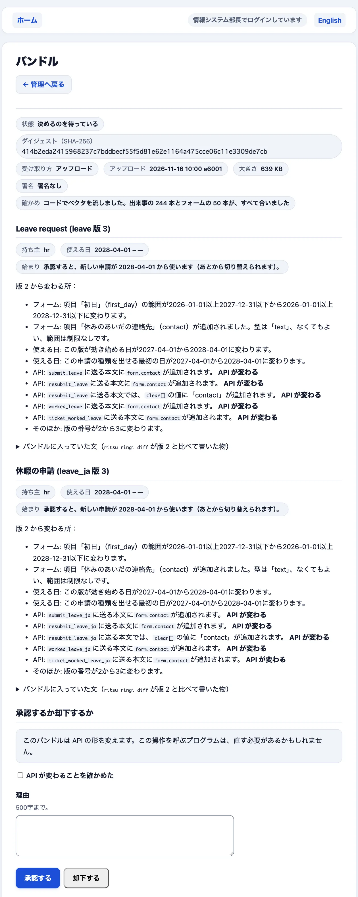

# 動いているサーバーに版を足す

申請の種類の新しい版や、新しい申請の種類は、サーバーを組み直さずに、動いているサーバーに足せます。足す物は**バンドル**という一つの zip のファイルで、ritsu がプロジェクトから書きます。中の申請の種類は WebAssembly で動きます。管理する人が管理のページでアップロードすると、サーバーが確かめて何が変わるかを見せ、ほかの管理する人が承認します。起動のときに、ディレクトリにあるバンドルを読ませることもできます。英語版は [bundles.md](bundles.md) です。

新しい版をサーバーに組み込むやり方は、[申請の種類を足す、変える](types.ja.md#4-サーバーに二つの版を渡す)にあります。どちらのやり方でも、進行中の申請は、出したときの版のまま最後まで進みます。

## 1. バンドルを作る

`--extra wasm` は申請の種類を `requests/kinds.wasm` に組み、`--extra bundle` は `requests/` の全体と、申請の種類の元のファイルを、一つの zip（`requests.zip`）にまとめます。同じファイルからは、同じバイト列ができます。WebAssembly を組むには、cargo と、その WebAssembly の target（`rustup target add wasm32-unknown-unknown`）が要ります。ネットワークからは何も取りません。

```sh
ritsu gen . --root . --target requests --extra wasm --extra bundle \
  --catalog https://example.com/acme/approvals/v3/a2ui/catalog.json \
  --diff-from ../v2/requests.zip --out ../v3 --lang en
```

- **`--catalog`**：サーバーに組み込む版ごとにするのと同じに、バンドルごとに別の名前のカタログを付けます。サーバーにある版と同じ名前のカタログで、画面の部品が違うバンドルは、サーバーが受け取りません。
- **`--diff-from`**：前の版のバンドルを渡すと、`ritsu ringi diff` がそれぞれの申請の種類について言うことを、英語と日本語でバンドルに入れます。管理する人は、サーバーが自分で見つけた差と並べて読みます（3）。省いてもかまいません。

例にも一つあります。`examples/regen.sh` が、`examples/v3/project` の休暇の申請の版 3 から、`examples/bundles/leave-v3.zip` を書きます。版 3 は「休みのあいだの連絡先」の項目を足し、休みの初日を 2028 年の終わりまで受け付け、2028-04-01 から使われます。例のサーバーには、版 1 と版 2 が組み込んであります。

サーバーが受け取るのは、並べた鍵で署名したバンドルだけです。[バンドルに署名する](signing.ja.md)のとおりに、レビューしたリポジトリから組む CI の仕事の鍵で署名します。この案内では、例を試すためだけに作った鍵で署名します。この鍵を、ほかの何にも使ってはいけません。

## 2. アップロードして、承認してもらう

[バンドルに署名する](signing.ja.md)のとおりに、鍵の組を作ってバンドルに署名します（`examples/` で）。

```sh
go run github.com/i2y/ringi-server/cmd/ringi-bundle keygen -out bundle
go run github.com/i2y/ringi-server/cmd/ringi-bundle sign -key bundle.key bundles/leave-v3.zip
```

公開鍵を渡して、例のサーバーを起動します。

```sh
go run ./cmd/server -dev-login -bundle-keys bundle.pub
```

<http://localhost:8080/> を開き、人事部の部長の `e6001` として、役割 `workflow_admin` でサインインします。休暇の申請を受け持つのは人事部です。ホームのいちばん下の「管理」を開き、「バンドルで版や申請の種類を足す」を開きます。バンドルに `bundles/leave-v3.zip` を、署名に `bundles/leave-v3.zip.sig` を選んで「アップロードして確かめる」を押すと、サーバーは zip を開く前に署名を確かめ、それから確かめて（5）、バンドルのページを出します。

アップロードした人は、そのバンドルを決められません。`e7001` として、役割 `system_admin` でサインインし直し、同じ一覧からバンドルを開きます。



- **版 2 から変わる所**：サーバーが二つの版の説明から書きます。フォームの項目、ステップ、承認者の決め方、使える日です。プログラムが送る物、読む物を変える行には「API が変わる」の印が付きます。行は説明からだけ書きます。種類のコードそのものは、バンドルが持つベクタでしか確かめていないので、説明と違うことをするコードはここでは分かりません。だれが組んだかを言うのは署名です。
- **バンドルに入っていた文**：`ritsu ringi diff` が書いた物を、バンドルを作った人が渡したとおりに、表も含めて出します。その行を押すと開きます。
- **いつから使われるか**：「承認すると、新しい申請が 2028-04-01 から使います」。ファイルに書いた日です。

API が変わるバンドルは、承認の前に「API が変わることを確かめた」に印を付けます。API を呼ぶプログラムやエージェントは、直す必要があるかもしれません。例のバンドルは、種類のページが読み込むスクリプトと、ツールが種類について言う文と、画面も変えるので、それぞれに印を付けます。印を付ける前に、差が並べる行を読んでください。理由を書いて「承認する」を押すと、新しい版が「申請の種類の版を切り替える」のページに並び、ファイルに書いたとおりに始まります。切り替えは、ほかの版と同じです（[管理する](use/admin.ja.md#申請の決まりの版を切り替える)）。

## 3. API からアップロードする

プログラムや、配備の台本からも同じことができます。例のサーバーを `-dev-login` なしで起動すると（`go run ./cmd/server`）、ヘッダーの `X-Person` と `X-Roles` がサインインの代わりになります。本番のサーバーでは、[`-api-keys` の鍵](api.ja.md#プログラムから呼ぶ)を使います。

```sh
curl -s http://127.0.0.1:8080/admin/bundles/uploads \
  -H 'Content-Type: application/zip' -H 'Idempotency-Key: leave-v3' \
  -H 'X-Person: e6001' -H 'X-Roles: workflow_admin' \
  -H "Bundle-Signature: $(cat bundles/leave-v3.zip.sig)" \
  --data-binary @bundles/leave-v3.zip |
  jq -c '{digest, state, adds: [.adds[] | {name, version}], checks, difference: {digest: .difference.digest, api_changes: .difference.api_changes, script_changes: .difference.script_changes, tools_changes: .difference.tools_changes, screens_changes: .difference.screens_changes}}'
```

```
{"digest":"8f331813bd2b79a44f64f4ed6bcd2a2971788a0d1ff2e9a8c2794b963797633b","state":"pending","adds":[{"name":"leave","version":3},{"name":"leave_ja","version":3}],"checks":{"vectors":244,"worked":50},"difference":{"digest":"3c945201fdcccc359a23993537516a74c344e1816fa2e618f123d3dfddc0e500","api_changes":true,"script_changes":true,"tools_changes":true,"screens_changes":true}}
```

サーバーは、バンドルのベクタのうち 244 のイベントと 50 のフォームをそのコードで動かし、どれもベクタのとおりに答えました。`difference.kinds` には、ページに出るのと同じ差の行が入っています。

ほかの人として承認します。読んだ差のダイジェスト（`difference.digest`）を送り返し、差が API を変えるなら `api_changes` を、スクリプトやツールや画面が変わるなら `script_changes`、`tools_changes`、`screens_changes` も付けます。

```sh
curl -s http://127.0.0.1:8080/admin/bundles/8f331813bd2b79a44f64f4ed6bcd2a2971788a0d1ff2e9a8c2794b963797633b/approve \
  -H 'Content-Type: application/json' -H 'Idempotency-Key: approve-leave-v3' \
  -H 'X-Person: e7001' -H 'X-Roles: system_admin' \
  -d '{"digest": "3c945201fdcccc359a23993537516a74c344e1816fa2e618f123d3dfddc0e500", "api_changes": true, "script_changes": true, "tools_changes": true, "screens_changes": true, "reason": "The contact while away, from April"}' |
  jq -c '{state, decided: {person: .decided.person, reason: .decided.reason}, starts: [.difference.kinds[] | {name, version, day: .starts.day}]}'
```

```
{"state":"approved","decided":{"person":"e7001","reason":"The contact while away, from April"},"starts":[{"name":"leave","version":3,"day":"2028-04-01"},{"name":"leave_ja","version":3,"day":"2028-04-01"}]}
```

アップロードした `e6001` として送ると、承認は受け付けられません（409）。

```
{"refused":"uploader","text":"You uploaded this bundle: another administrator decides it","text_ja":"このバンドルはあなたがアップロードしました。決めるのは、ほかの管理者です","at":null}
```

操作は、[プログラムから API を呼ぶ](api.ja.md)と、`framework.openapi.json`（`/admin/bundles…`）にあります。

## 4. 起動のときにバンドルを読む

`-bundles` には、バンドルを置いたディレクトリを渡します。バンドルは `<名前>.zip` で、その横に署名の `<名前>.zip.sig` を置きます。サーバーが鍵を並べるとき、起動のときに読むバンドルにも、アップロードと同じくそのどれかによる署名を求めます。署名が違うか無いときは起動を止めます。鍵を並べないときは、ディレクトリのバンドルに署名は要らず、アップロードは断ります。決めるのはディレクトリに書く人で、サーバーに何を組み込むかを決める人と同じです。

```sh
go run ./cmd/server -dev-login -bundle-keys bundle.pub -bundles bundles
```

```
level=INFO msg="the server reads the bundles of -bundles as it starts" dir=bundles bundles=1
level=INFO msg="a bundle of Config.Bundles is checked, and served" bundle=leave-v3.zip digest=8f331813bd2b adds="leave v3, leave_ja v3" vectors=244 worked=50
level=INFO msg=listening addr=127.0.0.1:8080 pages=http://127.0.0.1:8080/
```

確かめを通らないバンドルがあれば、サーバーは待ち受ける前に、何が違うかを言って止まります。

ストアは、サーバーが受け取ったバンドルをどれも保ちます。起動し直したサーバーも、同じデータベースを使うほかのプロセスも、`-bundles` があってもなくても、ストアが承認済みとして保つバンドルを受け持ちます。あるプロセスが承認したバンドルを、ほかのプロセスは 30 秒のうちに読みます。

## 5. サーバーが確かめること

何かを保つ前に、次を確かめます。

| 何を | 受け取る物 |
|---|---|
| 大きさ | アップロードしたままで 64 MiB まで（`server.Config.MaxBundle`）、ファイルは 10,000 まで、展開した大きさも 64 MiB まで |
| 形 | `wasm.json` があり、このサーバーが読める版の約束であること |
| 署名 | `-bundle-keys` のどれかの鍵の署名。zip を開く前に確かめます。鍵を一つも並べないサーバーはアップロードを受け取りません。そのとき起動のときに読むバンドルには署名を求めません |
| 版 | サーバーにある版は、サーバーの物と同じであること。サーバーにない版を一つ以上足すこと。決めるのを待っているほかのバンドルが足す版を足さないこと |
| コード | 読み込めて、その画面とエージェントのツールがサーバーの物と合うこと |
| ベクタ | ベクタのイベントとフォームのどれも、そのコードで動かして、ベクタのとおりに答えること |

サーバーにある版は変わりません。同じファイルからでも、別の ritsu で組んだために違うことを言う版があれば、受け取りません。版を上げるか、サーバーの物を作った ritsu でバンドルを作り直します（どちらの ritsu かは、断りの文が言います）。

同じバンドルをもう一度アップロードしても、何も足しません。通らなかったときは、組織のデータと同じに、問題ごとに何がどこで違うかを答えます。

## 6. だれができるか

gate には、バンドルが足す版ごとに、三つの操作を尋ねます。

| 操作 | できること |
|---|---|
| `upload_bundle` | その版のバンドルをアップロードする、隠す |
| `approve_bundle` | その版のバンドルを承認する、却下する |
| `add_request_type` | サーバーにない申請の種類を足すバンドルを承認する |

例の gate は、部の `workflow_admin` に、その部が受け持つ申請の種類について初めの二つを、`system_admin` に三つとも与えます。

```gate title="project/shared/company.gate"
permit admins_bundle_their_own_departments
  description "An administrator uploads and decides the bundles of the request types their department owns"
  principal in workflow_admin
  action upload_bundle, approve_bundle
  when resource.owner is principal.department
```

gate が何を言っても、アップロードした人はそのバンドルを決められません。決まりの変え方は、[だれが何をしてよいかを決める](permissions.ja.md)にあります。

## 7. バンドルを隠す

「バンドルを隠す」で、一覧から外せます。承認しなかったバンドルは、隠すとサーバーが中身を忘れます。承認したバンドルは、その版の申請が使うかもしれないので、消しません。新しい申請がその版を使わなくなったら（どの版も「使わない」に切り替えたら）隠せて、その版で出した申請のためには、そのあとも受け持ちます。

アップロード、承認、却下、隠したこと、起動のときに読んだバンドルは、どれも、だれがなぜしたかと一緒に記録に残ります。
