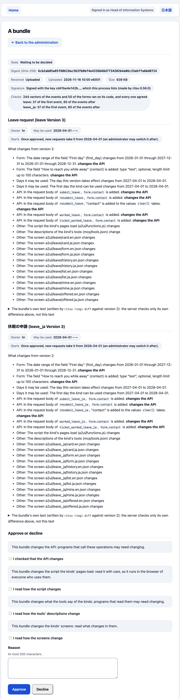

# Add a version to a running server

A new version of a request type, or a new request type, can reach a server that is running, with no new
build of the server: as a **bundle**, one zip file that ritsu writes from the project, in which the request
types run as WebAssembly. An administrator uploads it on the pages for administrators, the server checks it
and shows what it changes, and another administrator approves it. A server can also read the bundles of a
directory as it starts. Japanese: [bundles.ja.md](bundles.ja.md).

The other way, building the new version into the server, is in
[Add and change request types](types.md#4-give-the-server-both-versions). Either way, a request in progress ends
in the version it was made in.

## 1. Make a bundle

`--extra wasm` builds the request types into `requests/kinds.wasm`, and `--extra bundle` puts all of
`requests/`, with the files the request types are made from, into one zip, `requests.zip`. The same files make
the same bytes. Building the WebAssembly needs cargo and its target for WebAssembly
(`rustup target add wasm32-unknown-unknown`); nothing is fetched from the network.

```sh
ritsu gen . --root . --target requests --extra wasm --extra bundle \
  --catalog https://example.com/acme/approvals/v3/a2ui/catalog.json \
  --diff-from ../v2/requests.zip --out ../v3 --lang en
```

- **`--catalog`**: give each bundle a catalog of its own name, as you do for each version you build into the
  server. When a bundle names the catalog of a version the server has, and its screens differ, the server
  refuses it.
- **`--diff-from`**: with the bundle of the version before, the bundle holds what `ritsu ringi diff` says of
  each request type, in English and in Japanese. The administrators read it beside what the server finds itself
  (3). It may be left out.

The examples make one: `examples/regen.sh` writes `examples/bundles/leave-v3.zip` from `examples/v3/project`,
version 3 of the leave request. It adds the field "How to reach you while away", takes a first day up to the end
of 2028, and takes effect on 2028-04-01. The examples' server has versions 1 and 2 built in.

To have the server take only the bundles you signed, see [Sign bundles](signing.md).

## 2. Upload it, and have it approved

Start the examples' server, in `examples/`:

```sh
go run ./cmd/server -dev-login
```

Open <http://localhost:8080/>, and sign in as `e6001`, the head of human resources, with the role
`workflow_admin`: human resources keeps the leave request. Open "Administration" at the bottom of the start
page, then "Add a version or a request type with a bundle". Choose `bundles/leave-v3.zip`, and press "Upload
and check". The server checks it (5) and shows its page.

The one who uploaded a bundle does not decide it. Sign in again as `e7001` with the role `system_admin`, and
open the bundle from the same list.



- **What changes from version 2**: the server writes it from the two versions: the fields of the form, the
  stages, how the approvers are chosen, the days it may be used on. A line that changes what a program sends or
  reads is marked "changes the API".
- **The text the bundle held**: what `ritsu ringi diff` wrote, as those who made the bundle gave it, with its
  tables. Click its line to open it.
- **When it starts**: "Once approved, new requests take it from 2028-04-01": the day its file says.

When the bundle changes the API, tick "I checked that the API changes" before you approve it: programs that
call the API, and agents, may need changing. Write the reason, and press "Approve". The new version is then on
the page "Switch the versions of the request types", and starts as its file says; switch it as any version
([Administering](use/admin.md#switching-the-version-of-a-requests-rules)).

## 3. Upload it through the API

The same, from a program or a script of a deployment. Start the examples' server without `-dev-login`
(`go run ./cmd/server`), so that the headers `X-Person` and `X-Roles` stand for the sign-in; a real server
takes [a key of `-api-keys`](api.md#call-it-from-a-program).

```sh
curl -s http://127.0.0.1:8080/admin/bundles/uploads \
  -H 'Content-Type: application/zip' -H 'Idempotency-Key: leave-v3' \
  -H 'X-Person: e6001' -H 'X-Roles: workflow_admin' \
  --data-binary @bundles/leave-v3.zip |
  jq -c '{digest, state, adds: [.adds[] | {name, version}], checks, difference: {digest: .difference.digest, api_changes: .difference.api_changes}}'
```

```
{"digest":"414b2eda2415968237c7bddbecf55f5d81e62e1164a475cce06c11e3309de7cb","state":"pending","adds":[{"name":"leave","version":3},{"name":"leave_ja","version":3}],"checks":{"vectors":244,"worked":50},"difference":{"digest":"643ef0b7db3cfe193d208b73d47b9c46753a648b282f8acd1c767168a05b96ce","api_changes":true}}
```

The server ran 244 events and 50 forms of the bundle's vectors on its code, and each answered as the vector
says. `difference.kinds` holds the lines of the difference, as the page shows them.

Approve it as another person, sending back the digest of the difference you read (`difference.digest`), and
`api_changes` when the difference says it changes the API:

```sh
curl -s http://127.0.0.1:8080/admin/bundles/414b2eda2415968237c7bddbecf55f5d81e62e1164a475cce06c11e3309de7cb/approve \
  -H 'Content-Type: application/json' -H 'Idempotency-Key: approve-leave-v3' \
  -H 'X-Person: e7001' -H 'X-Roles: system_admin' \
  -d '{"digest": "643ef0b7db3cfe193d208b73d47b9c46753a648b282f8acd1c767168a05b96ce", "api_changes": true, "reason": "The contact while away, from April"}' |
  jq -c '{state, decided: {person: .decided.person, reason: .decided.reason}, starts: [.difference.kinds[] | {name, version, day: .starts.day}]}'
```

```
{"state":"approved","decided":{"person":"e7001","reason":"The contact while away, from April"},"starts":[{"name":"leave","version":3,"day":"2028-04-01"},{"name":"leave_ja","version":3,"day":"2028-04-01"}]}
```

Sent as `e6001`, who uploaded it, the approval is refused (409):

```
{"refused":"uploader","text":"You uploaded this bundle: another administrator decides it","text_ja":"このバンドルはあなたがアップロードしました。決めるのは、ほかの管理者です","at":null}
```

The operations are in [Call the API from a program](api.md) and in `framework.openapi.json`
(`/admin/bundles…`).

## 4. Read bundles as the server starts

`-bundles` names a directory of bundles, each `<name>.zip`, with its signature `<name>.zip.sig` beside it when
the server takes only signed ones. The server checks each as it starts, as an upload is checked, and serves it:
whoever writes the directory decides it, as they decide what is built into the server.

```sh
go run ./cmd/server -dev-login -bundles bundles
```

```
level=INFO msg="the server reads the bundles of -bundles as it starts" dir=bundles bundles=1
level=INFO msg="a bundle of Config.Bundles is checked, and served" bundle=leave-v3.zip digest=414b2eda2415 adds="leave v3, leave_ja v3" vectors=244 worked=50
level=INFO msg=listening addr=127.0.0.1:8080 pages=http://127.0.0.1:8080/
```

A bundle that does not pass stops the server before it listens, saying what is wrong.

The store keeps each bundle the server takes. A server started again, and every other process on the same
database, serves the bundles the store keeps approved, with or without `-bundles`. Another process reads
those another one approved within 30 seconds.

## 5. What the server checks

Before it keeps anything:

| What | What it takes |
|---|---|
| The size | 64 MiB as uploaded (`server.Config.MaxBundle`), 10,000 files, and as much uncompressed |
| The form | A `wasm.json` and a contract of a version this server reads |
| The signature | With `-bundle-keys`, a signature by one of its keys |
| The versions | A version the server has, the same as the server's; at least one version the server does not have; none that another bundle waiting to be decided adds |
| The code | It loads, and its screens and its agents' tools go with the server's |
| The vectors | Every event and every form of its vectors, run on its code, answers as the vector says |

A version the server has does not change. When the bundle holds one that says another thing, even from the
same file built with another ritsu, it is refused: raise the version, or make the bundle with the ritsu that
made the server's (the refusal names the two).

The same bundle uploaded again adds nothing. What does not pass is answered with each problem and where, as
the organization's data is.

## 6. Who may

The gate is asked three actions, of each version the bundle adds:

| Action | What it lets a person do |
|---|---|
| `upload_bundle` | Upload a bundle of the version, and hide it |
| `approve_bundle` | Approve or decline a bundle of the version |
| `add_request_type` | Approve a bundle that adds a request type the server does not have |

The examples' gate gives the first two to a department's `workflow_admin` for the request types the department
keeps, and all three to `system_admin`:

```gate title="project/shared/company.gate"
permit admins_bundle_their_own_departments
  description "An administrator uploads and decides the bundles of the request types their department owns"
  principal in workflow_admin
  action upload_bundle, approve_bundle
  when resource.owner is principal.department
```

Whatever the gate says, the one who uploaded a bundle does not decide it. [Decide who may do what](permissions.md)
says how to change the rules.

## 7. Hide a bundle

"Hide the bundle" takes it out of the list. When a bundle that was never approved is hidden, the server forgets
its contents. An approved bundle is never deleted, as a request of its versions may need it; it can be hidden once no new request
takes its versions (each switched to "Never"), and it is still served for the requests made in them.

Every upload, approval, decline and hiding, and every bundle read as the server starts, is in the record, with
who did it and why.
