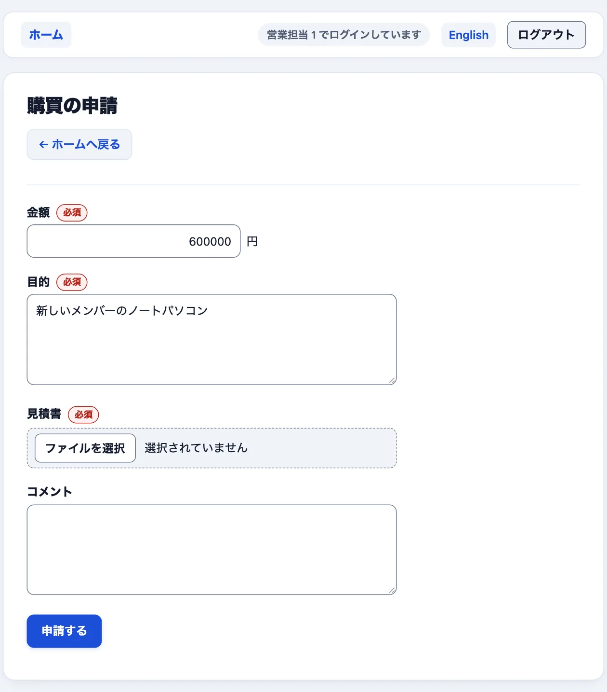

# 2. 申請の種類を書き換える

[1. 動かして、申請を承認する](start.ja.md)で作った購買の申請に、二つの決まりを足します。500,000 円を超えたら見積書を付けてもらうことと、1,000,000 円を超えたら社長も承認することです。ファイルを書き換え、検査し、コードを作り直す、という手順はどの変更でも同じです。20 分ほどで終わります。英語版は [change.md](change.md) です。

この申請はまだだれも使っていないので、版は `v1` のまま書き換えます。社員が使い始めた申請を変えるときは、版を上げます（[使われている申請の決まりを変える](types.ja.md#使われている申請の決まりを変える)）。

作業は、プロジェクトのディレクトリ `shinsei` で行います。ritsu の表示を日本語にするため、次の環境変数を設定しておきます。

```sh
export RITSU_LANG=ja
```

## 書いてあることを読む

`project/purchase.ringi` をエディタで開きます。初めの部分は次のとおりです。

```ringi title="project/purchase.ringi"
request 購買(purchase) v1 "購買の申請"
description "購買の申請。申請者の上長が承認し、次に部長が承認する。ritsu ringi init が始めの形として書いたので、自分の決まりに書き換える"
owner general_affairs

use organization 組織(org) from "shared/company.ringi"
use calendar 本社(office) from "shared/office.cal"
use gate "shared/company.gate"

form
  金額(amount)  : money[JPY] "金額"  range >=1JPY <=10_000_000JPY
  目的(purpose) : long text "目的"  count >=1 <=500

route
  上長(manager)  上長
  部長(head)     部長

who
  上長(manager)   = manager of requester
  部長(dept_head) = head of requester.department

every stage
  due in 3 business days at end of day
  remind after 2 business days at 09:00
  when late expire
  when empty escalate

ticket
  # 社長は組織のいちばん上にいて、購買を承認する上長がいない。
  submitted by   everyone except position president
  self approval  not allowed
  # 上長が部長でもあるときは、一度承認すれば両方のステップが済む。
  same approver  approves once
  send back      to the requester, at most 2 times
  resubmit       within 5 business days
  withdraw       until it is decided

claims
  期限内に終わる : every ticket ends within 28 business days
```

| 書く場所 | 内容 |
|---|---|
| `request` | 名前、版（`v1`）、ページに出る題。`購買(purchase)` の括弧の中は、API やコードで使う英字の名前 |
| `owner` | この申請を受け持つチーム。ここでは総務部（`general_affairs`） |
| `use` | 読むファイル。組織の形、営業日、権限 |
| `form` | 申請する人が入力する項目 |
| `route` | 承認のステップ。上から順に進む。一行は、ステップの名前と、答える人 |
| `who` | 答える人の決め方。`route` の「答える人」には、ここの名前を書く |
| `every stage` | どのステップにも効くこと。期限は 3 営業日目の終わり。2 営業日たったら 9 時に催促する。期限を過ぎたら終わりにする。答える人がいなければ、上の人に回す |
| `ticket` | 申請にできること。社長のほかはだれでも申請できる。自分の申請は承認できない。同じ人が二つのステップの承認者なら、一度の承認で済む。差し戻しは二回まで。再申請は 5 営業日のうちに。決まるまでは取り下げられる |
| `claims` | いつでも成り立ってほしいこと。ここでは、どの申請も 28 営業日のうちに終わること |

このあとに、`scenario` で始まる例と、英語の文言（`labels en`）が続きます。ステップと答える人には別々に名前を付けるので、同じ「部長」でも、ステップの英字の名前は `head`、答える人の英字の名前は `dept_head` です。

## 見積書の項目を足す

`form` に見積書の行を足します。

```ringi title="project/purchase.ringi" hl_lines="4"
form
  金額(amount)  : money[JPY] "金額"  range >=1JPY <=10_000_000JPY
  目的(purpose) : long text "目的"  count >=1 <=500
  見積書(quote) : attachment "見積書"  required when 金額 > 500_000JPY
```

| 書いたもの | 意味 |
|---|---|
| `見積書(quote)` | 項目の名前と、英字の名前 |
| `attachment` | 項目の型。ここでは添付ファイル。ほかに `money`、`long text`、`date`、`choice`、`person` などがある |
| `"見積書"` | ページに出る文言 |
| `required when 金額 > 500_000JPY` | 金額が 500,000 円を超えるときは必須。それ以外は、なくてもよい |

ページは英語でも出るので、英語の文言も足します。同じファイルの終わりにある `labels en` です。

```ringi title="project/purchase.ringi" hl_lines="5"
labels en
  request     "Purchase request"
  金額        "Amount"
  目的        "Purpose"
  見積書      "Quotation"
  stage 上長  "Manager"
  stage 部長  "Head of department"
  who 上長    "Manager"
  who 部長    "Head of department"
```

## 検査する

書き換えたら、`ritsu check` で検査します。

```sh
ritsu check project
```

エラーが一つ出ます。ritsu の表示では、一件の申請を「チケット」と呼びます。

```
…
エラー[ringi E603]: project/purchase.ringi:64:22: チケットは、この行の `submit` を受け付けません: `見積書` がありません。この申請では必須です（`required when` が成り立つ）
    64 | | 2026-11-16 10:00 | submit  | s1202 |                        | 上長     | in progress |
  = チケットはまだありません。
…
```

`.ringi` のファイルには、`scenario` で始まる例があります。だれがいつ何をすると、申請がどのステップに進むかを、表で書いたものです。`ritsu check` は、どの例も表のとおりに進むかを毎回確かめます。例の一つに 9,000,000 円の車の購買があり、いまの変更で見積書が必須になったため、申請できなくなりました。

新しい決まりのほうが正しいので、例に見積書を付けます。

```ringi title="project/purchase.ringi" hl_lines="3"
scenario 部長が却下する
  requester s1202
  form 金額 = 9_000_000JPY, 目的 = "課の車", 見積書 = "見積書.pdf"
| at               | event   | by    | comment                | -> stage | status      |
| 2026-11-16 10:00 | submit  | s1202 |                        | 上長     | in progress |
| 2026-11-16 15:00 | approve | s1101 |                        | 部長     | in progress |
| 2026-11-17 11:00 | reject  | s1001 | "今年の予算にありません" |          | rejected    |
```

もう一度検査すると、通ります。

```sh
ritsu check project
```

```
…
ritsu check: ファイル 4 個（koyomi 1、sekisho 1、ringi 2）。どれも検査を通りました。言語の境目: 確かめた 3 か所、決められない 0 か所
```

koyomi は営業日（`office.cal`）の言語、sekisho は権限（`company.gate`）の言語です。「言語の境目」は、`.ringi` からほかの言語のファイルを使うところで、書いたことが互いに合っているかを確かめた数です。

## コードを作り直して、動かす

`go generate` で、`go/` と `requests/` を作り直します。`go test` は、例のとおりにサーバーが動くかと、ページで申請して承認できるかを確かめます。

```sh
go generate ./...
go test ./...
go run ./cmd/server -dev-login
```

ブラウザで「営業担当 1（s1201）」を選び、購買の申請を開きます。金額に `600000` と入力すると、見積書が必須に変わります。



ファイルを選ばずに申請すると、申請は受け付けられず、見積書のところに理由が出ます。ページの出し方も、必須かどうかの確かめも、書いたのはさきほどの一行だけです。

## 社長の承認を足す

次に、1,000,000 円を超える購買を社長にも承認してもらいます。サーバーを `Ctrl+C` で止めて、`route` と `who` に一行ずつ足します。

```ringi title="project/purchase.ringi" hl_lines="4"
route
  上長(manager)  上長
  部長(head)     部長
  社長(president) 社長  when 金額 > 1_000_000JPY
```

```ringi title="project/purchase.ringi" hl_lines="4"
who
  上長(manager)   = manager of requester
  部長(dept_head) = head of requester.department
  社長(president) = nearest president above requester
```

`route` の行の終わりには、`when` と、そのステップが来る条件を書けます。条件が成り立たない申請では、そのステップを飛ばします。`nearest president above requester` は、申請した人のチームから上にたどって最初に見つかる、役職が `president` の長です。

英語の文言も足します。

```ringi title="project/purchase.ringi" hl_lines="8 11"
labels en
  request     "Purchase request"
  金額        "Amount"
  目的        "Purpose"
  見積書      "Quotation"
  stage 上長  "Manager"
  stage 部長  "Head of department"
  stage 社長  "President"
  who 上長    "Manager"
  who 部長    "Head of department"
  who 社長    "President"
```

検査すると、今度は別のエラーが出ます。

```sh
ritsu check project
```

```
…
エラー[ringi E401]: project/purchase.ringi:41:3: 主張 `期限内に終わる` は、どのチケットも 28 営業日のうちに終わると言いますが、長いと 37 営業日かかります
    41 |   期限内に終わる : every ticket ends within 28 business days
  = 一つの `round` は、長くて 9 営業日です: `上長` 3、`部長` 3、`社長` 3。条件で来るステップは、来るものとして数えます。
  = `上長`、`部長`、`社長`: `due in 3 business days at end of day`。過ぎれば期限切れで終わります（`when late expire`）。3 営業日。
  = チケットは 2 回まで戻るので（`send back … at most 2 times`）、`round` は 3 回まであり、戻るたびに、申請者の出し直しを 5 営業日まで待ちます（`resubmit within 5 business days`）。3 × 9 + 2 × 5 = 37 営業日。
…
```

`claims` の下には、いつでも成り立ってほしいことを書きます。ここには「どの申請も 28 営業日のうちに終わる」と書いてありました。ステップが三つになると、経路を一回通るのに長くて 9 営業日かかります。差し戻しは二回までなので、経路は最長で三回通り、27 営業日です。あいだに再申請を 5 営業日ずつ二回待つので、合わせて 37 営業日になります。ritsu の表示では、経路を一回通ることを `round` と呼びます。

37 営業日でよければ、主張のほうを直します。長すぎるなら、期限を短くします。ここでは主張を直します。

```ringi title="project/purchase.ringi" hl_lines="2"
claims
  期限内に終わる : every ticket ends within 37 business days
```

社長まで承認する例も足しておきます。`labels en` の前に書きます。

```ringi title="project/purchase.ringi"
scenario 社長まで承認される
  requester s1201
  form 金額 = 1_500_000JPY, 目的 = "展示会のブース", 見積書 = "見積書.pdf"
| at               | event   | by    | -> stage | status      |
| 2026-11-16 10:00 | submit  | s1201 | 上長     | in progress |
| 2026-11-16 15:00 | approve | s1101 | 部長     | in progress |
| 2026-11-17 11:00 | approve | s1001 | 社長     | in progress |
| 2026-11-17 16:00 | approve | p0001 |          | approved    |
```

検査を通し、コードを作り直し、試験をして、動かします。

```sh
ritsu check project
go generate ./...
go test ./...
go run ./cmd/server -dev-login
```

```
…
ritsu check: ファイル 4 個（koyomi 1、sekisho 1、ringi 2）。どれも検査を通りました。言語の境目: 確かめた 3 か所、決められない 0 か所
…
```

1,500,000 円で申請すると、「経路」に社長のステップが出ます。120,000 円の申請には出ません。

## だれに回るかを、動かさずに見る

`ritsu ringi simulate` は、ある人のある申請がだれに回るかを表示します。サーバーは要りません。

```sh
ritsu ringi simulate project/purchase.ringi --requester s1201 --on 2026-11-25 \
  --form '金額 = 1_500_000JPY, 目的 = "展示会のブース", 見積書 = "見積書.pdf"'
```

```
project/purchase.ringi（2026-11-25、2026-04-01 からの組織）
申請者 s1201（営業担当 1）
  上長  上長：s1101（営業一課長）
        期限は 2026-11-30 の終わり、催促は 2026-11-27 09:00
  部長  部長：s1001（営業部長）
        期限は、始まってから 3 営業日目の終わり
  社長  社長：p0001（社長）
        期限は、始まってから 3 営業日目の終わり
```

全員の申請について、だれに回るかをまとめて見ることもできます。

```sh
ritsu ringi simulate project/purchase.ringi --every-requester --on 2026-11-25
```

```
project/purchase.ringi（2026-11-25、2026-04-01 からの組織）
  `--form` が無いので、経路が来うるステップを、承認者の決め方ごとに見せます。どれが来るかはフォームの値で決まります
  出せない人 1 人（`submitted by everyone except position president`）：p0001（社長）
申請者 s1001（営業部長）、e1001（開発部長）、g1001（総務部長）（3 人）
  上長  上長：p0001（社長）
  部長  部長：当たるのは申請者だけです。p0001（社長）へ回ります。`上長` の承認で済みます（`same approver approves once`）
  社長  社長：p0001（社長）。`上長` の承認で済みます（`same approver approves once`）
申請者 s1101（営業一課長）
  上長  上長：s1001（営業部長）
  部長  部長：s1001（営業部長）。`上長` の承認で済みます（`same approver approves once`）
  社長  社長：p0001（社長）
…
```

ふつうと違う回り方をする人も分かります。営業部長が申請すると、上長は社長です。部長のステップは承認者が自分になるので、上の社長に回ります。社長は上長としてすでに承認しているので、もう一度は聞かれません（`same approver approves once`）。

申請の決まりを決める人に見せるページは、`ritsu ringi doc project/purchase.ringi --format html --lang ja` で作れます。

## エージェントに書いてもらう

`.ringi` のファイルは、コーディングエージェントに書いてもらうこともできます。ritsu には、言語の説明と書き方をまとめたスキルがあります。プロジェクトのディレクトリで、次のコマンドを実行します。

```sh
ritsu skills install ringi
```

`.claude/skills/ringi/` に三つのファイルができます。スキルを読めるエージェントに、「購買の申請に、金額が 500,000 円を超えたら見積書を必須にする項目を足して」のように頼みます。エージェントが書いたものも、`ritsu check` の検査と例で確かめられます。だれが何を承認するかという決まりそのものは、人が決めて、`ritsu ringi simulate` の結果と例で確かめてください。

## 次へ

次は、[3. 通知をメールで送る](mail.ja.md)で、ログに書くだけだった通知をメールにします。申請の種類に書けることの全部は、[ringi の言語のページ](https://i2y.github.io/ritsu/ja/ringi/language/)にあります。
