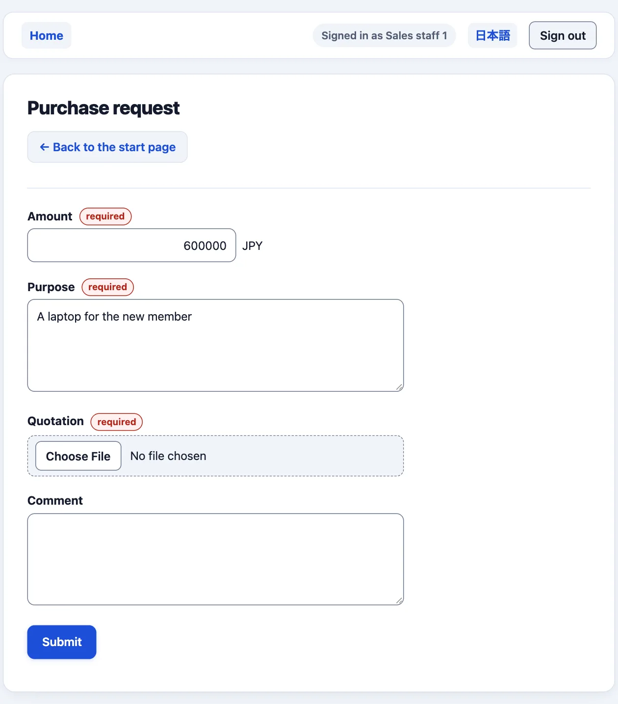

# 2. Change the request type

You add two rules to the purchase request of [1. Run it, and approve a request](start.md): above 500,000
yen a quotation is attached, and above 1,000,000 yen the president approves too. Every change goes the
same way: you change the file, check it, and make the code again. It takes about twenty minutes.
Japanese: [change.ja.md](change.ja.md).

No one uses this request yet, so it stays version `v1`. To change a request that your staff have begun to
use, you raise its version ([Change the rules of a type in
use](types.md#change-the-rules-of-a-type-in-use)).

Work in the project's directory, `approvals`.

## Read what it says

Open `project/purchase.ringi` in an editor. It begins like this:

```ringi title="project/purchase.ringi"
request purchase v1 "Purchase request"
description "A purchase the requester's manager approves, then the head of their department. ritsu ringi init wrote it as a start: change it into your own rules"
owner general_affairs

use organization org from "shared/company.ringi"
use calendar office from "shared/office.cal"
use gate "shared/company.gate"

form
  amount  : money[JPY] "Amount"  range >=1JPY <=10_000_000JPY
  purpose : long text "Purpose"  count >=1 <=500

route
  manager  manager
  head     dept_head

who
  manager   = manager of requester
  dept_head = head of requester.department

every stage
  due in 3 business days at end of day
  remind after 2 business days at 09:00
  when late expire
  when empty escalate

ticket
  # The president is at the top of the organization, with no manager to approve their purchases.
  submitted by   everyone except position president
  self approval  not allowed
  # A manager who is also the head of the department approves once for both stages.
  same approver  approves once
  send back      to the requester, at most 2 times
  resubmit       within 5 business days
  withdraw       until it is decided

claims
  ends_in_time : every ticket ends within 28 business days
```

| Where | What it says |
|---|---|
| `request` | The name, the version (`v1`), and the title on the pages. The name is used in the API and the code too |
| `owner` | The team that keeps this kind of request: here, general affairs (`general_affairs`) |
| `use` | The files it reads: the shape of the organization, the business days, the permissions |
| `form` | The fields the requester fills in |
| `route` | The stages of the approval, from the top down. A line is the name of a stage, and who answers it |
| `who` | How those who answer are found. The second column of `route` is a name from here |
| `every stage` | What holds in every stage. An answer is due by the end of the third business day. After two business days, a reminder goes out at 9:00. A request past its deadline ends. With no one to answer, it goes to the person above |
| `ticket` | What can be done with a request. Everyone but the president may make one. No one approves their own. A person who is the approver of two stages approves once for both. It may be sent back twice, is submitted again within 5 business days, and may be withdrawn until it is decided |
| `claims` | What is to hold at all times: here, that every request ends within 28 business days |

After it come the examples, which begin with `scenario`, and the Japanese words (`labels ja`). The stages
and the people who answer have names of their own, so a stage named `manager` is answered by the `manager`
of `who`, and the stage `head` by `dept_head`.

## Add a field for the quotation

Add a line for the quotation to `form`.

```ringi title="project/purchase.ringi" hl_lines="4"
form
  amount  : money[JPY] "Amount"  range >=1JPY <=10_000_000JPY
  purpose : long text "Purpose"  count >=1 <=500
  quote   : attachment "Quotation"  required when amount > 500_000JPY
```

| What you wrote | What it means |
|---|---|
| `quote` | The name of the field, in the API and the code too |
| `attachment` | Its type: a file attached. Others are `money`, `long text`, `date`, `choice` and `person` |
| `"Quotation"` | Its label on the pages |
| `required when amount > 500_000JPY` | Required when the amount is above 500,000 yen. Otherwise it may be left empty |

The pages are in Japanese too, so add the Japanese label, under `labels ja` at the end of the same file.

```ringi title="project/purchase.ringi" hl_lines="5"
labels ja
  request        "購買の申請"
  amount         "金額"
  purpose        "目的"
  quote          "見積書"
  stage manager  "上長"
  stage head     "部長"
  who manager    "上長"
  who dept_head  "部長"
```

## Check it

After a change, check it with `ritsu check`.

```sh
ritsu check project
```

It finds an error. ritsu calls one request a ticket.

```
…
error[ringi E603]: project/purchase.ringi:64:22: The ticket does not take the `submit` of this row: `quote` is not filled in, and this request must have it (its `required when` holds)
    64 | | 2026-11-16 10:00 | submit  | s1202 |                               | manager  | in progress |
  = There is no ticket yet.
…
```

A `.ringi` file has examples, which begin with `scenario`. Each is a table of who does what and when, and
of the stage the request goes to. `ritsu check` sees, every time, that each example goes as its table
says. One of them buys a car for 9,000,000 yen, and can no longer be submitted, as your change requires a
quotation.

The new rule is the right one, so give the example a quotation.

```ringi title="project/purchase.ringi" hl_lines="3"
scenario rejected_by_the_head
  requester s1202
  form amount = 9_000_000JPY, purpose = "A car for the section", quote = "quotation.pdf"
| at               | event   | by    | comment                       | -> stage | status      |
| 2026-11-16 10:00 | submit  | s1202 |                               | manager  | in progress |
| 2026-11-16 15:00 | approve | s1101 |                               | head     | in progress |
| 2026-11-17 11:00 | reject  | s1001 | "Not in this year's budget"   |          | rejected    |
```

Check it again, and it passes.

```sh
ritsu check project
```

```
…
ritsu check: 4 files (koyomi 1, sekisho 1, ringi 2): all pass; borders between the languages: 3 checked, 0 undecided
```

koyomi is the language of the business days (`office.cal`), and sekisho the one of the permissions
(`company.gate`). The borders between the languages are the places where a `.ringi` file uses a file of
another language: the line says at how many of them what is written was seen to agree.

## Make the code again, and run it

`go generate` makes `go/` and `requests/` again. `go test` sees that the server does what the examples
say, and that a request can be made and approved on the pages.

```sh
go generate ./...
go test ./...
go run ./cmd/server -dev-login
```

In a browser, choose "Sales staff 1 (s1201)" and open a purchase request. Fill in `600000` as the amount,
and the quotation becomes required.



Submit it without choosing a file, and it is not accepted: the reason is at the quotation. The field on
the page, and the check that it is filled in, both come from the one line you wrote.

## Add the president's approval

Next, the president approves purchases above 1,000,000 yen too. Stop the server with `Ctrl+C`, and add a
line to `route` and one to `who`.

```ringi title="project/purchase.ringi" hl_lines="4"
route
  manager  manager
  head     dept_head
  president  president  when amount > 1_000_000JPY
```

```ringi title="project/purchase.ringi" hl_lines="4"
who
  manager   = manager of requester
  dept_head = head of requester.department
  president = nearest president above requester
```

A line of `route` may end with `when` and the condition on which the stage comes. A request for which the
condition does not hold skips the stage. `nearest president above requester` is the first head in the
position `president` on the way up from the requester's team.

Add the Japanese labels too.

```ringi title="project/purchase.ringi" hl_lines="8 11"
labels ja
  request        "購買の申請"
  amount         "金額"
  purpose        "目的"
  quote          "見積書"
  stage manager  "上長"
  stage head     "部長"
  stage president "社長"
  who manager    "上長"
  who dept_head  "部長"
  who president  "社長"
```

The check finds another error this time.

```sh
ritsu check project
```

```
…
error[ringi E401]: project/purchase.ringi:41:3: The claim `ends_in_time` says every ticket ends within 28 business days, and a ticket can take 37
    41 |   ends_in_time : every ticket ends within 28 business days
  = A round takes 9 business days at the most: `manager` 3, `head` 3 and `president` 3. A stage that comes on a condition is counted as coming.
  = `manager`, `head` and `president`: `due in 3 business days at end of day`, and the ticket expires then (`when late expire`): 3.
  = The ticket goes back 2 times at the most (`send back … at most 2 times`), for 3 rounds, and its requester has 5 business days each time (`resubmit within 5 business days`): 3 × 9 + 2 × 5 = 37.
…
```

Under `claims` are the things that are to hold at all times. It said here that every request ends within
28 business days. With three stages, going through the route once takes up to 9 business days. A request
may be sent back twice, so it goes through the route three times at the most: 27 business days. In between,
the server waits up to 5 business days, twice, for the request to be submitted again: 37 in all. ritsu calls
going through the route once a round.

If 37 business days will do, correct the claim. If that is too long, shorten the deadlines. Here, correct
the claim.

```ringi title="project/purchase.ringi" hl_lines="2"
claims
  ends_in_time : every ticket ends within 37 business days
```

Add an example in which the president approves too, before `labels ja`.

```ringi title="project/purchase.ringi"
scenario approved_up_to_the_president
  requester s1201
  form amount = 1_500_000JPY, purpose = "A stand at the trade fair", quote = "quotation.pdf"
| at               | event   | by    | -> stage  | status      |
| 2026-11-16 10:00 | submit  | s1201 | manager   | in progress |
| 2026-11-16 15:00 | approve | s1101 | head      | in progress |
| 2026-11-17 11:00 | approve | s1001 | president | in progress |
| 2026-11-17 16:00 | approve | p0001 |           | approved    |
```

Check it, make the code again, test it and run it.

```sh
ritsu check project
go generate ./...
go test ./...
go run ./cmd/server -dev-login
```

```
…
ritsu check: 4 files (koyomi 1, sekisho 1, ringi 2): all pass; borders between the languages: 3 checked, 0 undecided
…
```

A request of 1,500,000 yen has the president's stage in its "Route". One of 120,000 yen does not.

## See whom a request goes to, without running it

`ritsu ringi simulate` shows whom a request of a person goes to. It needs no server.

```sh
ritsu ringi simulate project/purchase.ringi --requester s1201 --on 2026-11-25 \
  --form 'amount = 1_500_000JPY, purpose = "A stand at the trade fair", quote = "quotation.pdf"'
```

```
project/purchase.ringi on 2026-11-25, in the organization from 2026-04-01
requester s1201 (Sales staff 1)
  manager    manager: s1101 (Manager of Sales Section 1)
             due 2026-11-30 at the end of the day, reminder on 2026-11-27 09:00
  head       dept_head: s1001 (Head of Sales)
             due 3 business days after it starts, at the end of the day
  president  president: p0001 (President)
             due 3 business days after it starts, at the end of the day
```

It can also show where everyone's requests go.

```sh
ritsu ringi simulate project/purchase.ringi --every-requester --on 2026-11-25
```

```
project/purchase.ringi on 2026-11-25, in the organization from 2026-04-01
  without `--form`: every stage the route can come to, by each way to choose its approver; which come depends on the form
  1 person may not submit it (`submitted by everyone except position president`): p0001 (President)
requesters s1001 (Head of Sales), e1001 (Head of Engineering), g1001 (Head of General Affairs) (3 requesters)
  manager    manager: p0001 (President)
  head       dept_head: it comes to the requester alone; it goes up to p0001 (President); done with the approval of `manager` (`same approver approves once`)
  president  president: p0001 (President); done with the approval of `manager` (`same approver approves once`)
requester s1101 (Manager of Sales Section 1)
  manager    manager: s1001 (Head of Sales)
  head       dept_head: s1001 (Head of Sales); done with the approval of `manager` (`same approver approves once`)
  president  president: p0001 (President)
…
```

It tells you whose requests go another way. When a head of department makes one, their manager is the
president. The stage `head` would come to themselves, so it goes up to the president. The president has
approved already as the manager, and is not asked again (`same approver approves once`).

`ritsu ringi doc project/purchase.ringi --format html --lang en` makes a page to show to those who decide
the rules.

## Have an agent write it

A coding agent can write a `.ringi` file too. ritsu has a skill that says what the language is and how to
write in it. In the project's directory, run this:

```sh
ritsu skills install ringi
```

It writes three files in `.claude/skills/ringi/`. Ask an agent that reads skills for something like "add
to the purchase request a field that requires a quotation when the amount is above 500,000 yen". What an
agent writes is checked by `ritsu check` and by the examples, too. The rules themselves, who approves
what, are for people to decide: see that they are right with `ritsu ringi simulate` and the examples.

## Next

Next, [3. Send the notices by mail](mail.md) sends the notices that have only been written to the log. All
that a request type can say is on [the pages of the language
ringi](https://i2y.github.io/ritsu/ringi/language/).
