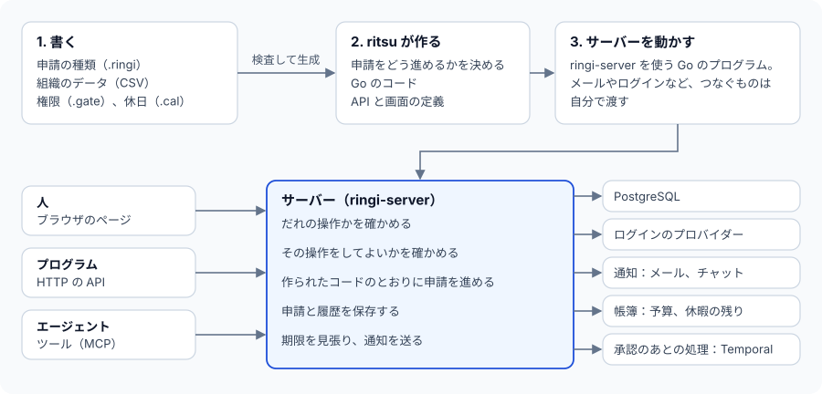
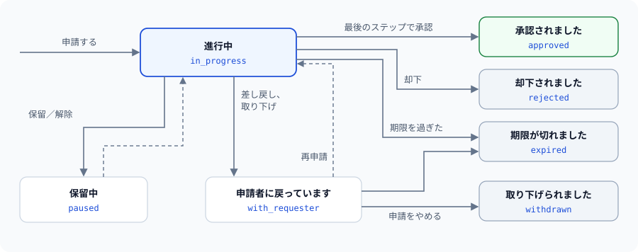
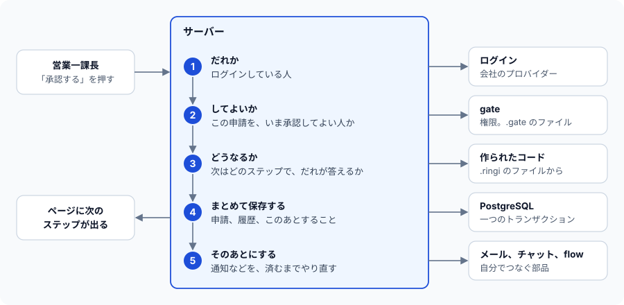

# しくみと言葉

ringi-server がどう動くかと、文書とページに出てくる言葉の意味を、[チュートリアル](start.ja.md)の購買の申請を例に説明します。英語版は [concepts.md](concepts.md) です。

## 書くもの、作られるもの、動くもの

| 段階 | もの | 場所 |
|---|---|---|
| 書く | 申請の種類（`.ringi`）、組織のデータ（CSV）、権限（`.gate`）、営業日（`.cal`） | `project/` |
| 作る | ritsu が `project/` を検査して作る、申請を進める Go のコード | `go/` |
| 作る | ritsu が作る、API の記述、画面の定義、試験に使うデータ | `requests/` |
| 動かす | 作られたコードと、自分で用意した部品を渡したサーバー | `cmd/server` |

`project/` を書き換えたら、`ritsu check project` で検査し、`go generate ./...` で作り直します。`go/` と `requests/` は手では直しません。

サーバーは、承認の決まりを自分では持っていません。どう進めるかは、すべて作られたコードに尋ねます。そのため、ページから操作しても、API から操作しても、エージェントから操作しても、同じ決まりになります。

作られたコードとサーバーが受け渡すものの形を、**約束**（contract）と呼びます。約束には番号があり、番号の合わないコードを渡すと、サーバーは起動しません。

## 申請の種類と、一件の申請

「購買の申請」のような種類を、**申請の種類**と呼びます。`.ringi` のファイル一つが、申請の種類一つです。

営業担当 1 が出した 120,000 円のノートパソコンの申請は、一件の申請です。API とコードでは**チケット**（ticket）と呼びます。一件ごとに `01M89JDENBGHWVJ8XXBRHKCY64` のような番号が付きます。

## 経路、ステップ、承認者

申請の種類には、承認の順を書きます。これを**経路**（route）と呼び、その一つ一つを**ステップ**（stage）と呼びます。購買の申請の経路は、上長、部長の二つのステップです。

ステップで答える人が**承認者**です。`.ringi` には「申請した人の上長」「申請した人の部の長」のように、決め方を書きます。

一つのステップに何人かの承認者がいて、そのうち二人以上が答えればよい、という書き方もできます。条件によって飛ばすステップ、読んでもらうだけのステップ（回覧）、エージェントが答えるステップも書けます。書き方は、[申請の種類を足す、変える](types.ja.md#よく使う書き方)にあります。

## 承認者はどう決まるか

だれが承認者になるかは、ステップが始まるときに、その日に有効な組織のデータから決まります。主な決め方は次のとおりです。

| `.ringi` の書き方 | 承認者になる人 |
|---|---|
| `manager of requester` | 申請者の主な所属のチームの長。長が申請者自身のときと、長がいないときは、上のチームの長 |
| `head of requester.department` | 申請者のチームから上へたどって最初に見つかる、種類が `department`（部）のチームの長 |
| `nearest president above requester` | 申請者のチームから上へたどって最初に見つかる、役職が `president` かそれより上の長 |
| `team accounting` | チーム `accounting` の人のだれか |
| `chosen by requester in 確認者` | 申請者がフォームの「確認者」で選んだ人 |

チュートリアルの会社では、次のように決まります。

| 申請者 | `manager of requester` | `head of requester.department` |
|---|---|---|
| 営業担当 1。営業一課の人 | 営業一課長 | 営業部長 |
| 営業一課長。営業一課の長 | 営業部長。営業一課の長は自分なので、上のチームの長になる | 営業部長 |
| 営業部長。営業部の長 | 社長 | 当てはまるのは自分だけ。自分の申請は承認できないので、`when empty` のとおりになる |

承認者になれる人がいないときにどうするかは、`when empty` に書きます。

| `when empty` の書き方 | どうなるか |
|---|---|
| `escalate` | 組織を上へたどり、次に見つかる長に回る。上の表の営業部長の申請は、社長に回る |
| `skip` | そのステップを飛ばす |
| `stay` | 止まって待つ。管理する人が、承認者を加える |

`head` や `manager` は、いくつかの場所に出てくる名前です。同じ名前でも、別のものを指します。

| 名前 | 書く場所 | 指すもの |
|---|---|---|
| 長（`head`） | `teams.csv` の列 | チームの長。`manager of requester` と `head of requester.department` は、この列で決まる |
| 役職（`staff`、`manager`、`head`、`president`） | `company.ringi` と `members.csv` | 課長、部長など。`nearest president above requester` や `submitted by everyone except position president` のように、役職を書いた決まりで使う |
| ステップと承認者の名前（`上長(manager)` など） | `.ringi` の `route` と `who` | 自分で付ける名前。API と Go のコードでは、括弧の中の英字を使う |
| 役割（`staff`、`system_admin` など） | ログインと `company.gate` | サーバーで何をしてよいか（[だれが何をしてよいかを決めるもの](#だれが何をしてよいかを決めるもの)） |

## 申請の状態

| ページに出る言葉 | API の値 | どういうときか |
|---|---|---|
| 進行中 | `in_progress` | どこかのステップで、承認者の回答を待っている |
| 保留中 | `paused` | 承認者が保留にした。期限は進まない。決められた日数が過ぎると、自動で解ける |
| 申請者に戻っています | `with_requester` | 差し戻されたか、申請者が取り下げた。再申請するか、申請をやめるかを待っている |
| 承認されました | `approved` | 最後のステップまで承認された |
| 却下されました | `rejected` | 承認者が却下した |
| 期限が切れました | `expired` | 期限までに答えがなかった |
| 取り下げられました | `withdrawn` | 申請者が、申請をやめた |

「取り下げる」を押した申請は、申請者に戻るだけです。状態は「申請者に戻っています」になり、直して再申請できます。「取り下げられました」になるのは、そのあと「申請をやめる」を押したときです。差し戻された申請も、「申請をやめる」で終わりにできます。ただし、差し戻しの決まり（`send back`）のない申請の種類では、取り下げた申請はそのまま終わります。

再申請すると、経路の最初のステップから始まります。前に承認した人にも、もう一度答えてもらいます。

`send back … at most 2 times` と書いた種類の申請が申請者に戻るのは、差し戻しと取り下げを合わせて二回までです。三回目に取り下げると、申請者には戻らず「取り下げられました」になります。

保留、取り下げのできる時期、期限を過ぎたときにどうするかも、申請の種類ごとに書きます。書いていない操作のボタンは出ません。

## ボタンを押すと起きること

営業一課長が「承認する」を押したときの、サーバーの中の順番です。

1. ログインしているのがだれかを調べます。
2. その人がこの申請を見てよく、いま承認してよいかを、権限の決まり（gate）に尋ねます。よくなければ、何も変えずに理由を返します。
3. 申請、操作、組織のデータ、いまの時刻を、作られたコードに渡します。コードは、次のステップ、その承認者、期限、送る通知を返します。
4. 申請、履歴、期限のタイマー、このあとすることを、一つのトランザクションでまとめて保存します。予算などの帳簿をつないでいれば、残りを押さえるのもこのときです。残りが足りなければ、何も保存しません。途中で止まっても、半分だけ変わった申請は残りません。
5. 応答を返してから、通知を送り、承認のあとの処理を始めます。失敗したら、成功するまでやり直します。メールサーバーが止まっていても、承認は済みます。

期限と催促も、同じ順番で処理します。押した人がいない代わりに、時刻が来たことがきっかけになります。

## だれが何をしてよいかを決めるもの

三つのものが、それぞれ別のことを決めます。

| 決めるもの | 決めること | 例 |
|---|---|---|
| ログイン | その操作をした人はだれで、どの役割を持つか | 営業一課長（s1101）。役割は `staff` |
| gate（`.gate`） | 会社全体の決まり。どの申請の種類でも同じこと | 総務部の人は、総務部が受け持つ種類の申請を見られる |
| 申請の種類（`.ringi`） | その種類の決まり | 社長は購買を申請できない。差し戻しは二回まで。だれが承認者か |

ページには、ログインした人について、gate と申請の種類の両方が許す操作のボタンだけが出ます。

**役割**（role）は、ログインが人に与えるものです。最初から入っている gate には、次の四つがあります。

| 役割 | 意味 |
|---|---|
| `staff` | 社員。ログインした人は、だれでもこの役割を持つ |
| `workflow_admin` | 自分の部が受け持つ申請の種類を管理する人 |
| `system_admin` | すべての申請の種類と、組織のデータを管理する人 |
| `auditor` | 記録を読む人。何も変えられない |

## 申請を見られる人

一件の申請を見られるのは、次の人だけです。ほかの人には、その番号の申請はないという応答を返します。

- 申請者の側。申請者と、その日に申請の代理をする人。代理が出した申請なら、出した人も入る
- 承認者と、その代理。過ぎたステップの承認者や、差し戻した人も入る
- 回覧を受け取った人
- gate が「見てよい」とする人。最初の gate では、その申請の種類を受け持つ部の人

## 組織のデータ

人、チーム、役職、だれがどのチームに属するか、だれがどのチームの長かを、CSV のファイルに書いたものです。有効になる日ごとのディレクトリに置きます（`project/org/2026-04-01/` など）。

異動の前にその日のデータを用意しておけば、その日から新しいデータで承認者が決まります。動いているサーバーに、管理のページから取り込むこともできます。用意のしかたは、[組織のデータを用意する](organization.ja.md)にあります。

組織のデータと gate は、申請の種類がいくつあっても、サーバーに一つずつです。

## 四つの「版」

「版」という言葉は、四つのものに使います。

| 版 | 例 | 何のためにあるか |
|---|---|---|
| 申請の種類の版 | `request 購買(purchase) v1` の `v1` | 出した申請は、出したときの版で最後まで進む。決まりを変えても、進行中の申請に影響しない |
| 組織のデータの版 | `2026-04-01` | ステップが始まるとき、その日に有効な版で承認者を決める |
| ringi-server と ritsu の版 | v0.1.0 と 0.56.0 | 組で使う。上げるときは両方を上げて、コードを作り直す |
| 約束の版 | 3 | 作られたコードとサーバーの約束の番号。合わないと、サーバーは起動しない |

## 止まったとき、重なったとき

| 起きること | サーバーがすること |
|---|---|
| ボタンを二度押した、通信が切れて送り直した | 操作ごとの番号で気づき、一度だけ実行する。二度目にも同じ応答を返す |
| 二人の承認者が同時に押した | 一つずつ順に処理する |
| 古いページから承認した | 内容が変わっていれば受け付けず、いまの内容を見せる |
| 通知の送り先が止まっていた | 2 秒後、4 秒後と間隔を延ばしながら（最長 10 分）、成功するまでやり直す |
| サーバーのプロセスが止まった | 起動し直したプロセスか、動いているほかのプロセスが、続きを引き受ける。過ぎていた期限は、すぐに処理する |

送り直しのため、通知などの部品は同じものを二度受け取ることがあります。同じものには同じ番号（キー）が付いています。

## 言葉の一覧

| 言葉 | 意味 | 英語、コードでの名前 |
|---|---|---|
| 申請の種類 | 購買、経費などの種類。`.ringi` のファイル一つ | request type、kind |
| 申請、チケット | 出された一件の申請 | request、ticket |
| 受け持つ部、持ち主 | 申請の種類を受け持つチーム。`.ringi` の `owner` に書く | owner |
| 経路 | 承認の順 | route |
| ステップ | 経路の一段 | stage |
| 承認者 | ステップで答える人 | approver |
| 申請者 | 申請した人。代理が出した申請では、代理を頼んだ本人 | requester |
| 代理 | ほかの人の代わりに申請や承認をする人。組織のデータに期間つきで書く | proxy |
| 差し戻し | 直してもらうために、申請者か前のステップに返すこと | send back |
| 再申請 | 戻ってきた申請を直して、もう一度出すこと | resubmit |
| 取り下げ | 決まる前に、申請者が申請を自分に戻すこと | withdraw |
| 申請をやめる | 申請者に戻った申請を、出し直さずに終わりにすること | discard |
| 引き継ぎ | ステップの承認者を、ほかの人に替えること。管理する人が行う | hand over |
| 保留 | 承認者が、期限を止めて待たせること | pause |
| 回覧 | 承認を求めずに、読んでもらうこと | circulation |
| 催促 | 期限の前に、承認者にもう一度知らせること | reminder |
| 通知 | 人に知らせること。送る部品が Notifier | notice、`Notifier` |
| 履歴 | 一件の申請について、だれがいつ何をしたか。申請のページで読む | history |
| 記録 | すべての申請の操作、版の切り替え、組織のデータの取り込みを、だれがいつしたか。管理のページで読む | record、audit |
| 組織のデータ | 人、チーム、役職、所属、代理のデータ | organization |
| 役職 | 課長、部長など。組織のデータにある | position |
| 役割 | 管理する人、監査する人など。ログインが人に与える | role |
| gate | だれが何をしてよいかを書いたファイルと、そこから作られたコード | gate、`Gate` |
| 帳簿 | 予算や休暇の残りを数えるもの。申請が出たときに押さえ、承認されたら確定する | book、`Books` |
| flow | 承認のあとやステップの中で動かす、処理の手順 | flow、`Flows` |
| 約束 | 作られたコードとサーバーが受け渡すものの形 | contract |
| プロバイダー | 会社のログインを受け持つ、OpenID Connect のサーバー | provider |
