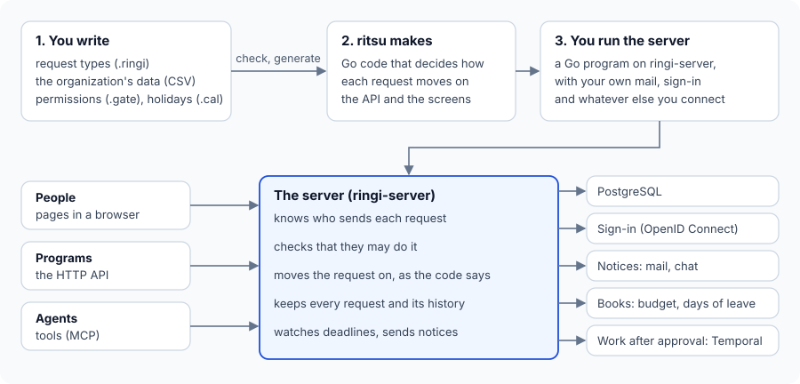
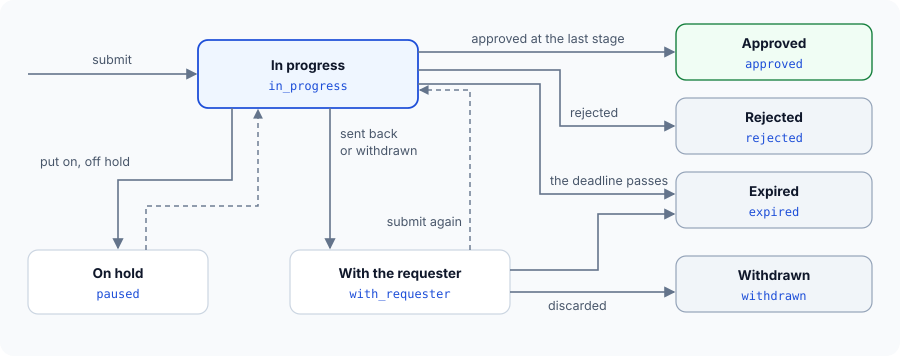
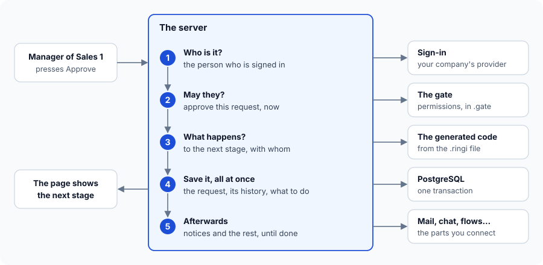

# How it works, and its words

How ringi-server works, and what the words of these documents and of the pages mean, with the purchase
request of [the tutorial](start.md) as the example. Japanese: [concepts.ja.md](concepts.ja.md).

## What is written, what is made, what runs

| Step | What | Where |
|---|---|---|
| Written | The request types (`.ringi`), the organization's data (CSV), the permissions (`.gate`), the business days (`.cal`) | `project/` |
| Made | The Go code that takes a request through its approvals, which ritsu makes from `project/` once it has checked it | `go/` |
| Made | The description of the API, the screens, and the data the tests use, which ritsu makes too | `requests/` |
| Runs | A server that is given the code that was made, and the parts you wrote | `cmd/server` |

After a change in `project/`, you check it with `ritsu check project` and make the rest again with
`go generate ./...`. You do not change `go/` and `requests/` by hand.

The server has no rules of approval of its own. It asks the code that was made how each request goes on.
So the rules are the same whether someone acts on the pages, through the API or with an agent.

The form of what the code and the server pass to each other is called the **contract**. The contract has a
number, and a server given code of another number does not start.

## A request type, and one request

A kind of request, such as "Purchase request", is called a **request type**. One `.ringi` file is one
request type.

The laptop of 120,000 yen that Sales staff 1 asked for is one request. The API and the code call it a
**ticket**. Each has an ID, such as `01M89JDENBGHWVJ8XXBRHKCY64`.

## Routes, stages and approvers

A request type says the order of its approvals. This is called the **route**, and each step of it a
**stage**. The route of a purchase request has two stages, `manager` and `head`.

A person who answers at a stage is an **approver**. The `.ringi` file says how they are found: "the
manager of the person who made the request", "the head of that person's department".

A stage can have several approvers and take the answer of two of them. A stage can be skipped on a
condition, be only for reading (circulation), or be answered by an agent. [Add and change request
types](types.md#common-forms) says how to write each.

## How an approver is found

Who the approvers are is found when a stage starts, in the organization's data in effect that day. These
are the main ways.

| In the `.ringi` file | Who the approver is |
|---|---|
| `manager of requester` | The head of the requester's main team. When that is the requester, or there is no head, the head of the team above |
| `head of requester.department` | The head of the first team of the kind `department`, on the way up from the requester's team |
| `nearest president above requester` | The first head, on the way up from the requester's team, whose position is `president` or higher |
| `team accounting` | Any of the people of the team `accounting` |
| `chosen by requester in reviewers` | The person the requester chose in the form, among `reviewers` |

In the company of the tutorial, they come out like this.

| The requester | `manager of requester` | `head of requester.department` |
|---|---|---|
| Sales staff 1, who is in Sales Section 1 | The manager of Sales Section 1 | The head of Sales |
| The manager of Sales Section 1, who is its head | The head of Sales: the head of their own section is themselves, so it is the head of the team above | The head of Sales |
| The head of Sales, who is the head of the Sales Department | The president | Only themselves. No one approves their own request, so it goes as `when empty` says |

`when empty` says what happens when there is no one who can be the approver.

| `when empty` | What happens |
|---|---|
| `escalate` | It goes up the organization, to the next head there is. The request of the head of Sales above goes to the president |
| `skip` | The stage is skipped |
| `stay` | It stops and waits. A person who administers the requests adds an approver |

Names like `head` and `manager` come up in several places. The same name is not the same thing.

| The name | Where it is written | What it is |
|---|---|---|
| The head (`head`) | A column of `teams.csv` | The head of a team. `manager of requester` and `head of requester.department` are found by this column |
| The positions (`staff`, `manager`, `head`, `president`) | `company.ringi` and `members.csv` | The manager of a section, the head of a department and so on. Used in rules that name a position, such as `nearest president above requester` and `submitted by everyone except position president` |
| The names of stages and of who answers (`manager`, `dept_head`) | `route` and `who` of a `.ringi` file | Names you give |
| The roles (`staff`, `system_admin` and so on) | The sign-in and `company.gate` | What a person may do on the server ([What decides who may do what](#what-decides-who-may-do-what)) |

## The states of a request

| On the pages | In the API | When |
|---|---|---|
| In progress | `in_progress` | It waits for an approver's answer at a stage |
| On hold | `paused` | An approver put it on hold. Its deadline does not run. It goes on by itself after the number of days its type says |
| With the requester | `with_requester` | It was sent back, or the requester withdrew it. It waits to be submitted again or discarded |
| Approved | `approved` | It was approved at its last stage |
| Rejected | `rejected` | An approver rejected it |
| Expired | `expired` | There was no answer by the deadline |
| Withdrawn | `withdrawn` | The requester discarded it |

A request on which "Withdraw" was pressed only goes back to its requester. Its state is "With the
requester", and it can be changed and submitted again. It is "Withdrawn" once "Discard the request" is
pressed after that. A request that was sent back can be ended with "Discard the request" too. In a request
type that says nothing of sending back (`send back`), though, a request that is withdrawn ends there.

A request submitted again starts at the first stage of its route. Those who approved it before are asked
again.

A request whose type says `send back … at most 2 times` can be with its requester twice, counting both
being sent back and being withdrawn. Withdrawn a third time, it does not go back to the requester, and is
"Withdrawn".

Putting on hold, how long a request may be withdrawn, and what happens past the deadline are for each
request type to say. There is no button for what a type does not say.

## What happens when a button is pressed

This is the order inside the server when the manager of Sales Section 1 presses "Approve".

1. The server sees who is signed in.
2. It asks the permissions (the gate) whether that person may see this request, and may approve it now. If
   not, it changes nothing and says why.
3. It gives the request, the operation, the organization's data and the time to the code that was made.
   The code answers with the next stage, its approvers, the deadline, and the notices to send.
4. It saves the request, its history, the timers of the deadlines, and what is to be done next, all in one
   transaction. If the books of a budget are connected, what is left of it is held now too. If too little is
   left, nothing is saved. A request is never left half changed, even if the server stops in the middle.
5. After it has answered, it sends the notices and starts the work after an approval. What fails is tried
   again until it succeeds. An approval is done even when the mail server is down.

Deadlines and reminders go in the same order. There is no one who pressed a button: the time that came is
what starts them.

## What decides who may do what

Three things decide, and each decides something different.

| What decides | What it decides | For example |
|---|---|---|
| The sign-in | Who did this, and which roles they have | The manager of Sales Section 1 (s1101), with the role `staff` |
| The gate (`.gate`) | The rules of the whole company, the same for every request type | The people of general affairs may see the requests of the types general affairs keeps |
| The request type (`.ringi`) | The rules of that type | The president may not make a purchase request. It may be sent back twice. Who the approvers are |

A page has only the buttons of the operations that both the gate and the request type let that person do.

A **role** is what the sign-in gives a person. The gate you start with has these four.

| Role | What it means |
|---|---|
| `staff` | A member of the company. Everyone who signs in has it |
| `workflow_admin` | Administers the request types their department keeps |
| `system_admin` | Administers every request type, and the organization's data |
| `auditor` | Reads the records. May change nothing |

## Who can see a request

Only these people can see a request. To anyone else, the server answers that there is no request of that
ID.

- The requester's side: the requester, and those who may make requests for them that day. For a request a
  proxy made, the one who made it too
- The approvers, and their proxies. Those of the stages that are past, and one who sent it back, too
- Those it was circulated to
- Those the gate lets see it. By the gate you start with, the people of the department that keeps the
  request type, who also have the list of all its requests ([Call the API from a
  program](api.md#list-all-the-requests-of-a-request-type))

## The organization's data

The people, the teams, the positions, who belongs to which team and who is the head of which, written in
CSV files. They are in a directory for each day they take effect (`project/org/2026-04-01/` and so on).

With the data of a day put in before that day, approvers are found in the new data from that day on. A
server that runs can take new data too, from the pages for administrators. [Prepare the organization's
data](organization.md) says how.

A server has one organization's data and one gate, however many request types there are.

## Four kinds of version

The word "version" is used of four things.

| Version | For example | What it is for |
|---|---|---|
| The version of a request type | The `v1` of `request purchase v1` | A request goes on to its end in the version it was made in. Changing the rules does not touch the requests in progress |
| The version of the organization's data | `2026-04-01` | When a stage starts, its approvers are found in the version in effect that day |
| The versions of ringi-server and ritsu | v0.1.0 and 0.56.0 | They go together. To raise them, you raise both and make the code again |
| The version of the contract | 3 | The number of the contract between the code that was made and the server. If it does not match, the server does not start |

## When something stops, or happens twice

| What happens | What the server does |
|---|---|
| A button was pressed twice, or the network failed and it was sent again | It knows by the number each operation has, and carries it out once. The second time, it gives the same answer |
| Two approvers pressed at the same time | It takes them one after the other |
| Someone approved on a page that was out of date | If the request has changed, it does not take it, and shows the request as it is now |
| What a notice is sent through was down | It tries again after 2 seconds, 4 seconds and so on, up to 10 minutes apart, until it succeeds |
| A process of the server stopped | The process that is started again, or another that is running, goes on from there. Deadlines that passed are dealt with at once |

Because it tries again, a part such as the one that sends notices may be given the same thing twice. The
same thing has the same number (its key).

## The words

| Word | What it means | In Japanese, and its name in the code |
|---|---|---|
| request type | A kind of request, such as purchases or expenses. One `.ringi` file | 申請の種類、kind |
| request, ticket | One request that was made | 申請、ticket |
| owner | The team that keeps a request type. `owner` of the `.ringi` file says it | 受け持つ部、持ち主 |
| route | The order of the approvals | 経路、route |
| stage | One step of the route | ステップ、stage |
| approver | A person who answers at a stage | 承認者、approver |
| requester | The person who made the request. In one a proxy made, the person they made it for | 申請者、requester |
| proxy | A person who makes requests or approves for another. The organization's data says so, for a time | 代理、proxy |
| send back | To give a request back to its requester or to an earlier stage, to be put right | 差し戻し、send back |
| resubmit | To change a request that came back, and submit it again | 再申請、resubmit |
| withdraw | To take a request back before it is decided | 取り下げ、withdraw |
| discard | To end a request that came back, without submitting it again | 申請をやめる、discard |
| hand over | To change an approver of a stage for another person. Those who administer the requests do it | 引き継ぎ、hand over |
| put on hold | For an approver to stop the deadline and let the request wait | 保留、pause |
| circulation | To have someone read a request, without asking them to approve it | 回覧、circulation |
| reminder | To tell an approver again, before the deadline | 催促、reminder |
| notice | To tell a person something. The part that sends it is the notifier | 通知、`Notifier` |
| history | Who did what on one request, and when. Read on the request's page | 履歴、history |
| record | Every operation on requests, switch of a version, bundle and import of the organization's data: who did it, and when. Read on the pages for administrators | 記録、record、audit |
| bundle | One zip file of new versions of request types, built into WebAssembly, put on a server while it runs. One administrator uploads it, and another approves it | バンドル、bundle |
| organization's data | The data of the people, teams, positions, memberships and proxies | 組織のデータ、organization |
| position | The manager of a section, the head of a department and so on. In the organization's data | 役職、position |
| role | One who administers, one who audits and so on. The sign-in gives it to a person | 役割、role |
| gate | The file that says who may do what, and the code made from it | gate、`Gate` |
| book | What counts what is left of a budget or of days of leave. An amount is held when a request is made, and settled when it is approved | 帳簿、`Books` |
| flow | The steps of the work that runs after an approval, or in a stage | flow、`Flows` |
| contract | The form of what the code that was made and the server pass to each other | 約束、contract |
| provider | The OpenID Connect server that runs your organization's sign-in | プロバイダー、provider |
