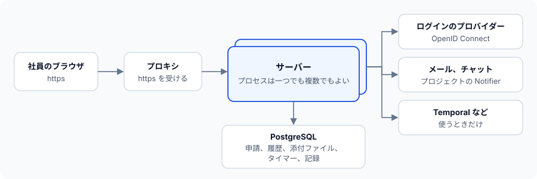

# 用意して起動する

社員に使ってもらうサーバーを、用意して起動するまでの手引きです。起動したあとのことは、[バックアップと版の上げ方](maintenance.ja.md)と、[監視する、困ったとき](troubleshooting.ja.md)にあります。英語版は [operations.md](operations.md) です。



手元で試すときとの違いは、次の五つです。

| | 手元で試すとき | 社員に使ってもらうとき |
|---|---|---|
| ログイン | `-dev-login`（本人を確かめない） | 会社のログイン（OpenID Connect） |
| 申請を置く場所 | メモリ。止めると消える | PostgreSQL |
| 通知 | ログに書く | メールやチャットに送る |
| 通信 | 自分のコンピューターの中だけ | https |
| 組織のデータ | 見本の会社 | 自分の会社の人とチーム |

## 1. 用意する

| もの | 内容 |
|---|---|
| PostgreSQL のデータベース | サーバーが、スキーマ `ringi` に自分で表を作る。データベースのユーザーには、スキーマを作る権限を与える（`grant create on database ringi to ringi_server`）。接続をまとめるプーラーを間に置くなら、セッションモードにする。試験は PostgreSQL 18 で行っている |
| 会社のログイン | クライアントを一つ登録し、役割を渡す設定をする（[ログインをつなぐ](sign-in.ja.md)） |
| 組織のデータ | 自分の会社の CSV。`people.csv` の `email` は、ログインのサービスが確認済みとしているアドレスと同じにする（[組織のデータを用意する](organization.ja.md)） |
| 営業日 | 会社の休みと祝日を入れたカレンダー（[営業日と祝日を決める](calendar.ja.md)） |
| 通知 | メールなどを送る部品。例のコードの、ページのアドレス、差出人、メールサーバーの認証を、会社のものに替える（[会社のメールサーバーで送るとき](mail.ja.md#会社のメールサーバーで送るとき)） |
| https | サーバーに渡す証明書か、手前で https を受けるプロキシ |
| 時刻の同期 | 期限とログインの長さは、サーバーのコンピューターの時計で数える。時刻を合わせておく |

## 2. ビルドする

サーバーは、一つの実行ファイルになります。申請の種類、ページ、組織のデータは組み込まれるので、ほかのファイルは要りません。動かすコンピューターの OS がビルドする所と違うときは、`GOOS` と `GOARCH` を指定します（`GOOS=linux GOARCH=amd64` など）。

```sh
go test ./...
go build -o server ./cmd/server
```

## 3. 起動する

秘密の値は環境変数で、ほかの設定はフラグで渡します。`SMTP_ADDR` は、[チュートリアル](mail.ja.md)のとおりにメールを送るときに渡します。

```sh
export RINGI_OIDC_CLIENT_SECRET='ログインのサービスで受け取ったシークレット'
export RINGI_SESSION_KEYS='保管してある鍵'
export PGPASSWORD='データベースのパスワード'
export SMTP_ADDR='mail.example.com:587'
./server -addr :8443 -tls-cert server.crt -tls-key server.key \
  -db 'postgres://ringi_server@db.example.com/ringi' \
  -oidc-issuer https://id.example.com -oidc-client-id ringi \
  -oidc-redirect-url https://ringi.example.com:8443/login/callback \
  -oidc-roles-claim roles
```

鍵の作り方は[ログインをつなぐ](sign-in.ja.md#3-設定を渡す)に、フラグの一覧は[フラグと設定](reference.ja.md)にあります。

起動すると、サーバーはデータベースに表を作り、組み込まれた組織のデータを取り込みます。設定に誤りがあれば、リクエストを受ける前に、理由をログに出して止まります（[起動しないとき](troubleshooting.ja.md#起動しないとき)）。

## 4. 確かめる

申請を消す操作はないので、確かめるために出した申請は残ります。別の空のデータベースを `-db` に渡して確かめ、済んだら本番のものに替えます。

1. `https://<ホスト>/a2ui/functions.js` が、ログインなしで 200 を返す。
2. ブラウザでホームを開くと、会社のログインに移り、戻ってくる。
3. 申請を一件出すと、承認する人に通知が届き、通知のリンクからその申請が開く。承認して、最後まで進む。
4. 管理の役割を持つ人のホームに「管理」のリンクが出る。
5. サーバーを起動し直しても、申請が残っている。

## 自動で起動する

コンピューターが起動したときや、サーバーが止まったときに、自動で起動させます。systemd を使うなら、次のファイルを置きます。

```ini title="/etc/systemd/system/ringi.service"
[Unit]
Description=ringi-server
Wants=network-online.target
After=network-online.target

[Service]
User=ringi
EnvironmentFile=/etc/ringi/env
ExecStart=/opt/ringi/server -addr :8443 -tls-cert /etc/ringi/server.crt -tls-key /etc/ringi/server.key \
  -db postgres://ringi_server@db.example.com/ringi \
  -oidc-issuer https://id.example.com -oidc-client-id ringi \
  -oidc-redirect-url https://ringi.example.com:8443/login/callback \
  -oidc-roles-claim roles
Restart=on-failure
RestartSec=5

[Install]
WantedBy=multi-user.target
```

秘密の値は `/etc/ringi/env` に `名前=値` の形で一行ずつ書き、管理者だけが読めるようにします（`chmod 600`）。

```sh
sudo systemctl daemon-reload
sudo systemctl enable --now ringi
journalctl -u ringi -f
```

コンテナーで動かすときも、要るのは実行ファイルと、上の環境変数とフラグだけです。

## プロキシの後ろで動かす

https をプロキシが受けるときは、サーバーを、プロキシだけが届くアドレスで、`-tls-cert` と `-tls-key` を付けずに起動します。`-oidc-redirect-url` には、社員が使うアドレスを書きます。

プロキシには、次の設定をします。

- `Host` ヘッダーを、届いたまま渡す。
- http で来た人を、https に移す。ログインのクッキーは https でだけ送られる。
- 64 MiB までの本文を通し（組織のデータの取り込み）、応答を 30 秒待つ。

`-dev-login` やヘッダー `X-Person` のサーバーの手前に、プロキシを置いてはいけません。どちらも本人を確かめません。

## 複数のプロセスで動かす

同じ実行ファイルを、同じデータベースと同じクッキーの鍵で、いくつでも起動できます。どのプロセスも、どのリクエストにも応答します。プロセスどうしをつなぐ設定は要りません。

- 一つの期限や通知は、一度に一つのプロセスが扱います。そのプロセスが止まると、期限は 30 秒後、通知や処理の開始は 60 秒後に、ほかのプロセスが引き受けます。
- 引き受けるときに、通知などがもう一度送られることがあります。同じものには同じキーが付くので、部品の側で、二度目を行わないようにします（[部品とパッケージ](parts.ja.md#同じものを二度渡されることがある)）。
- ログアウトは、すぐにすべてのプロセスで効きます。申請の種類の版の切り替えと、組織のデータの取り込みは、30 秒以内にすべてのプロセスに伝わります。

## 秘密と証明書を替える

| 替えるもの | 手順 |
|---|---|
| クッキーの鍵（全員がログインしたまま） | 1. `古い鍵,新しい鍵` にして、すべてのプロセスを起動し直す。2. `新しい鍵,古い鍵` にして、すべて起動し直す。3. 12 時間たったら新しい鍵だけにして、もう一度起動し直す。プロセスが一つなら、1 は要らない |
| 漏れたクッキーの鍵 | 新しい鍵だけにして、すべてのプロセスを起動し直す。全員がログインし直す |
| クライアントシークレット | ログインのサービスと `RINGI_OIDC_CLIENT_SECRET` の両方で替え、起動し直す。ログインしている人は、そのまま使える |
| 証明書 | ファイルを替え、起動し直す。サーバーは起動のときに読む |

## 止める

`Ctrl+C`（`SIGINT`）か `SIGTERM` で止まります。応答の途中のリクエストを、最長 10 秒待ちます。止めているあいだに過ぎた期限は、次に起動したときに、すぐに処理されます。

## 次へ

- データを守り、新しい版にする：[バックアップと版の上げ方](maintenance.ja.md)
- 何を見ていればよいか、エラーが出たらどうするか：[監視する、困ったとき](troubleshooting.ja.md)
