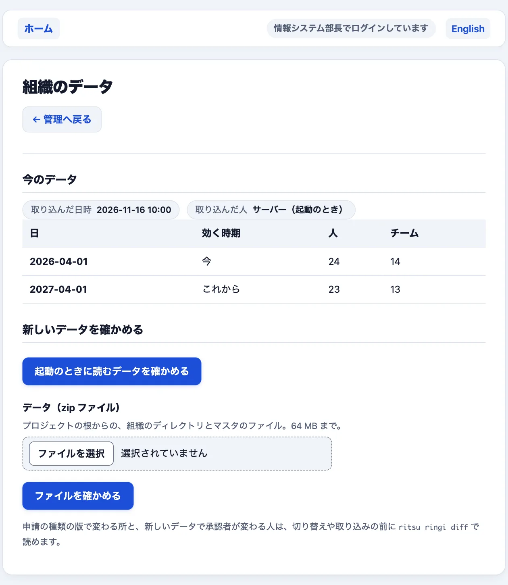

# 人に使ってもらうサーバーを動かす

このフレームワークのサーバーを動かす人のための手引きです。用意するもの、起動のしかた、バックアップ、版の上げ方、監視のしかたを書きます。パッケージ `serve` を使うサーバーについての手引きで、`ritsu ringi init` が書くサーバーもその一つです。英語版は [operations.md](operations.md) です。

## 用意するもの

| もの | 内容 |
|---|---|
| PostgreSQL のデータベース | 表は、サーバーがスキーマ `ringi` に自分で作る。データベースのユーザーには、スキーマを作る権限が要る（`grant create on database ringi to ringi_server`）。接続先は、データベースそのものか、セッションモードのプーラーにする。チケットのロックを接続が持つため。試験は PostgreSQL 18 で行っている |
| OpenID Connect のプロバイダーのクライアント | シークレットを持つ、認可コードフローのクライアント。リダイレクト URI は `https://<ホスト>/login/callback`。頼むことの一覧は[ログイン](../oidc/README.ja.md)にある |
| 組織のデータにあるメールアドレス | `people.csv` の列 `email`。プロバイダーが確認済みとしているものと同じにする。ログインした人をこれで探す |
| だれが管理者かを示すもの | 人の役割を並べた、プロバイダーの ID トークンのクレーム（[管理者](#管理者)） |
| https | サーバーの証明書か、手前で https を受けるプロキシ |
| 通知 | プロジェクトの Notifier。`ritsu ringi init` が書くものは、ログに出すだけ |
| 時刻の同期 | 期限とセッションは、それぞれのマシンの時計で数える。マシンの時刻を合わせておく |

## 設定

サーバーはフラグを取ります。秘密の二つは、マシンのほかの利用者に見えないよう、環境変数で渡します。

| フラグ | 内容 |
|---|---|
| `-addr` | 待ち受けるアドレス（指定がなければ `127.0.0.1:8080`） |
| `-db` | PostgreSQL の接続文字列。なければ、すべてメモリに置き、止めると消える |
| `-oidc-issuer` | プロバイダーの issuer の URL。プロバイダーのディスカバリーの文書にあるとおりに書く |
| `-oidc-client-id` | クライアントの ID |
| `RINGI_OIDC_CLIENT_SECRET` | クライアントのシークレット（または `-oidc-client-secret`） |
| `-oidc-redirect-url` | プロバイダーから戻ってくる URL。プロバイダーに登録したもの |
| `-oidc-roles-claim` | 人の役割を並べた、ID トークンのクレーム。なければ、プロバイダーはだれにも役割を与えない |
| `-oidc-scopes` | `openid`、`email`、`profile` のほかに求めるスコープ。役割を ID トークンに入れるのに要るプロバイダーで使う |
| `RINGI_SESSION_KEYS` | セッションのクッキーの鍵。32 バイトの乱数の base64 を、新しい順に、コンマで区切って並べる（または `-session-keys`） |
| `-tls-cert`、`-tls-key` | 証明書とその鍵。プロキシなしで https を受けるとき |

セッションの鍵は `head -c 32 /dev/urandom | base64` で作り、取っておきます。なくすと、全員がログインし直すことになります。データベースのパスワードは、`-db` に書く代わりに、`PGPASSWORD` か `.pgpass` ファイルに置けます。

サーバーは、動かすマシンでビルドするか、そのマシン向けにビルドします（`GOOS=linux GOARCH=amd64`）。申請の種類、ページ、組織のファイルは組み込まれるので、ほかのファイルは要りません。

```sh
go build -o server ./cmd/server
export RINGI_OIDC_CLIENT_SECRET='プロバイダーが発行したシークレット'
export RINGI_SESSION_KEYS='作った鍵'
export PGPASSWORD='データベースのパスワード'
./server -addr :8443 -tls-cert server.crt -tls-key server.key \
  -db 'postgres://ringi_server@db.example.com/ringi' \
  -oidc-issuer https://id.example.com -oidc-client-id ringi \
  -oidc-redirect-url https://ringi.example.com:8443/login/callback \
  -oidc-roles-claim roles
```

プロキシを通してプロバイダーに届くサーバーや、組織の認証局が署名した証明書を使うプロバイダーには、HTTP のクライアントを Go で渡します。プロジェクトのコマンドが設定する `Flags.ProviderClient` です。

サーバーは、リクエストを受ける前に設定を確かめ、誤りがあれば、それを示して止まります。`SIGINT` と `SIGTERM` でも止まります。そのときは、応答の途中のリクエストを、最長 10 秒待ちます。

### 管理者

だれが何をしてよいかは、人の役割を見て gate が決めます。`ritsu ringi init` が書く gate と例の gate には、`staff` のほかに三つあります。

| 役割 | できること |
|---|---|
| `workflow_admin` | 自分の部署が持つ申請の種類を管理する |
| `system_admin` | すべての申請の種類と、組織のデータを管理する |
| `auditor` | すべての記録を読む。何も変えられない |

人に使ってもらうサーバーでは、役割はプロバイダーから来ます。役割を並べたクレームの名前を `-oidc-roles-claim` で渡します。値が文字列か、文字列のリストのクレームです。役割はセッションのクッキーに入るので、このサーバーの役割だけを並べたクレームにします。クッキーに入りきらないほどあると、ログインできません。gate にない役割は無視し、そのことを一度だけログに書きます。gate の役割を一つも持たない人は `staff` です。プロバイダーで変えた役割は、その人が次にログインしたときから効きます。

これらの役割を持つ人のホームには、管理へのリンクが出ます。そこで、申請の種類の版を切り替え、組織のデータを確かめて取り込みます。



### プロキシの後ろで

プロキシが https を受けるときは、サーバーは、プロキシだけが届くアドレスで、`-tls-cert` なしで待ち受けます。`-oidc-redirect-url` は、人が使うアドレスです。

- `Host` ヘッダーは、届いたまま渡します。フォームがどこから来たかを示さないブラウザは、これで確かめます。
- 人は https で来る必要があります。セッションのクッキーは、https でだけ送られます。
- 64 MiB の本文（組織のデータ）を通し、応答を 30 秒待ちます。

人をログインさせるプロキシの後ろに置くときは、パッケージ `serve` を使わないサーバーで `web.ProxyHeader` を使います（[作り方](embedding.ja.md#人をログインさせるプロキシの後ろで)）。`-dev-login` やヘッダー `X-Person` のサーバーの手前に、プロキシを置いてはいけません。どちらも本人を確かめません。

## 複数のプロセス

同じコマンドを、同じデータベースと同じセッションの鍵で、何台でも起動できます。どのプロセスも、どのリクエストにも応答します。

- 一つのタイマーや通知は、一度に一つのプロセスが扱います。そのプロセスが止まると、タイマーは 30 秒、通知と flow と帳簿の解放は 60 秒たってから、ほかのプロセスが引き受けます。
- 二度実行しても、キーによって一度分になります。プロジェクトの Notifier、Books、Flows も、これを守る必要があります（[設計](../DESIGN.ja.md)の 2.3）。
- ログアウトは、すべてのプロセスで効きます。版の切り替えと、組織のデータの取り込みは、30 秒以内にすべてのプロセスに伝わります。

## バックアップと復元

サーバーが持つものは、すべてデータベースにあります。申請とその履歴、添付ファイル、タイマー、これから送るもの、組織のデータ、記録です。プロジェクトが帳簿を同じデータベースに置いていれば、帳簿もそこにあります。互いに食い違わないよう、データベース全体をバックアップします。

```sh
pg_dump --format=custom --file=ringi.dump ringi
```

復元するときは、すべてのプロセスを止め、空のデータベースに復元して、それを使ってサーバーを起動します。

```sh
createdb ringi_restored
pg_restore --dbname=ringi_restored --exit-on-error ringi.dump
```

バックアップのあとに起きたことは失われるので、もう一度行う必要があります。バックアップのときに送るのを待っていた通知、flow、帳簿の呼び出しは、同じキーでもう一度送られます。キーを覚えている受け手は、一度だけ受け取ります。そのあいだに過ぎた期限は、サーバーが起動するとすぐに処理されます。

## 版を上げる

**フレームワークと ritsu。** 二つは組で使います（[版の表](../README.ja.md#版)）。ritsu を上げ、`go.mod` のフレームワークを上げ、生成し直して、試験します。

```sh
go get github.com/i2y/ringi-server@<version>
go generate ./...
go mod tidy
go test ./...
```

データベースをバックアップし、古い版のプロセスをすべて止めてから、新しい版を起動します。起動のときに、一つのトランザクションで表を新しくします。古いサーバーは新しい表では起動しないので、戻すにはバックアップを復元します。

**申請の種類。** 申請は、出したときの版で終わりまで進みます。進行中の申請に影響させたくない変更は、新しい版にして、生成した古いパッケージと新しいパッケージの両方をサーバーに渡します（`server.Config` の `Packages`。例では `Package` と `Version2`）。古いパッケージは、その版の進行中の申請がなくなったら外せます。

```sql
select kind, version, count(*) from ringi.tickets
where status in ('in_progress', 'paused', 'with_requester') group by kind, version order by kind, version;
```

新しい版は、記述にある日から、または管理者が切り替えたときから始まります。変わるところは、前もって `ritsu ringi diff` で読めます。

**組織のデータ。** 管理者が、ページ `/pages/admin/organization` でアップロードし、日ごとに変わるところを読んで、取り込みます。プログラムに組み込んだデータは、前に取り込んだときから変わっていれば、サーバーが起動するときに取り込みます。

## 監視する

**動いているか。** `GET /a2ui/functions.js` は、プロセスが動いていれば、ログインなしで 200 を返します。データベースには問い合わせません。

**ログ** は標準エラー出力に出るテキストで、一つのことが一行です。監視する行は次のとおりです。

| 行 | 意味 |
|---|---|
| `msg="a thing to do failed; it is tried again"` | 通知、flow、エージェントのステップ、帳簿の解放のどれかが失敗した。`what` がどれか、`tries` が何回目か、`err` が理由。2 秒後、4 秒後、8 秒後、… と、最長 10 分の間隔で、成功するまでやり直す |
| `msg="a timer failed; it is tried again when its lease ends"` | 期限や催促を処理できなかった |
| `msg="a timer was refused; it is tried again later"` | 生成されたコードが拒否した。多くは、その日の組織のデータが原因 |
| `msg="an operation failed"` | だれかに 500 を返した。`operation`、`ticket`、`person` が何か、`err` が理由 |
| `msg="oidc: a sign-in refused"` | プロバイダーではログインできたが、このサーバーの人ではなかった。`reason` は `no_verified_email`、`not_in_organization`、`ambiguous_email` のどれか |
| `msg="oidc: a sign-in failed"` | サーバーとプロバイダーのあいだの失敗。`step` がどこか |
| `msg="reading the starts of the versions"`（エラー） | データベースが応答しなかった |
| `msg="the server stopped"` | 起動しなかった、または止まった理由 |

**データベース。** まだ済んでいないものと、失敗し続けているもの。

```sql
select what, count(*) filter (where done_at is null) as open, count(*) as made from ringi.todo group by what order by what;

select ticket, what, tries, last_error, try_at from ringi.todo where done_at is null and tries > 3 order by created;
```

過ぎているのに処理されていないタイマー。

```sql
select count(*) as late, min(at) as oldest from ringi.timers where at < now() - interval '5 minutes';
```

表の大きさ。

```sql
select relname as "table", n_live_tup as rows, pg_size_pretty(pg_total_relation_size(relid)) as size
from pg_stat_user_tables where schemaname = 'ringi' order by pg_total_relation_size(relid) desc;
```

表は読むだけにして、変えるときはサーバーを通します。サーバーは、一つの表の内容を、ほかの表と照らし合わせています。

## 残るものと、その期間

| もの | 期間 |
|---|---|
| 申請とその履歴、それぞれに関わる人、組織のデータ、管理の記録、済んだ処理 | ずっと |
| 申請が持つ添付ファイル | ずっと |
| どの申請も持たない添付ファイル | 7 日 |
| 操作のキーと応答 | 30 日。そのあいだに同じ操作をもう一度送ると、同じ応答が返る |
| 確かめただけで取り込んでいない、組織のデータ | 1 日 |
| 期限より前に終わったセッション | そのセッションの期限まで |

サーバーが、起動のときと 1 時間ごとに、自分で消します。期間は `server.Config` の `UploadsKept`、`OperationsKept`、`DraftsKept`、`SweepEvery` です。

## 上限

| もの | 上限 | `server.Config` の名前、または場所 |
|---|---|---|
| リクエストの本文 | 1 MiB | `MaxBody` |
| 添付ファイル一つ | 10 MiB | `web.Config` の `MaxFile` |
| 組織のデータのアップロード | 64 MiB | `MaxOrganization` |
| 一人がアップロードした、どの申請も持たない添付ファイル | 50 | `UploadsPerPerson` |
| コメントの間隔（同じ人が同じ申請に） | 10 秒 | `CommentEvery` |
| コメントの数（一つの申請に、そのうち一人が） | 100、25 | `CommentsPerTicket`、`CommentsPerPerson` |
| 組織の新しいデータの取り込み | 1 日 20 回 | `ImportsPerDay` |
| セッション | ログインから 12 時間、使わないまま 2 時間 | `oidc.Config` の `SessionLimit`、`IdleLimit` |
| リクエストを読む時間、応答する時間、使っていない接続 | 30 秒、30 秒、2 分 | パッケージ `serve` |

`server` 以外のパッケージの名前がある上限は、パッケージ `serve` を使うサーバーでは、この値のままです。

## 秘密と証明書を替える

- **セッションの鍵。** 新しい鍵を先頭に、古い鍵をそのあとに、コンマで区切って並べ、すべてのプロセスを起動し直します。12 時間たったら古い鍵を外します。
- **クライアントのシークレット。** プロバイダーと `RINGI_OIDC_CLIENT_SECRET` で替え、起動し直します。ログインしている人は、ログインしたままです。
- **証明書。** 起動のときに読みます。ファイルを更新したら、起動し直します。
- **漏れた鍵。** 古い鍵を入れずに、新しい鍵だけにします。全員がログインし直します。

## 起動しないとき

ログの最後の行に理由があります。よくあるものは次のとおりです。

| ログ | すること |
|---|---|
| `signing in through the provider takes …, and these are missing: …` | 挙がっているものを渡す |
| `… checks no one, so it listens only on a loopback address …` | プロバイダーの設定がない。設定がないと、自分のコンピューターでしか使えない |
| `the environment has RINGI_SESSION_KEYS, a setting of signing in through the provider, and … checks no one` | `-oidc-…` のフラグを渡すか、その環境変数を外す |
| `-session-keys: oidc: key 1 has 33 bytes, not 32` | 鍵を `head -c 32 /dev/urandom \| base64` で作る |
| `the -oidc-… settings: oidc: the provider's discovery document: …` | issuer の書き方がプロバイダーと違う。または、プロバイダーに届かない |
| `-db: postgres: the database cannot be reached: …` | 接続文字列、パスワード、ネットワークを確かめる |
| `-db: postgres: the tables in the schema ringi: ERROR: permission denied for database …` | ユーザーがスキーマを作れない。`grant create on database` をする |
| `-db: postgres: the tables in the schema ringi: they are at version 11, newer than this code's 10: …` | 新しいサーバーが表を新しくした。その版を動かすか、その前のバックアップを復元する |
| `org/` のファイルと行 | 組織のデータが検査を通らない。起動する前なら `ritsu ringi check` が同じことを示す |
