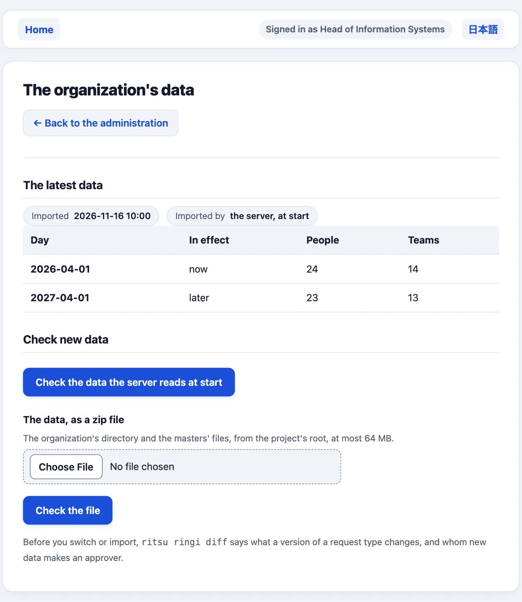

# Running a server for people

This guide is for the person who runs a server of the framework: what to prepare, how to start it,
how to back it up, raise its version and watch it. It holds for a server made with package `serve`,
as the one `ritsu ringi init` writes is. Japanese: [operations.ja.md](operations.ja.md).

## What to prepare

| What | How |
|---|---|
| A PostgreSQL database | The server makes its tables itself, in the schema `ringi`. Its user needs the right to make a schema: `grant create on database ringi to ringi_server`. Connect to the database itself, or through a pooler in session mode: a ticket is locked by a connection. The tests run on PostgreSQL 18 |
| A client at the OpenID Connect provider | A confidential client of the authorization code flow, with the redirect URI `https://<host>/login/callback`. [Signing in](../oidc/README.md) lists what to ask for |
| People's addresses in the organization's data | The column `email` of `people.csv`, as the provider verifies them. A person who signs in is found by it |
| A way to say who administers | A claim of the provider's ID tokens that lists a person's roles ([Administrators](#administrators)) |
| https | A certificate for the server, or a proxy that serves https in front of it |
| Notices | The notifier of your project: `ritsu ringi init` writes one that only logs them |
| The same clock everywhere | Deadlines and sessions are read from the clock of each machine, so keep them synchronized |

## Settings

The server takes flags. The two secrets are better in the environment, where other users of the
machine do not see them.

| Flag | What it is |
|---|---|
| `-addr` | the address to listen on (`127.0.0.1:8080` when not given) |
| `-db` | the PostgreSQL connection string. Without it, everything is in memory and lost when the server stops |
| `-oidc-issuer` | the provider's issuer URL, exactly as its discovery document writes it |
| `-oidc-client-id` | the client's ID |
| `RINGI_OIDC_CLIENT_SECRET` | the client's secret (or `-oidc-client-secret`) |
| `-oidc-redirect-url` | the URL the provider sends people back to, as registered there |
| `-oidc-roles-claim` | the claim of the ID tokens that lists a person's roles. Without it, no one has a role from the provider |
| `-oidc-scopes` | more scopes to ask for, besides `openid`, `email` and `profile`, when the provider needs one to put the roles in its ID tokens |
| `RINGI_SESSION_KEYS` | the keys of the session cookies, base64 of 32 random bytes each, the newest first, with commas between (or `-session-keys`) |
| `-tls-cert`, `-tls-key` | a certificate and its key, to serve https without a proxy |

Make a session key with `head -c 32 /dev/urandom | base64`, and keep it: without it, everyone signs
in again. The password of the database can be in `PGPASSWORD` or in a `.pgpass` file instead of in
`-db`.

Build the server on the machine it runs on, or for that machine (`GOOS=linux GOARCH=amd64`). The file
needs nothing beside it: the request types, the pages and the organization's files are built in.

```sh
go build -o server ./cmd/server
export RINGI_OIDC_CLIENT_SECRET='the secret the provider gave'
export RINGI_SESSION_KEYS='the key you made'
export PGPASSWORD='the password of the database'
./server -addr :8443 -tls-cert server.crt -tls-key server.key \
  -db 'postgres://ringi_server@db.example.com/ringi' \
  -oidc-issuer https://id.example.com -oidc-client-id ringi \
  -oidc-redirect-url https://ringi.example.com:8443/login/callback \
  -oidc-roles-claim roles
```

A server that reaches the provider through a proxy, or whose provider has a certificate signed by the
organization's own authority, is given an HTTP client in Go: `Flags.ProviderClient`, which the
project's command sets.

The server checks its settings before it takes a request, and stops with what is wrong. It stops on
`SIGINT` and `SIGTERM` too: it finishes what it is answering, for 10 seconds at most.

### Administrators

The gate decides who may do what, by a person's roles. In the gate that `ritsu ringi init` writes,
and in the examples', there are three besides `staff`:

| Role | What the person may do |
|---|---|
| `workflow_admin` | administer the request types their own department owns |
| `system_admin` | administer every request type, and the organization's data |
| `auditor` | read every record, and change nothing |

On a server for people, a person's roles come from the provider. Name the claim that lists them with
`-oidc-roles-claim`: a claim whose value is a text, or a list of texts. Take a claim that lists the
roles of this server only, since the roles are kept in the session's cookie, and a sign-in with more
of them than a cookie holds fails. A role the gate does not declare is left out, and the log says so
once. Who has none of the gate's roles is `staff`. A change at the provider takes effect when the
person signs in again.

A person with one of these roles finds the administration on the start page. There they switch the
versions of a request type, and check and import the organization's data.



### Behind a proxy

When a proxy serves https, the server listens on an address only the proxy reaches, without
`-tls-cert`, and `-oidc-redirect-url` is the address people use:

- Pass the `Host` header on as it came. A browser that does not say where a form comes from is
  checked by it.
- People must come by https: the session's cookie is sent over https only.
- Let a body of 64 MiB through (the organization's data) and an answer take 30 seconds.

A proxy that signs people in itself needs `web.ProxyHeader`, on a server made without package
`serve` ([how](embedding.md#behind-a-proxy-that-signs-people-in)). Never put a proxy in front of
`-dev-login` or of the header `X-Person`: they check no one.

## Several processes

Start the same command on as many machines as you like, with the same database and the same session
keys. Any of them answers any request.

- A timer or a notice is taken by one process at a time. If that process stops, another takes it
  after 30 seconds (a timer) or 60 seconds (a notice, a flow, a book's release).
- Doing one of them twice counts as once, by its key. Your notifier, books and flows must hold to
  that ([the design](../DESIGN.md), 2.3).
- Signing out holds in every process. A switch of a version and an import of the organization's data
  are known to all of them within 30 seconds.

## Backing up and restoring

Everything the server keeps is in the database: the requests and their history, the attachments, the
timers, what is still to be sent, the organization's data and the records. The books are there too
when your project puts them in the same database. Back up the whole database, so that they agree:

```sh
pg_dump --format=custom --file=ringi.dump ringi
```

To restore, stop every process, restore into an empty database, and start the server on it:

```sh
createdb ringi_restored
pg_restore --dbname=ringi_restored --exit-on-error ringi.dump
```

What happened after the backup is gone, and has to be done again. A notice, a flow or a call of a
book that was waiting at the time of the backup is made again, with the same key, so a receiver that
keeps the keys takes it once. Deadlines that passed meanwhile ring as soon as the server starts.

## Raising the version

**The framework and ritsu.** The two go together ([the table of versions](../README.md#versions)).
Raise ritsu, raise the framework in `go.mod`, generate and test:

```sh
go get github.com/i2y/ringi-server@<version>
go generate ./...
go mod tidy
go test ./...
```

Back up the database, stop every process of the old version, then start the new one: it raises the
tables when it starts, in one transaction. An older server does not start on newer tables, so going
back means restoring the backup.

**A request type.** A request runs to its end by the version it was made with. When you change a
request type in a way open requests must not see, make it a new version, and give the server the old
generated package and the new one (`Packages` of `server.Config`; the examples do, with
`Package` and `Version2`). Take the old package out when no request of it is open:

```sql
select kind, version, count(*) from ringi.tickets
where status in ('in_progress', 'paused', 'with_requester') group by kind, version order by kind, version;
```

A new version starts on the day its description says, or when an administrator switches it.
`ritsu ringi diff` says what it changes before you do.

**The organization's data.** An administrator uploads it on the page `/pages/admin/organization`,
reads what changes day by day, and imports it. Data built into the program is imported when the
server starts, if it changed since the server last imported it.

## Watching it

**Is it up?** `GET /a2ui/functions.js` answers 200 without a person while the process serves. It does
not ask the database.

**The log** is text on the standard error, a line for each thing. These are the lines to watch:

| Line | What it means |
|---|---|
| `msg="a thing to do failed; it is tried again"` | a notice, a flow, an agent's step or a book's release failed. `what` says which, `tries` how often, `err` why. It is tried again after 2 seconds, then 4, 8, … up to 10 minutes, with no end |
| `msg="a timer failed; it is tried again when its lease ends"` | a deadline or a reminder could not be rung |
| `msg="a timer was refused; it is tried again later"` | the generated code refused it, most often because of the organization's data of that day |
| `msg="an operation failed"` | a person was answered 500. `operation`, `ticket` and `person` say whose, `err` why |
| `msg="oidc: a sign-in refused"` | the provider signed a person in whom the server does not take: `reason` is `no_verified_email`, `not_in_organization` or `ambiguous_email` |
| `msg="oidc: a sign-in failed"` | something went wrong between the server and the provider, at the `step` it says |
| `msg="reading the starts of the versions"` (an error) | the database did not answer |
| `msg="the server stopped"` | why it did not start, or stopped |

**The database.** What is still to be done, by kind, and what keeps failing:

```sql
select what, count(*) filter (where done_at is null) as open, count(*) as made from ringi.todo group by what order by what;

select ticket, what, tries, last_error, try_at from ringi.todo where done_at is null and tries > 3 order by created;
```

Timers that should have rung:

```sql
select count(*) as late, min(at) as oldest from ringi.timers where at < now() - interval '5 minutes';
```

How large the tables are:

```sql
select relname as "table", n_live_tup as rows, pg_size_pretty(pg_total_relation_size(relid)) as size
from pg_stat_user_tables where schemaname = 'ringi' order by pg_total_relation_size(relid) desc;
```

Read the tables, and change them only through the server: what it keeps in one table it holds to
another.

## What is kept, and for how long

| What | For how long |
|---|---|
| Requests and their history, the people of each, the organization's data, the records of the administration, what was done | for ever |
| An attachment a request holds | for ever |
| An attachment no request holds | 7 days |
| The answer to an operation, by its key | 30 days: an operation sent again within them is answered the same |
| A draft of the organization's data that was checked and not imported | a day |
| A session that ended before its time | until it would have ended |

The server forgets them itself, when it starts and every hour. The times are `UploadsKept`,
`OperationsKept`, `DraftsKept` and `SweepEvery` of `server.Config`.

## Limits

| What | Limit | In `server.Config`, or where |
|---|---|---|
| A request's body | 1 MiB | `MaxBody` |
| An attachment | 10 MiB | `MaxFile` of `web.Config` |
| An upload of the organization's data | 64 MiB | `MaxOrganization` |
| Attachments a person uploaded that no request holds | 50 | `UploadsPerPerson` |
| Comments: between two by one person on one request | 10 seconds | `CommentEvery` |
| Comments: on one request, and by one person on it | 100, 25 | `CommentsPerTicket`, `CommentsPerPerson` |
| Imports of new data of the organization | 20 a day | `ImportsPerDay` |
| A session | 12 hours from signing in, 2 hours unused | `SessionLimit`, `IdleLimit` of `oidc.Config` |
| Reading a request, answering it, an idle connection | 30 seconds, 30 seconds, 2 minutes | package `serve` |

Where the table names another package than `server`, a server made with package `serve` has the limit
as it is.

## Changing secrets and certificates

- **The session keys.** Put a new key first and keep the old one after it, with a comma between, and
  start every process again. Take the old one out after 12 hours.
- **The client's secret.** Change it at the provider and in `RINGI_OIDC_CLIENT_SECRET`, and start
  again. People who are signed in stay signed in.
- **The certificate.** It is read when the server starts: start it again after renewing the files.
- **A key that leaked.** Give new keys only, without the old one: everyone signs in again.

## When it does not start

The last line of the log says why. The most common:

| The log says | What to do |
|---|---|
| `signing in through the provider takes …, and these are missing: …` | give what it names |
| `… checks no one, so it listens only on a loopback address …` | the settings of the provider are missing: without them, a server serves your own computer only |
| `the environment has RINGI_SESSION_KEYS, a setting of signing in through the provider, and … checks no one` | give the `-oidc-…` flags, or take the variable out of the environment |
| `-session-keys: oidc: key 1 has 33 bytes, not 32` | make the key with `head -c 32 /dev/urandom \| base64` |
| `the -oidc-… settings: oidc: the provider's discovery document: …` | the issuer is not written as the provider writes it, or the provider cannot be reached |
| `-db: postgres: the database cannot be reached: …` | the connection string, the password, or the network |
| `-db: postgres: the tables in the schema ringi: ERROR: permission denied for database …` | the user may not make a schema: `grant create on database` |
| `-db: postgres: the tables in the schema ringi: they are at version 11, newer than this code's 10: …` | a newer server raised the tables: run that version, or restore the backup made before |
| a file and a line of `org/` | the organization's data does not pass its checks: `ritsu ringi check` says the same before you start |
