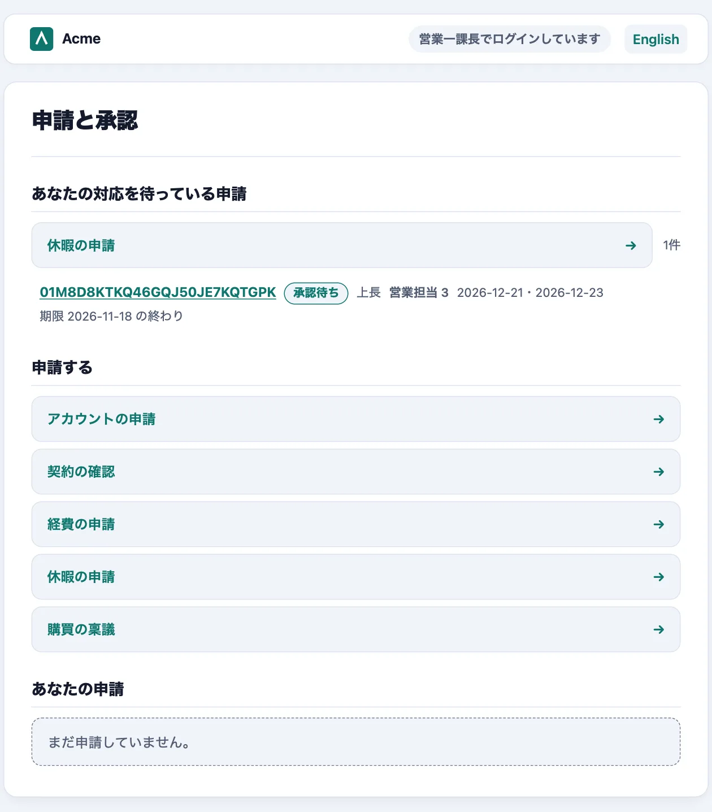

# 自分の画面を作る

サーバーのページには、会社のロゴと名前と色を付けられます。見た目をすべて自分で決めたいとき、会社のポータルに件数を出したいとき、自分のアプリの中で承認したいときは、ほかの方法を選びます。英語版は [screens.md](screens.md) です。

| したいこと | 方法 |
|---|---|
| サーバーのページに、会社のロゴ、名前、色を付ける | [ページの見た目を変える](#ページの見た目を変える) |
| 同じサーバーに、自分のページや API を足す | [ルートを足す](#ルートを足す) |
| 自分のアプリから、申請を出す、承認する | [HTTP API を使う](#http-api-を使う) |
| フォームや承認の画面の部品を、自分のアプリに表示する | [A2UI の画面を使う](#a2ui-の画面を使う) |

サーバーのページを使いながら、一部だけを自分で作ることもできます。

## ページの見た目を変える

サーバーのページの上に会社のロゴと名前を出し、リンクやボタンを会社の色にします。まず、プロジェクトのコードの横にロゴを置きます。

```svg title="logo.svg"
<svg xmlns="http://www.w3.org/2000/svg" viewBox="0 0 64 64"><rect width="64" height="64" rx="12" fill="#0f766e"/><path d="M18 46 32 16l14 30" fill="none" stroke="#fff" stroke-width="6"/></svg>
```

プロジェクトのパッケージに、見た目を書きます。

```go title="look.go"
package shinsei

import (
	_ "embed"

	"github.com/i2y/ringi-server/web"
)

//go:embed logo.svg
var logo []byte

// Look は、ページの見た目。会社のロゴと名前と色。
func Look() web.Look {
	return web.Look{Name: "アクメ", Logo: logo, Accent: "#0f766e"}
}
```

`cmd/server/main.go` で、申請の置き場を開く行のあとに、サーバーに渡します。

```go title="cmd/server/main.go" hl_lines="2"
	defer stores.Close()
	stores.Look = shinsei.Look()
	cfg, err := shinsei.Parts(log)
```

試用のログインでサーバーを起動し、`http://localhost:8080/pages/` を開きます。ロゴと名前から、ホームへ戻れます。

```sh
go run ./cmd/server -dev-login
```



色は、ページのスタイルシートの最後に足されます。そのため、試用のログインのページにも付きます。ロゴには、専用のアドレスがあります。

```sh
curl -s localhost:8080/pages/assets/page.css | tail -n 5
curl -s -o /dev/null -w '%{content_type}\n' localhost:8080/pages/assets/logo
```

```
/* the organization's colours (web.Look) */
.ringi { --accent: #0f766e; }
@media (prefers-color-scheme: dark) {
  .ringi { --accent: #4b9892; }
}
image/svg+xml
```

`#4b9892` は、暗い配色にしたブラウザのための色です。サーバーが、暗いページの上で読めるように、`Accent` を明るくして作りました。自分で選ぶときは、`AccentDark` も渡します。ページの文字は読めなければならないので、背景との比が 4.5:1 に届かない色（WCAG 1.4.3）では、サーバーは起動せず、理由を言います。

```
web: Look.Accent #e11d48 reads at 4.26:1 on the pages' tint #f1f4f9, and the links and the buttons need 4.5:1 (WCAG 1.4.3): take a darker colour
```

ロゴは SVG、PNG、JPEG、GIF、WebP のどれかで、名前は 60 文字までです（[ページの見た目](reference.ja.md#ページの見た目)）。この見た目は、サーバーのページの物です。自分のアプリに出す A2UI の画面は、アプリの見た目になります。

## ルートを足す

`cmd/server` のサーバーには、自分のルートを足せます。たとえば、社内ポータルに「あなたを待っている申請が 1 件あります」と出すために、件数を返すルートを作ります。

```go title="portal.go"
package shinsei

import (
	"encoding/json"
	"log/slog"
	"net/http"

	server "github.com/i2y/ringi-server"
	"github.com/i2y/ringi-server/serve"
)

// HandlePortal は、社内ポータルに出す件数を返す。
func HandlePortal(st *serve.Stores, log *slog.Logger) {
	st.Handle("/portal/counts", func(srv *server.Server) (http.Handler, error) {
		return http.HandlerFunc(func(w http.ResponseWriter, r *http.Request) {
			p, err := serve.Person(r) // ログインしている人
			if err != nil {
				http.Error(w, "no one is signed in", http.StatusUnauthorized)
				return
			}
			waiting, err := srv.CountWaiting(r.Context(), p) // 申請の種類ごとの、その人を待っている件数
			if err != nil {
				log.Error("counting what waits", "err", err)
				http.Error(w, "the server failed", http.StatusInternalServerError)
				return
			}
			w.Header().Set("Content-Type", "application/json")
			json.NewEncoder(w).Encode(map[string]any{"waiting": waiting})
		}), nil
	})
}
```

`cmd/server/main.go` の、`stores.Serve` を呼ぶ行の前に一行足します。

```go title="cmd/server/main.go" hl_lines="1"
	shinsei.HandlePortal(stores, log)
	return stores.Serve(ctx, cfg, func(srv *server.Server) { shinsei.Started(cfg, srv) })
```

サーバーを起動します。

```sh
go run ./cmd/server
```

別の端末で、営業担当 1 として申請を一件出し、営業一課長の件数を読みます。最後の行は、だれもログインしていないリクエストです。

```sh
curl -s -o /dev/null -X POST localhost:8080/requests/purchase/tickets -H 'X-Person: s1201' \
  -H 'Content-Type: application/json' -H 'Idempotency-Key: buy-1' \
  -d '{"form": {"amount": 120000, "purpose": "新しいメンバーのノートパソコン"}}'
curl -s localhost:8080/portal/counts -H 'X-Person: s1101'
curl -s -w ' %{http_code}\n' localhost:8080/portal/counts
```

```
{"waiting":{"purchase":1}}
{"error":"no one is signed in"} 401
```

足したルートは、サーバーのページと同じログインの後ろに置かれます。だれもログインしていないリクエストには、自分のコードに届く前に 401 を返します。

`Server` には、ほかにも次の関数があります。API と同じ決まりで動きます。人を渡して呼ぶ関数は、その人が見てよいものだけを返します。

| 関数 | すること |
|---|---|
| `Waiting`、`Mine`、`CountWaiting`、`CountMine` | 一覧と件数を読む |
| `Can` | その人が、いま押せる操作を調べる |
| `Do`、`Try` | 操作を実行する、実行せずに結果だけを調べる |
| `People`、`Teams`、`Names` | 組織のデータの人、チーム、名前を読む |

全部の関数は、[Go のリファレンス](https://pkg.go.dev/github.com/i2y/ringi-server)にあります。`/pages/`、`/a2ui/`、`/tickets/` など、フレームワークが使うパスには足せません。足そうとすると、サーバーは起動せずに、どのパスかを表示します。

## HTTP API を使う

自分のアプリからは、[HTTP API](api.ja.md) で操作します。入力のフォームを作るには、`requests/types/<種類>.json` が使えます。ritsu が申請の種類から作るファイルで、項目の名前、ラベル、型、範囲、選択肢、どんなときに出る項目かが入っています。

```sh
jq -c '.form[] | {name, label, type, min, max, count_max}' requests/types/purchase.json
```

```
{"name":"amount","label":"金額","type":"money[JPY]","min":1,"max":10000000,"count_max":null}
{"name":"purpose","label":"目的","type":"long text","min":null,"max":null,"count_max":500}
```

別のドメインのページからブラウザで直接 POST すると、拒否されます。自分のアプリのサーバーを通して呼びます。[自分で組み立てたサーバー](embedding.ja.md#1-サーバーを組み立てる)なら、`web.Config` の `TrustedOrigins` にそのドメインを加える方法もあります。

## A2UI の画面を使う

[A2UI](https://a2ui.org/) は、画面を「部品」と「データ」のメッセージで表す形式です。受け取ったアプリは、メッセージのとおりに自分の部品で画面を描きます。ritsu は、申請の種類ごとに、フォーム、承認、一覧、履歴の画面を A2UI で作ります。サーバーは、そこに申請の値を入れて返します。

| 呼び出し | 画面 |
|---|---|
| `GET /a2ui/requests/{kind}/form` | 新しい申請のフォーム |
| `GET /a2ui/tickets/{id}/card` | 承認の画面 |
| `GET /a2ui/tickets/{id}/form` | 再申請のフォーム |
| `GET /a2ui/tickets/{id}/history` | 履歴 |
| `GET /a2ui/waiting/{kind}`、`/a2ui/mine/{kind}` | 待っている申請、自分の申請の一覧 |
| `GET /a2ui/requests/{kind}` | 受け持つ部のための、申請の種類のすべての申請の一覧（一覧の画面を、サーフェス `<kind>.list.all` で） |
| `POST /a2ui/actions` | ボタンが押されたときに送る。操作を実行し、次の画面を返す |
| `GET /a2ui/catalog.json`、`/a2ui/functions.js` | 部品の一覧と、画面の中の計算に使う関数 |

```sh
curl -s -H 'X-Person: s1201' 'localhost:8080/a2ui/requests/purchase/form?lang=ja' |
  jq -c '[.[] | keys[0]], .[1].updateDataModel.value.can, .[2].updateComponents.components[0]'
```

```
["createSurface","updateDataModel","updateComponents"]
{"discard":false,"resubmit":false,"submit":true}
{"id":"title","component":"Text","text":"購買の申請"}
```

`can` は、その人がいま押せるボタンです。どの画面にも、その人が見てよいものと、押せるボタンだけが入ります。

画面を描く側の作り方と、メッセージの細かい決まりは、[パッケージ screens](../screens/README.ja.md) と[パッケージ web](../web/README.ja.md) にあります。
