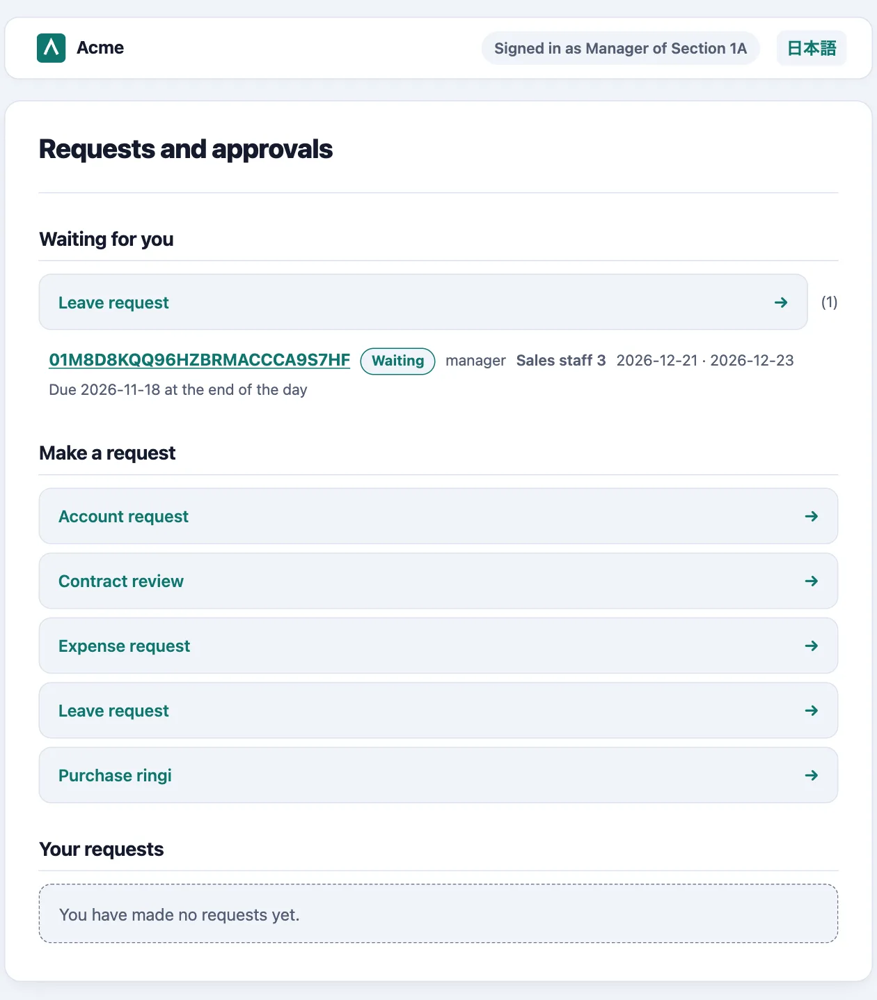

# Make screens of your own

The server's pages can have your company's logo, name and colour. To decide everything about how things look
yourself, to show the numbers in your company's portal, or to approve in an application of your own, take one of the
other ways. Japanese: [screens.ja.md](screens.ja.md).

| What you want | How |
|---|---|
| To put your company's logo, name and colour on the server's pages | [Change how the pages look](#change-how-the-pages-look) |
| To add pages and an API of your own to the same server | [Add routes](#add-routes) |
| To make and approve requests from your own application | [Use the HTTP API](#use-the-http-api) |
| To show the parts of the forms and the approvals in your own application | [Use the A2UI screens](#use-the-a2ui-screens) |

You can also use the server's pages, and make only some of them yourself.

## Change how the pages look

Put your company's logo and name at the top of the server's pages, and its colour on the links and the buttons.
First put the logo beside the code of the project.

```svg title="logo.svg"
<svg xmlns="http://www.w3.org/2000/svg" viewBox="0 0 64 64"><rect width="64" height="64" rx="12" fill="#0f766e"/><path d="M18 46 32 16l14 30" fill="none" stroke="#fff" stroke-width="6"/></svg>
```

Write the look in the package of the project.

```go title="look.go"
package approvals

import (
	_ "embed"

	"github.com/i2y/ringi-server/web"
)

//go:embed logo.svg
var logo []byte

// Look is how the pages look: the company's logo and name, and its colour.
func Look() web.Look {
	return web.Look{Name: "Acme", Logo: logo, Accent: "#0f766e"}
}
```

In `cmd/server/main.go`, give it to the server after the lines that open where the requests are kept.

```go title="cmd/server/main.go" hl_lines="2"
	defer stores.Close()
	stores.Look = approvals.Look()
	cfg, err := approvals.Parts(log)
```

Start the server with the trial sign-in, and open `http://localhost:8080/pages/`. The logo and the name lead to the
start page.

```sh
go run ./cmd/server -dev-login
```



The colours are added at the end of the pages' style sheet, so the page of the trial sign-in has them too. The logo
has an address of its own.

```sh
curl -s localhost:8080/pages/assets/page.css | tail -n 5
curl -s -o /dev/null -w '%{content_type}\n' localhost:8080/pages/assets/logo
```

```
/* the organization's colours (web.Look) */
.ringi { --accent: #0f766e; }
@media (prefers-color-scheme: dark) {
  .ringi { --accent: #4b9892; }
}
image/svg+xml
```

`#4b9892` is the colour for a browser set to dark colours. The server made it of `Accent`, lighter so that it reads
on the dark pages. To choose it yourself, give `AccentDark` too. The text must read on the pages: a colour that is
less than 4.5:1 with their backgrounds (WCAG 1.4.3) stops the server, which says why.

```
web: Look.Accent #e11d48 reads at 4.26:1 on the pages' tint #f1f4f9, and the links and the buttons need 4.5:1 (WCAG 1.4.3): take a darker colour
```

The logo can be SVG, PNG, JPEG, GIF or WebP, and the name up to 60 characters ([The look of the
pages](reference.md#the-look-of-the-pages)). The look is that of the server's pages. The A2UI screens you show in an
application of your own look as your application does.

## Add routes

You can add your own routes to the server of `cmd/server`. To show "1 request waits for you" in your company's
portal, for example, make a route that answers how many do.

```go title="portal.go"
package approvals

import (
	"encoding/json"
	"log/slog"
	"net/http"

	server "github.com/i2y/ringi-server"
	"github.com/i2y/ringi-server/serve"
)

// HandlePortal answers the numbers your company's portal shows.
func HandlePortal(st *serve.Stores, log *slog.Logger) {
	st.Handle("/portal/counts", func(srv *server.Server) (http.Handler, error) {
		return http.HandlerFunc(func(w http.ResponseWriter, r *http.Request) {
			p, err := serve.Person(r) // the person signed in
			if err != nil {
				http.Error(w, "no one is signed in", http.StatusUnauthorized)
				return
			}
			waiting, err := srv.CountWaiting(r.Context(), p) // how many of each request type wait for them
			if err != nil {
				log.Error("counting what waits", "err", err)
				http.Error(w, "the server failed", http.StatusInternalServerError)
				return
			}
			w.Header().Set("Content-Type", "application/json")
			json.NewEncoder(w).Encode(map[string]any{"waiting": waiting})
		}), nil
	})
}
```

In `cmd/server/main.go`, add a line before the one that calls `stores.Serve`.

```go title="cmd/server/main.go" hl_lines="1"
	approvals.HandlePortal(stores, log)
	return stores.Serve(ctx, cfg, func(srv *server.Server) { approvals.Started(cfg, srv) })
```

Start the server.

```sh
go run ./cmd/server
```

In another terminal, make a request as Sales staff 1, and read the numbers of the manager of Sales Section 1. The
last line is a request with no one signed in.

```sh
curl -s -o /dev/null -X POST localhost:8080/requests/purchase/tickets -H 'X-Person: s1201' \
  -H 'Content-Type: application/json' -H 'Idempotency-Key: buy-1' \
  -d '{"form": {"amount": 120000, "purpose": "A laptop for the new member"}}'
curl -s localhost:8080/portal/counts -H 'X-Person: s1101'
curl -s -w ' %{http_code}\n' localhost:8080/portal/counts
```

```
{"waiting":{"purchase":1}}
{"error":"no one is signed in"} 401
```

The routes you add are behind the same sign-in as the server's pages. A request with no one signed in is answered
401 before it comes to your code.

`Server` has these functions too. They keep the same rules as the API. Those that take a person answer only what
that person may see.

| Function | What it does |
|---|---|
| `Waiting`, `Mine`, `CountWaiting`, `CountMine` | Read the lists, and how many there are |
| `Can` | Says which operations the person may do now |
| `Do`, `Try` | Carry out an operation, and only say what would come of it |
| `People`, `Teams`, `Names` | Read the people, the teams and the names of the organization's data |

[The Go reference](https://pkg.go.dev/github.com/i2y/ringi-server) has all of them. A path the framework uses, such
as `/pages/`, `/a2ui/` or `/tickets/`, cannot be added: the server does not start, and says which path it is.

## Use the HTTP API

Your own application acts through [the HTTP API](api.md). To make the form to fill in, use
`requests/types/<kind>.json`. ritsu makes it from the request type, and it has the name, the label, the type, the
range and the choices of each field, and when the field is shown.

```sh
jq -c '.form[] | {name, label, type, min, max, count_max}' requests/types/purchase.json
```

```
{"name":"amount","label":"Amount","type":"money[JPY]","min":1,"max":10000000,"count_max":null}
{"name":"purpose","label":"Purpose","type":"long text","min":null,"max":null,"count_max":500}
```

A POST sent by a browser straight from a page of another domain is refused. Call the API through the server of your
application. On [a server you put together yourself](embedding.md#1-put-the-server-together), you can also add that
domain to `TrustedOrigins` of `web.Config`.

## Use the A2UI screens

[A2UI](https://a2ui.org/) writes a screen as messages of components and data. An application that gets them draws
the screen with components of its own, as the messages say. For each request type, ritsu makes the screens of the
form, of the approval, of the lists and of the history in A2UI. The server puts the values of the requests in them
and answers them.

| Call | Screen |
|---|---|
| `GET /a2ui/requests/{kind}/form` | The form of a new request |
| `GET /a2ui/tickets/{id}/card` | The screen of the approval |
| `GET /a2ui/tickets/{id}/form` | The form to submit a request again |
| `GET /a2ui/tickets/{id}/history` | The history |
| `GET /a2ui/waiting/{kind}`, `/a2ui/mine/{kind}` | The lists of the requests that wait for one, and of one's own |
| `GET /a2ui/requests/{kind}` | The list of all the requests of a request type, for the department that keeps it (the screen of the list, on the surface `<kind>.list.all`) |
| `POST /a2ui/actions` | Sent when a button is pressed. It carries out the operation, and answers the next screen |
| `GET /a2ui/catalog.json`, `/a2ui/functions.js` | The list of the components, and the functions of what is computed on a screen |

```sh
curl -s -H 'X-Person: s1201' 'localhost:8080/a2ui/requests/purchase/form?lang=en' |
  jq -c '[.[] | keys[0]], .[1].updateDataModel.value.can, .[2].updateComponents.components[0]'
```

```
["createSurface","updateDataModel","updateComponents"]
{"discard":false,"resubmit":false,"submit":true}
{"id":"title","component":"Text","text":"Purchase request"}
```

`can` are the buttons the person may press now. Every screen has only what that person may see, and the buttons
they may press.

How to write what draws the screens, and the details of the messages, are in [the package
screens](../screens/README.md) and [the package web](../web/README.md).
