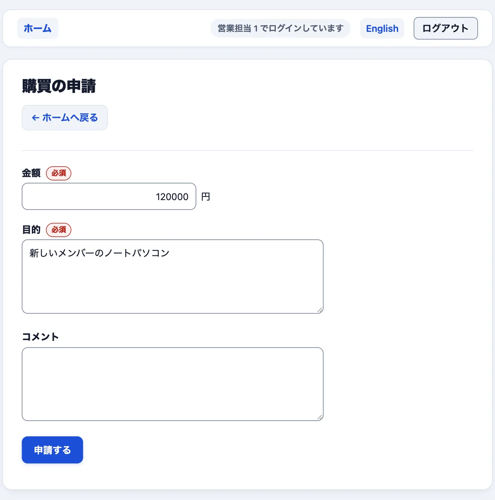
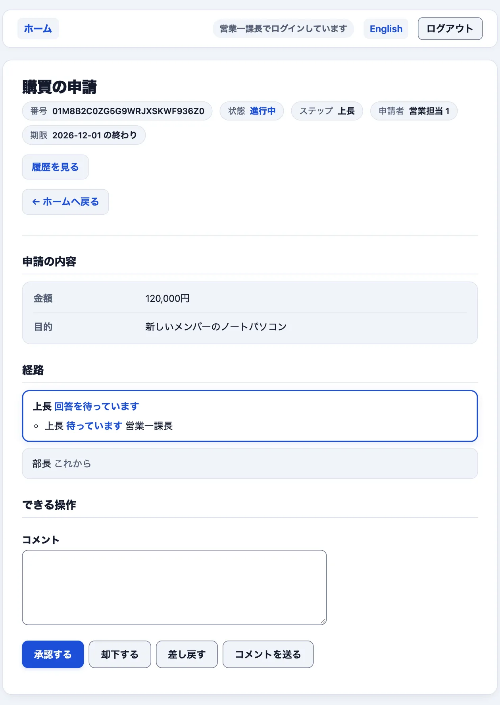

# 1. 動かして、申請を承認する

小さな会社の購買の申請を、自分のコンピューターで動かします。営業担当として申請し、営業一課長と営業部長になって承認するところまで、10 分ほどです。英語版は [start.md](start.md) です。

## 用意するもの

- Go 1.26 以降（[入れ方](https://go.dev/doc/install)、英語）
- ritsu 0.56.0 以降。macOS と Linux では `brew install i2y/tap/ritsu` で入る（[ほかの入れ方](https://github.com/i2y/ritsu/blob/main/README.ja.md#入れ方)）
- ブラウザ

ritsu は、申請の種類を書いたファイルを検査し、Go のコードを作るコマンドです。二つが入っていることを確かめます。

```sh
go version
ritsu --version
```

データベース、メール、会社のログインの設定は、ここでは要りません。

## プロジェクトを作る

`ritsu ringi init` で、動く状態のプロジェクトを作ります。

```sh
ritsu ringi init shinsei --module example.com/acme/shinsei --lang ja
```

```
shinsei に 53 個のファイルを書きました（モジュール example.com/acme/shinsei）。project/ に申請の種類と組織と gate、go/ と requests/ にそこから ritsu が生成したコード、cmd/server/ にフレームワーク github.com/i2y/ringi-server v0.1.0 のサーバー、それと試験です。次に:
  cd shinsei
  go mod tidy
  go test ./...
  go run ./cmd/server -dev-login
を走らせ、ブラウザで http://127.0.0.1:8080/pages/ を開きます。続きは README.ja.md にあります
```

`shinsei` は、作るディレクトリの名前です。`--module` には、Go のモジュールのパスを書きます。`--lang ja` を付けたので、申請の種類も会社のデータも日本語で書かれます。

| できたもの | 中身 |
|---|---|
| `project/purchase.ringi` | 購買の申請。入力する項目、承認の順、期限 |
| `project/org/2026-04-01/` | 会社のチーム、人、所属（CSV）。日付は、このデータが有効になる日 |
| `project/shared/` | 役職とチームの種類（`company.ringi`）、権限（`company.gate`）、営業日（`office.cal`） |
| `go/`、`requests/` | ritsu が `project/` から作ったもの。手では直さない |
| `generate.go` | `go generate` で動かすコマンド。`go/` と `requests/` を作り直す |
| `shinsei.go` | サーバーに渡すものを並べる関数。作られたコード、組織のデータ、権限、通知の部品 |
| `gate.go`、`notify.go` | 権限の部品と、通知の部品 |
| `cmd/server/` | サーバーのコマンド |
| `*_test.go` | 試験 |

`go/` と `requests/` のほかは、どれも自分で直してよいファイルです。

## サーバーを起動する

`go mod tidy` で必要なモジュールをダウンロードしてから、サーバーを起動します。

```sh
cd shinsei
go mod tidy
go run ./cmd/server -dev-login
```

最後に次の行が出たら、起動しています。

```
level=INFO msg=listening addr=127.0.0.1:8080 pages=http://127.0.0.1:8080/
```

`-dev-login` は、試すためのログインを使うフラグです。パスワードはなく、だれとして使うかをページで選びます。だれでもなりすませるので、サーバーは自分のコンピューターからの接続だけを受け付けます。

データベースを渡していないので、申請はメモリに置かれ、サーバーを止めると消えます。

## 営業担当として申請する

1. ブラウザで <http://127.0.0.1:8080/> を開きます。「試用のログイン」のページが出ます。
2. 下に並んでいる人の中から「営業担当 1（s1201）」を選びます。ホームが開きます。
3. 「申請する」の下の「購買の申請」を選びます。
4. 金額に `120000`、目的に `新しいメンバーのノートパソコン` と入力し、「申請する」を押します。



申請のページに変わり、状態が「進行中」、ステップが「上長」になります。「経路」には、営業一課長の回答を待っていることが出ます。

## 営業一課長と営業部長として承認する

1. 右上の「ログアウト」を押し、「営業一課長（s1101）」を選びます。ホームの「あなたの対応を待っている申請」に、さきほどの申請が出ています。
2. その申請を開いて、「承認する」を押します。ステップが「部長」に進みます。
3. もう一度ログアウトして「営業部長（s1001）」を選び、同じように承認します。状態が「承認されました」になります。



「差し戻す」や「却下する」も試してみてください。差し戻すと、申請した人のページに「内容を修正して再申請する」のリンクが出ます。

## だれに回るかは、どう決まったか

営業一課長に回したのは、`project/purchase.ringi` の次の行です。

```ringi title="project/purchase.ringi"
who
  上長(manager)   = manager of requester
  部長(dept_head) = head of requester.department
```

`manager of requester` は「申請した人の上長」です。サーバーは、会社のデータから次のように探します。

1. `members.csv` に `s1201,sales_1,staff,yes` という行があります。営業担当 1 の所属は、営業一課（`sales_1`）です。
2. `teams.csv` に `sales_1,Sales Section 1,営業一課,section,sales,s1101` という行があります。営業一課の長は s1101、つまり営業一課長です。

`head of requester.department` は「申請した人の部の長」です。営業一課の上の部は営業部（`sales`）で、その長は s1001、営業部長です。

人が異動したら、その日からの CSV のデータを足します。申請の種類のファイルは変えません。自分が長のときや、長がいないときの決まり方は、[承認者はどう決まるか](concepts.ja.md#承認者はどう決まるか)にあります。

## サーバーがしたこと

端末のログに、`msg=notice` の行が三つ出ています（時刻は省きました）。

```
level=INFO msg=notice notice=waiting to="s1101 s1101@example.com" kind=purchase title=購買の申請 title_lang=ja ticket=01M89JDENBGHWVJ8XXBRHKCY64 stage=manager
level=INFO msg=notice notice=waiting to="s1001 s1001@example.com" kind=purchase title=購買の申請 title_lang=ja ticket=01M89JDENBGHWVJ8XXBRHKCY64 stage=head
level=INFO msg=notice notice=decided to="s1201 s1201@example.com" kind=purchase title=購買の申請 title_lang=ja ticket=01M89JDENBGHWVJ8XXBRHKCY64 stage=""
```

`notice=waiting` は、承認を待っていることを承認する人に知らせる通知です。`notice=decided` は、結果が出たことを申請した人に知らせる通知です。いまのプロジェクトは、通知をログに書くだけです。メールで送る方法は、[3. 通知をメールで送る](mail.ja.md)にあります。

ほかにも、サーバーは次のことをしています。

- 承認のステップごとに、催促の時刻と期限を設定し、承認されたら取り消した
- ボタンが押されるたびに、その人がその操作をしてよいかを確かめた
- だれが、いつ、何をしたかを履歴に残した（申請のページの「履歴を見る」で読める）

## うまくいかないとき

| 起きること | 理由と、すること |
|---|---|
| `ritsu: command not found` | ritsu が入っていないか、`PATH` にない。[ritsu の入れ方](https://github.com/i2y/ritsu/blob/main/README.ja.md#入れ方)を見る |
| `go mod tidy` が、Go の版が古いと言って止まる | Go 1.26 以降を入れる |
| `listen tcp 127.0.0.1:8080: bind: address already in use` | 8080 番のポートを、ほかのプログラムが使っている。`go run ./cmd/server -dev-login -addr 127.0.0.1:8081` のように、別のポートで起動する |
| ほかのコンピューターやスマートフォンから開けない | `-dev-login` のサーバーは、自分のコンピューターからだけ使える。ほかの人に使ってもらう方法は[用意して起動する](operations.ja.md)にある |

## 次へ

サーバーは `Ctrl+C` で止まります。次は、[2. 申請の種類を書き換える](change.ja.md)で、この購買の申請を自分の会社の決まりに近づけます。
