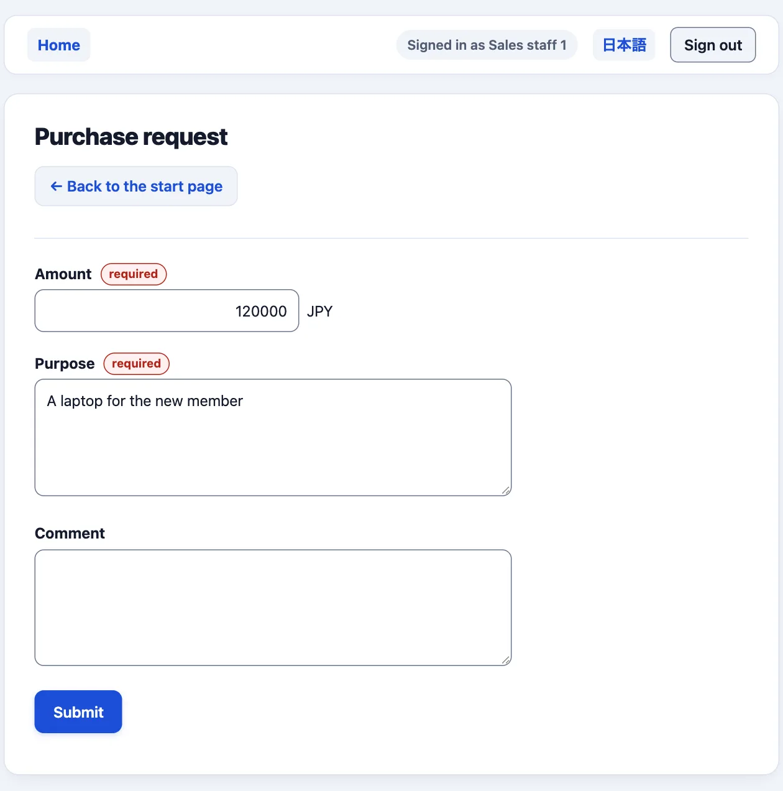
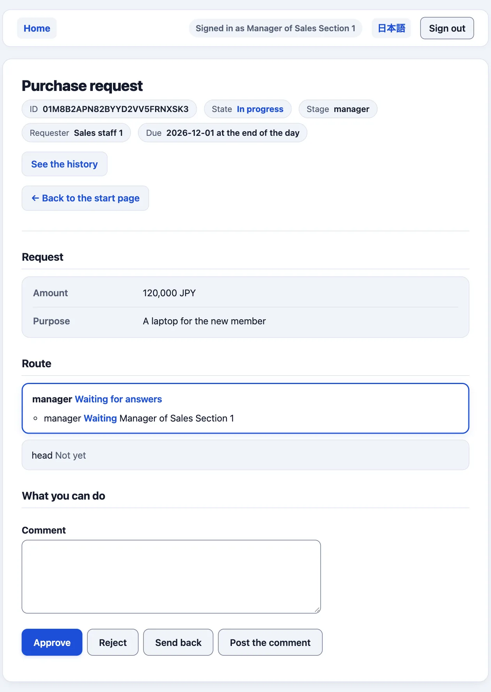

# 1. Run it, and approve a request

You run the purchase requests of a small company on your own computer: you make a request as a member of
its sales staff, then approve it as the manager and as the head of the department. It takes about ten
minutes. Japanese: [start.ja.md](start.ja.md).

## What you need

- Go 1.26 or later ([how to install it](https://go.dev/doc/install))
- ritsu 0.56.0 or later. On macOS and Linux, `brew install i2y/tap/ritsu` installs it ([other
  ways](https://github.com/i2y/ritsu#install))
- A browser

ritsu is the command that checks the files you write request types in, and makes Go code from them. See
that both are there:

```sh
go version
ritsu --version
```

You need no database, no mail server and no sign-in provider here.

## Make a project

`ritsu ringi init` makes a project that runs as it is.

```sh
ritsu ringi init approvals --module example.com/acme/approvals
```

```
wrote 52 files in approvals (module example.com/acme/approvals): a request type, its organization and a gate in project/, the code ritsu generates from them in go/ and requests/, a server of the framework github.com/i2y/ringi-server v0.1.0 in cmd/server/, and tests. Next, run
  cd approvals
  go mod tidy
  go test ./...
  go run ./cmd/server -dev-login
and open http://127.0.0.1:8080/pages/ in a browser. README.md says more
```

`approvals` is the name of the directory it makes. `--module` takes the path of the Go module.

| What it made | What it is |
|---|---|
| `project/purchase.ringi` | The purchase request: what to fill in, the order of the approvals, the deadlines |
| `project/org/2026-04-01/` | The company's teams, people and who belongs where (CSV). The date is the day this data takes effect |
| `project/shared/` | The positions and the kinds of team (`company.ringi`), the permissions (`company.gate`) and the business days (`office.cal`) |
| `go/`, `requests/` | What ritsu makes from `project/`. You do not change it by hand |
| `generate.go` | The command `go generate` runs, which makes `go/` and `requests/` again |
| `approvals.go` | The functions that list what the server is given: the code that was made, the organization's data, the permissions and the part that sends notices |
| `gate.go`, `notify.go` | The part that answers for the permissions, and the part that sends notices |
| `cmd/server/` | The server's command |
| `*_test.go` | The tests |

Apart from `go/` and `requests/`, every file is yours to change.

## Start the server

`go mod tidy` downloads the modules it needs. Then start the server.

```sh
cd approvals
go mod tidy
go run ./cmd/server -dev-login
```

It has started when its last line is this one:

```
level=INFO msg=listening addr=127.0.0.1:8080 pages=http://127.0.0.1:8080/
```

`-dev-login` is the flag of a sign-in for trying things out. It has no passwords: you choose on a page
whom you use the server as. Anyone can be anyone, so the server answers your own computer only.

It was given no database, so the requests are in memory, and are gone when the server stops.

## Make a request as a member of the staff

1. Open <http://127.0.0.1:8080/> in a browser. The page "Sign in to try the server" comes up.
2. Choose "Sales staff 1 (s1201)" among the people below. The start page opens.
3. Choose "Purchase request" below "Make a request".
4. Fill in `120000` as the amount and `A laptop for the new member` as the purpose, and press "Submit".



The page of the request comes up. Its state is "In progress" and its stage "manager". "Route" says that
it waits for the manager of Sales Section 1.

## Approve it as the manager, and as the head

1. Press "Sign out" at the top right, and choose "Manager of Sales Section 1 (s1101)". The request is
   under "Waiting for you" on the start page.
2. Open it and press "Approve". The stage becomes "head".
3. Sign out again, choose "Head of Sales (s1001)", and approve it in the same way. The state becomes
   "Approved".



Try "Send back" and "Reject" too. After a send-back, the requester's page has the link "Edit it and submit
again".

## How it was decided who approves

The request went to the manager of Sales Section 1 because of these lines of `project/purchase.ringi`:

```ringi title="project/purchase.ringi"
who
  manager   = manager of requester
  dept_head = head of requester.department
```

`manager of requester` is the manager of the person who made the request. The server finds them in the
company's data:

1. `members.csv` has the line `s1201,sales_1,staff,yes`: Sales staff 1 belongs to Sales Section 1
   (`sales_1`).
2. `teams.csv` has the line `sales_1,Sales Section 1,営業一課,section,sales,s1101`: the head of Sales
   Section 1 is s1101, its manager.

`head of requester.department` is the head of the department the requester is in. The department above
Sales Section 1 is the Sales Department (`sales`), and its head is s1001, the Head of Sales.

When people change places, you add the CSV data that takes effect from that day. The file of the request
type stays as it is. [How an approver is found](concepts.md#how-an-approver-is-found) says what happens
when the requester is the head, or when a team has no head.

## What the server did

The log in the terminal has three lines with `msg=notice` (without their times):

```
level=INFO msg=notice notice=waiting to="s1101 s1101@example.com" kind=purchase title="Purchase request" title_lang=en ticket=01M89JDENBGHWVJ8XXBRHKCY64 stage=manager
level=INFO msg=notice notice=waiting to="s1001 s1001@example.com" kind=purchase title="Purchase request" title_lang=en ticket=01M89JDENBGHWVJ8XXBRHKCY64 stage=head
level=INFO msg=notice notice=decided to="s1201 s1201@example.com" kind=purchase title="Purchase request" title_lang=en ticket=01M89JDENBGHWVJ8XXBRHKCY64 stage=""
```

`notice=waiting` tells an approver that a request waits for them, and `notice=decided` tells the
requester what became of it. The project only writes its notices to the log so far. [3. Send the notices
by mail](mail.md) sends them.

The server did more than that:

- For each stage, it set the time to remind the approver and the deadline, and cancelled both when the
  stage was approved.
- Each time a button was pressed, it checked that the person may do it.
- It kept a history of who did what, and when. "See the history" on a request's page shows it.

## When something does not work

| What happens | Why, and what to do |
|---|---|
| `ritsu: command not found` | ritsu is not installed, or not on `PATH`. See [how to install it](https://github.com/i2y/ritsu#install) |
| `go mod tidy` stops, and says that Go is too old | Install Go 1.26 or later |
| `listen tcp 127.0.0.1:8080: bind: address already in use` | Another program uses port 8080. Start the server on another: `go run ./cmd/server -dev-login -addr 127.0.0.1:8081` |
| Another computer or a phone cannot open it | A server with `-dev-login` answers your own computer only. [Prepare it and start it](operations.md) says how to open it to others |

## Next

`Ctrl+C` stops the server. Next, [2. Change the request type](change.md) brings this purchase request
closer to the rules of your own company.
