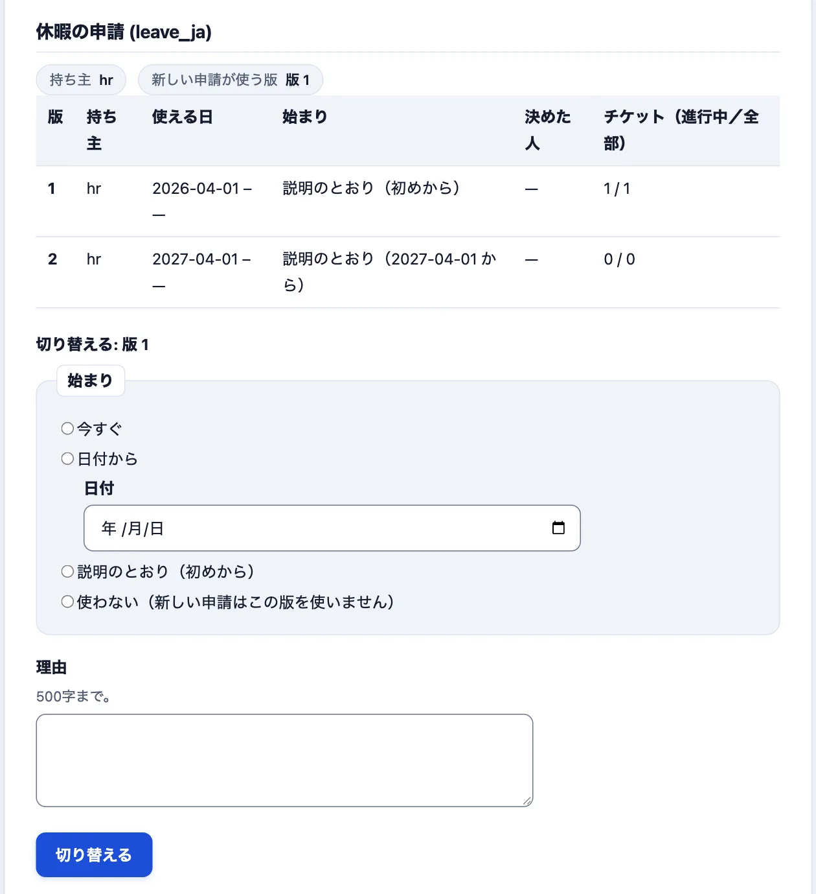
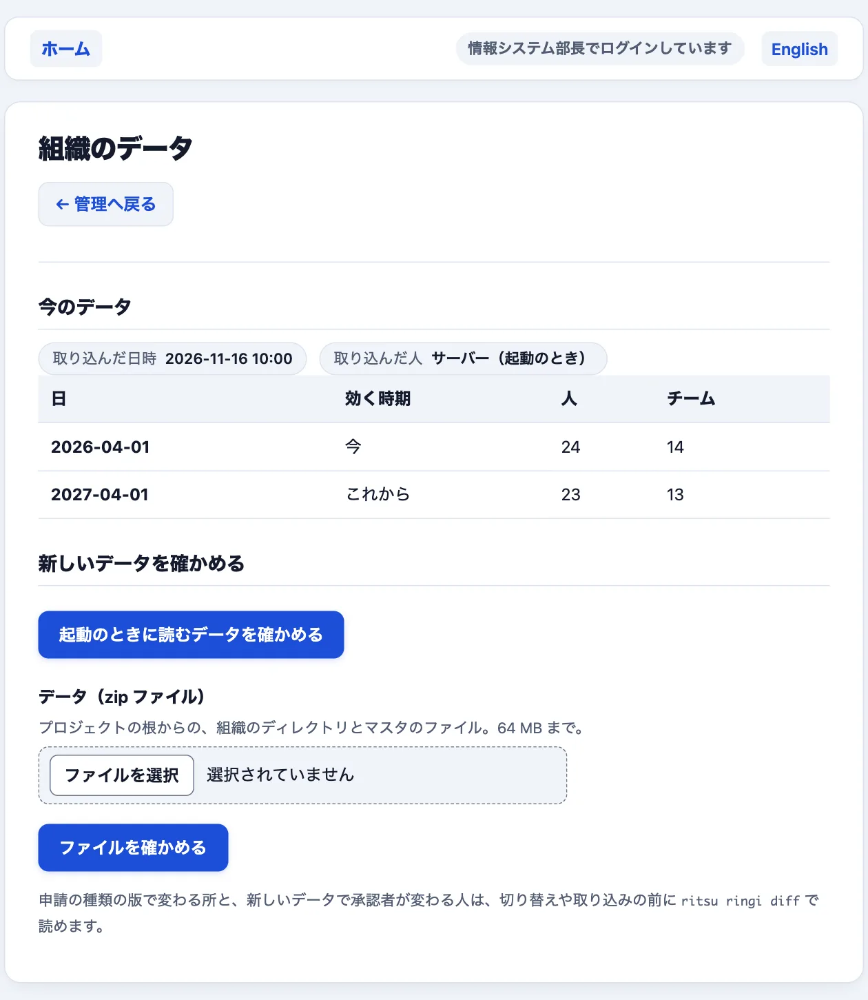

# 管理する

申請を管理する人のための手引きです。申請の決まりを切り替える、異動のデータを取り込む、代理を決める、答えられない承認者を替える、記録を調べる、の五つを説明します。英語版は [admin.md](admin.md) です。

## 管理のページを開く

管理の役割を持つ人のホームには、いちばん下に「管理」のリンクが出ます。

| 役割 | できること |
|---|---|
| `workflow_admin` | 自分の部が受け持つ申請（ページの「持ち主」が自分の部の種類）の決まりを切り替える、その記録を読む、その申請の承認者を加える、引き継ぐ |
| `system_admin` | すべての申請の決まりを切り替える、組織のデータを取り込む、すべての記録を読む |
| `auditor` | すべての記録を読む。何も変えられない |

役割は、会社のログインの側で人に付けます。付けたり外したりした役割は、その人が次にログインしたときから効きます。「管理」が出ないときは、ログインを管理している人に頼んでください。

役割の名前と、できることは、会社が決まりを変えていれば、この表と違います。

## 申請の決まりの版を切り替える

申請の種類を作る人は、決まりを変えるときに、新しい版をサーバーに入れます。何もしなければ、新しい申請は、新しい版がサーバーに入ったとき（日付が書いてあれば、その日）から、新しい版を使います。始める日を変えるときと、前の版に戻すときに、「申請の種類の版を切り替える」を使います。

1. 始まりを変えたい版の「切り替える: 版 2」のフォームを探します。
2. 始まりを選びます。「使える日」より前には始められません。
3. 理由を書き、「切り替える」を押します。理由は記録に残ります。

| 始まり | 意味 |
|---|---|
| 今すぐ | いまから使う |
| 日付から | その日から使う |
| 説明のとおり | 決まりを作った人がファイルに書いた日から使う。日付は括弧の中に出る |
| 使わない | 新しい申請では使わない |

新しい申請は、始まっている版のうち、番号が最も大きいものを使います。前の版に戻すときは、新しいほうの版を「使わない」にします。どの版も始まっていなければ、その申請は出せません。

進行中の申請は、出したときの版のまま最後まで進みます。表の「チケット（進行中／全部）」で、その版の申請がいくつあるかが分かります。

## 異動のデータを取り込む

人の入れ替わりや組織の変更は、組織のデータとして取り込みます。データは、CSV のファイルを zip にまとめたものです。ふつうは、システムの担当者に作ってもらいます（[作り方](../organization.ja.md)）。

1. 「組織のデータを取り込む」を開き、「データ（zip ファイル）」でファイルを選んで、「ファイルを確かめる」を押します。「起動のときに読むデータを確かめる」は、サーバーに組み込まれたデータを読み直すボタンです。zip ファイルを渡すときは使いません。
2. 日ごとに、人、チーム、所属がいくつ増え、減り、変わるかと、その人の ID が出ます。思ったとおりかを確かめます。誤りがあれば、どのファイルの何行目かが出ます。
3. よければ、理由を書いて「取り込む」を押します。

「取り込む」を押すまで、何も変わりません。取り込んだあとも、日付が先の版は、その日が来るまで使われません。

| 取り込むと | どうなるか |
|---|---|
| 前のデータ | zip ファイルの中身に、丸ごと替わる。zip には、前の日付の版も、代理も、すべて入れておく |
| 進行中の申請 | 始まっているステップの承認者は変わらない。次に始まるステップから、新しいデータで決まる |
| 元に戻したいとき | 前の zip ファイルを、もう一度取り込む |

## 休む人の代理を決める

承認者が休みに入る前に、代理を決めておきます。代理の人は、その期間、本人を待っている申請に答えられます。すでに待っている申請も含みます。

1. 代理をする人、最初の日と最後の日、どの申請の代理かを聞きます。
2. 組織のデータの `proxies.csv` に、一行足してもらいます（[代理を決める](../organization.ja.md#代理を決める)）。
3. `system_admin` の人が、上の手順で取り込みます。

## 答えられない承認者を替える

急な休みや退職で承認者が答えられないときは、その申請のページで承認者を替えられます。申請を受け持つ部の `workflow_admin` ができます。

1. 申請のページを開きます。アドレスは `…/pages/tickets/番号` です。番号は、申請した人に聞くか、記録で調べます。ある人を待っている申請をすべて知りたいときは、システムの担当者に調べてもらいます（[データベースを見る](../troubleshooting.ja.md#データベースを見る)）。
2. 答える人を足すなら「承認者を加える」を、いまの承認者の代わりを決めるなら「引き継ぐ」を使い、その人を選びます。

どちらも履歴に残ります。

承認者がいなくて止まった申請も、同じ方法で進めます。組織のデータを直しても、止まった申請は自動では進みません。

## 記録を読む

「記録を読む」には、だれが、いつ、何をしたかが新しい順に並びます。申請の操作、版の切り替え、組織のデータの取り込みの三つがあります。日付、申請の種類、人の ID、申請の番号で絞り込めます。

「この行を CSV で落とす」を押すと、絞り込んだ行を表計算ソフトで開けるファイルになります。

## 困ったとき

| 起きること | 考えられる理由と、すること |
|---|---|
| 「管理」のリンクが出ない | 役割が付いていない。付けてから、ログインし直す |
| 切り替えたのに、新しい申請が前の版のまま | 始めた版より番号の大きい版が、まだ使われている。その版を「使わない」にする |
| 切り替えが受け付けられない | ほかの管理者が先に切り替えていた。いまの状態を確かめてから、もう一度行う |
| データの確かめで、誤りが出る | 出ているファイルと行を直し、もう一度 zip にする |
| 「承認者がいないので止まっています」と出る申請がある | 組織のデータに、そのステップに答える人がいない。[承認者を加える](#答えられない承認者を替える) |
