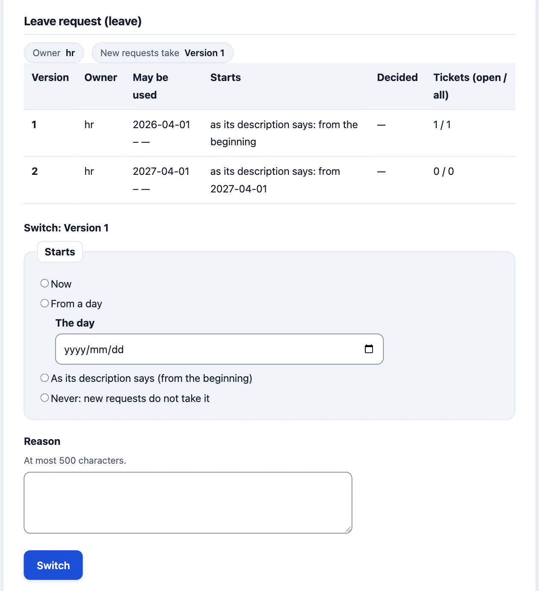
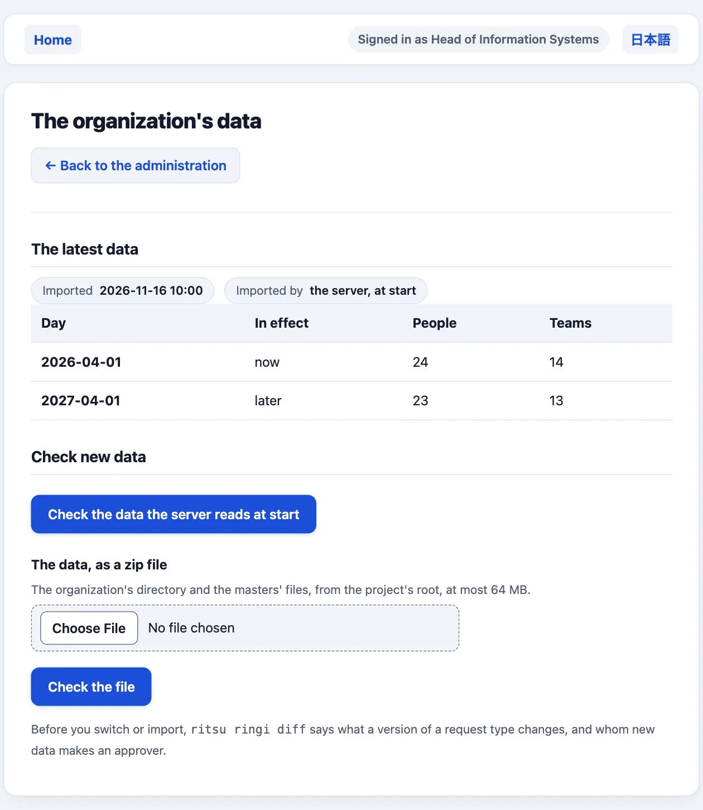

# Administering

A guide for the people who administer the requests: how to switch the rules of a request, import new data of
the organization, set proxies, replace an approver who cannot answer, and read the record. Japanese:
[admin.ja.md](admin.ja.md).

## Opening the pages for administrators

A person with a role that administers has the link "Administration" at the bottom of the start page.

| Role | What it lets a person do |
|---|---|
| `workflow_admin` | Switch the rules of the requests their department keeps (on the page, the types whose "Owner" is their department), read the record of those, add approvers to them, and hand a place over |
| `system_admin` | Switch the rules of every request, import the organization's data, and read the whole record |
| `auditor` | Read the whole record. May change nothing |

Roles are given to people at your company's sign-in. A role that is given or taken away counts from the next
time that person signs in. If "Administration" is not there, ask those who administer the sign-in.

If your company has changed its rules, the names of the roles and what they let a person do differ from this
table.

## Switching the version of a request's rules

When the rules of a request change, those who make the request type put a new version on the server. If you
do nothing, new requests take the new version from when it came onto the server (or from the day written in
it). Use "Switch the versions of the request types" to change the day it starts, and to go back to the
version before.

1. Find the form of the version whose start you want to change, such as "Switch: Version 2".
2. Choose when it starts. It cannot start before the days in "May be used".
3. Write the reason, and press "Switch". The reason is kept in the record.

| Starts | What it means |
|---|---|
| Now | From now on |
| From a day | From that day on |
| As its description says | From the day those who made the rules wrote in the file. The day is in the parentheses |
| Never | New requests do not take it |

New requests take the version with the highest number among those that have started. To go back to the
version before, set the newer one to "Never". If none has started, the request cannot be made.

A request in progress goes on to its end in the version it was made in. "Tickets (open / all)" in the table
says how many requests of that version there are.

## Importing new data of the organization

When people come, go or change places, you import new data of the organization. The data is CSV files in a
zip file. As a rule, those who run the system make it for you ([how to make it](../organization.md)).

1. Open "Import the organization's data", choose the file at "The data, as a zip file", and press "Check the
   file". "Check the data the server reads at start" is the button that reads again the data built into the
   server. You do not use it to give a zip file.
2. For each day, the page says how many people, teams and memberships are added, removed and changed, and
   the people by name and ID, with what changes of each one changed (their email address, say). See that it
   is what you meant. If there is a mistake, it says which line of which file.
3. If it is right, write the reason and press "Import".

Until you press "Import", nothing changes. After it, a version with a later day is not used until that day
comes.

| What an import does | How |
|---|---|
| To the data before | All of it is replaced by what is in the zip file. Put everything in it: the versions of the earlier days, and the proxies |
| To requests in progress | The approvers of a stage that has started stay as they are. From the next stage on, they are found in the new data |
| To undo it | Import the zip file you had before again |

## Setting a proxy for someone who is away

Set a proxy before an approver goes away. During that time, the proxy can answer what waits for the
approver, including what waits already.

1. Ask who is to be the proxy, the first day and the last, and for which requests.
2. Have a line added to `proxies.csv` of the organization's data ([how to set
   proxies](../organization.md#set-proxies)).
3. A person with the role `system_admin` imports the data as above.

## Replacing an approver who cannot answer

When an approver cannot answer, as when they fall ill or have left, you can replace them on the page of the
request. A `workflow_admin` of the department that keeps the request type can do this.

1. Open the page of the request. Its address is `…/pages/tickets/` and its ID. Ask the requester for the ID,
   or find it in the record. To know all the requests that wait for a person, ask those who run the system
   ([Look into the database](../troubleshooting.md#look-into-the-database)).
2. Use "Add an approver" to have one more person answer, or "Hand a place over" to put another in the place
   of an approver, and choose the person.

Both are kept in the history.

A request that stopped because it has no approver goes on in the same way. Putting the organization's data
right does not make it go on by itself.

## Reading the record

"Read the record" lists who did what and when, the newest first: the operations on requests, the switches of
versions, and the imports of the organization's data. You can narrow it down by date, request type, the ID of
a person and the ID of a request.

"Download these lines as CSV" makes a file of those lines that a spreadsheet can open.

## When something is wrong

| What happens | Why, and what to do |
|---|---|
| There is no link "Administration" | You do not have the role. Have it given, and sign in again |
| You switched a version, but new requests still take the one before | A version with a higher number is still in use. Set it to "Never" |
| A switch is not taken | Another administrator switched it first. See how it is now, and try again |
| Checking the data finds a mistake | Put right the line of the file it says, and make the zip file again |
| A request says "Stopped: no approver" | No one in the organization's data answers that stage. [Add an approver](#replacing-an-approver-who-cannot-answer) |
