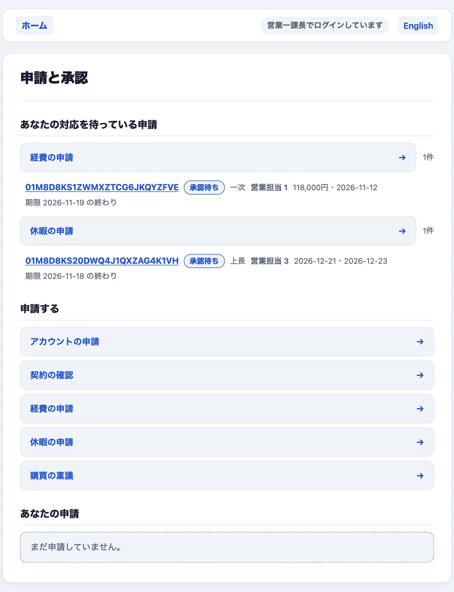
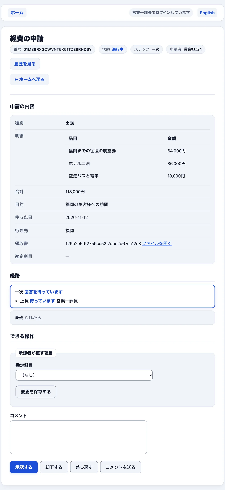

# 承認する

承認する人のための手引きです。画面の例は、見本の会社の経費の申請です。英語版は [approver.md](approver.md) です。

## 自分を待っている申請を見つける

承認の番が来ると、会社で決めた方法（メールなど）で通知が届きます。通知のリンクを開くと、その申請のページに移ります。

ホームの「あなたの対応を待っている申請」にも、すべて並びます。申請の種類を選ぶと、その種類の一覧が出ます。

## 内容を確かめて答える

申請を開くと、申請の内容、経路、できる操作が出ます。経路は承認の順番で、その一つ一つをステップと呼びます。添付ファイルは、開いて確かめます。

| ボタン | どうなるか |
|---|---|
| 承認する | 次のステップに進む。最後のステップなら、申請が承認される。二人以上の回答が要るステップでは、そろうまで待つ |
| 却下する | 申請が却下され、終わる。元に戻せない |
| 差し戻す | 申請した人に戻る。「差し戻す先」が出ているときは、前のステップも選べる |
| コメントを送る | 状態は変わらない。質問や伝言に使う |

ボタンを押す前に「コメント」に書いたことは、その操作と一緒に履歴に残ります。却下や差し戻しにコメントが要る申請の種類もあります。空のまま押すと、そう表示されます。

申請の種類によっては、次のボタンも出ます。

| ボタン | どうなるか |
|---|---|
| 変更を保存する | 承認する人が入力する項目（勘定科目など）を保存する。承認とは別に押す |
| 保留にする、保留を解く | 期限を止めて待たせる。決められた日数が過ぎると、自動で解ける |
| 承認を取り消す | 自分の承認をなかったことにする。次のステップの人がまだ答えていなければできる |

## 期限と催促

承認には期限があります。多くの申請では、期限の前に、もう一度通知（催促）が届きます。期限の日は、ページには出ません。催促が届いたら、早めに答えてください。

期限を過ぎると、申請は期限切れで終わるか、上の人に回ります。どちらになるかは、申請の種類ごとに決まっています。

期限を営業日で数える申請では、会社の休みの日は数えません。

## 差し戻した申請、答え終わった申請

差し戻した申請に、申請した人から質問のコメントが来たら、その申請のページを開き、「コメント」に返事を書いて「コメントを送る」を押します。

答え終わった申請は、ホームには出ません。通知のリンクか、申請のページのアドレスから、あとでも開けます。

回覧の通知は、読んでもらうためのものです。答えるボタンは出ません。

## 代理として承認する、代理を頼む

ほかの人の承認の代理になっている期間は、その人を待っている申請も「あなたの対応を待っている申請」に出ます。承認すると、履歴に、だれの代わりに答えたかが残ります。

休みに入る前に、代理をする人と期間を、申請を管理する人に伝えてください。組織のデータに入れてもらうと、その期間は、代理の人が答えられます。すでに自分を待っている申請にも、代理の人が答えられます。

## 困ったとき

| 起きること | 考えられる理由と、すること |
|---|---|
| ボタンが出ない | 自分の番ではない。ほかの承認者が先に答えたか、申請した人に戻っている。「経路」で確かめる |
| 自分が出した申請を承認できない | 自分の申請は承認できない決まりになっている。ほかの承認者か、上の人に回る |
| 「このページを開いたあとで、申請が変わりました。」と出る | 申請した人が取り下げたか、ほかの人が答えた。いまの内容が出ているので、確かめてからもう一度押す |
| 間違えて承認した | 「承認を取り消す」が出ていれば押す。出ていなければ、次の承認者に連絡し、差し戻すか却下してもらう |
| 間違えて却下した | 元に戻せない。申請した人に、新しく申請してもらう |
