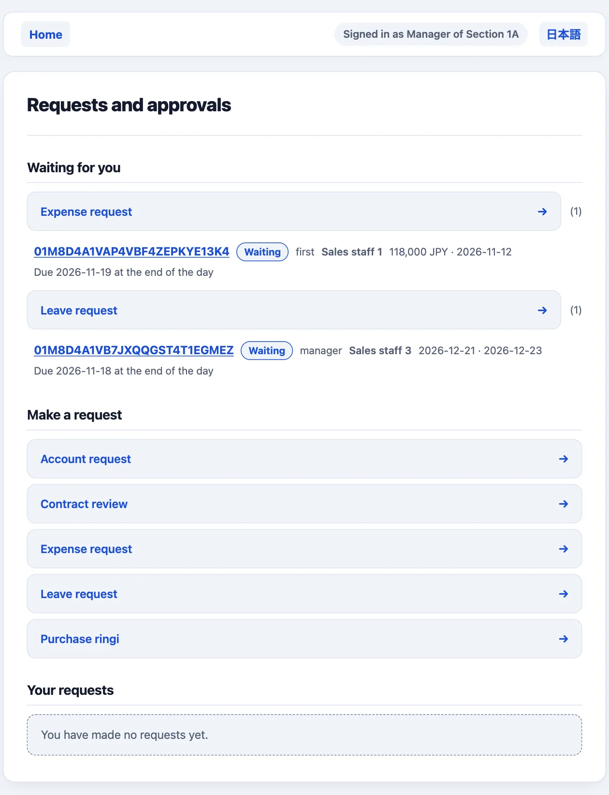
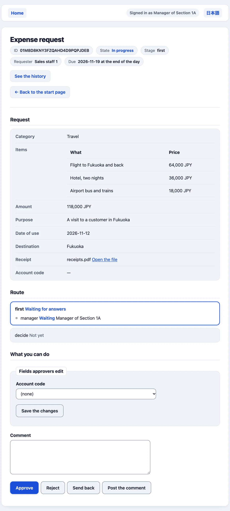

# Approving a request

A guide for the people who approve requests. The pictures are of the expense request of a sample company.
Japanese: [approver.ja.md](approver.ja.md).

## Finding what waits for you

When it is your turn to approve, you are told in the way your company has chosen, such as mail. Its link
opens the page of the request.

"Waiting for you" on the start page lists them all. Choose a request type to see the list of that type.

## Checking it, and answering

The page of a request has what was asked for, its route, and what you can do. The route is the order of the
approvals, and each step of it is a stage. Open the attachments and check them.

| Button | What happens |
|---|---|
| Approve | It goes to the next stage. At its last stage, it is approved. At a stage that takes the answers of two people or more, it waits until they are all there |
| Reject | It is rejected, and ends. This cannot be undone |
| Send back | It goes back to the person who made it. When there is a field "Send it back to", you can choose an earlier stage too |
| Post the comment | Its state does not change. For questions and messages |

What you write in "Comment" before you press a button is kept in the history with what you did. Some request
types take a comment to reject or to send back. If it is empty when you press the button, the page says so.

Some request types have these buttons too.

| Button | What happens |
|---|---|
| Save the changes | Saves the fields the approver fills in, such as the account. You press it apart from approving |
| Put on hold, Take off hold | Stops the deadline and lets the request wait. After a number of days, it goes on by itself |
| Take back my approval | Undoes your approval. You can do it while the people of the next stage have not answered |

## Deadlines and reminders

An approval has a deadline. In most request types you are told again before it (a reminder). The date of
the deadline is not on the page: answer soon after a reminder.

Past the deadline, a request expires or goes to the person above. Which it is differs from one request type
to another.

In a request type whose deadlines are counted in business days, your company's holidays do not count.

## Requests you sent back, and requests you have answered

If the requester asks you something in a comment on a request you sent back, open its page, write your answer
in "Comment", and press "Post the comment".

Requests you have answered are not on the start page. You can open one later from the link of its notice, or
from the address of its page.

A notice of a circulation is for you to read. There is no button to answer it with.

## All the requests of a type your department keeps

Your company may let the department that keeps a request type see all its requests. In the sample company,
Accounting keeps the expense request. Then "All requests", under "Your requests" on the start page, lists the types
your department keeps. Choose one to see every request of that type, whoever made it, the newest first, and open
any of them from the list. People of other departments do not have this part.

## Approving as a proxy, and asking someone to

While you are someone's proxy for approving, what waits for that person is under "Waiting for you" too. When
you approve it, the history says for whom you answered.

Before you go away, tell the people who administer the requests who is to be your proxy, and for how long.
Once it is in the organization's data, your proxy can answer during that time. That goes for the requests
that wait for you already.

## When something is wrong

| What happens | Why, and what to do |
|---|---|
| There are no buttons | It is not your turn. Another approver has answered, or it is back with the requester. See "Route" |
| You cannot approve a request you made | The rule is that no one approves their own. It goes to another approver, or to the person above |
| "The request changed after this page was shown." | The requester withdrew it, or someone else answered. The page shows it as it is now: check it, and press again |
| You approved by mistake | Press "Take back my approval" if it is there. If not, ask the next approver to send it back or to reject it |
| You rejected by mistake | It cannot be undone. Ask the requester to make a new request |
