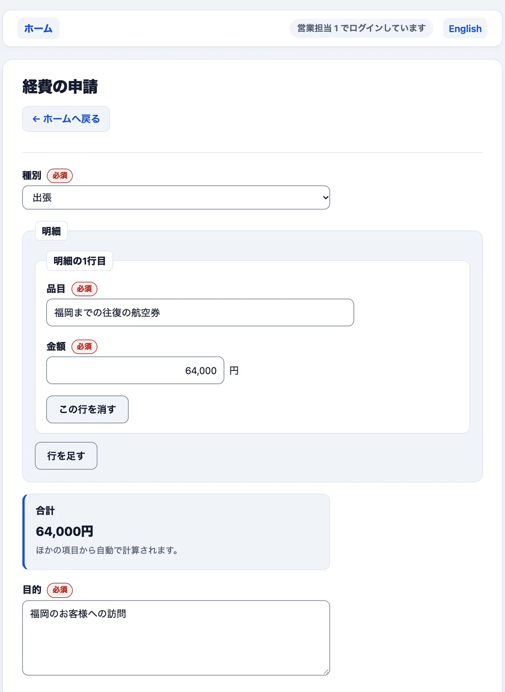

# 申請する

社員が申請するときの手引きです。画面の例は、見本の会社の経費の申請です。実際に出る申請の種類と、入力する項目は、会社ごとに違います。英語版は [requester.md](requester.md) です。

## ログインする

会社から案内されたアドレスをブラウザで開きます。会社のログインのページに移ったら、いつもの方法でログインします。終わるとホームが開きます。

ページは日本語と英語で使えます。右上の「English」か「日本語」で切り替わります。パソコンでも、スマートフォンでも使えます。

2 時間使わないでいるか、ログインから 12 時間たつと、もう一度ログインすることになります。ほかの人も使うパソコンでは、終わったら右上の「ログアウト」を押します。

## 申請を出す

1. ホームの「申請する」から、申請の種類を選びます。いま自分が出せるものだけが並びます。
2. 項目を入力します。「必須」と付いた項目は、入力しないと申請できません。
3. 「申請する」を押します。

申請すると、その申請のページに変わります。番号と状態、だれの回答を待っているかが出ます。番号は、問い合わせるときに伝えます。

| 入力するとき | 説明 |
|---|---|
| 項目が増えたり、必須になったりする | 選んだ種別や金額によって変わる |
| 明細を増やす、減らす | 「行を足す」と「この行を消す」を使う |
| 合計など、入力できない項目 | ほかの項目から自動で計算される |
| ファイルを付ける | 「ファイルを選択」から選ぶ。PDF、画像、テキスト、Word や Excel などのファイルを付けられる。大きさは、ふつう一つ 10 MB まで |
| 人や部署を選ぶ | 一覧から選ぶ。人の多い会社では、名前か ID の一部で探す |
| 承認する人に伝えたいこと | 「コメント」に書く |

入力に足りないところがあると、申請は出されず、その項目のところに理由が出ます。入力したものは残っているので、直してもう一度「申請する」を押します。

書きかけの申請は保存されません。ページを閉じたり、ログインが切れたりすると、入力したものは消えます。

## 進み具合を見る

差し戻されたとき、結果が出たとき、コメントが付いたときには、会社で決めた方法（メールなど）で通知が届きます。

ホームの「あなたの申請」には、自分の申請が並びます。横の印が、いまの状態です。

| 印 | 意味 |
|---|---|
| 承認待ち | 承認する人の回答を待っている |
| 差し戻し | 承認する人が、直してほしいと戻した |
| 再申請待ち | 自分で取り下げた。直して出し直すか、やめるかを選ぶ |
| 保留 | 承認する人が、いったん止めている |
| 承認 | 最後まで承認された |
| 却下 | 認められなかった |
| 期限切れ | 期限までに回答がなかった。または、期限までに再申請しなかった |
| 取り下げ | 申請をやめた |

申請を開くと、「経路」に、だれが承認したか、次はだれかが出ます。「状態」の言い方は、印と少し違います。「承認待ち」の申請は「進行中」、「差し戻し」と「再申請待ち」の申請は「申請者に戻っています」と出ます。

承認されると、発注や支払いなどの処理が始まる申請もあります。その申請のページには、「承認のあとの処理」に、処理の進み具合が出ます。「まだ始めていません」「始められず、やり直しています」「始めました」のあと、「済みました」（発注番号など、処理が終わったときの値も出ます）か、「失敗しました」（理由も出ます）になります。

「履歴を見る」を押すと、だれがいつ何をして、どんなコメントを書いたかが、順に読めます。

## 差し戻されたとき

差し戻された申請は、ホームの「あなたの対応を待っている申請」に出ます。

1. 申請を開き、「履歴を見る」で、差し戻した人のコメントを読みます。
2. 申請のページに戻り、「内容を修正して再申請する」を押します。
3. 内容を直し、「もう一度申請する」を押します。

再申請すると、最初の承認者からやり直しになります。前に承認した人にも、もう一度答えてもらいます。

何を直せばよいか分からないときは、申請のページの「コメント」に質問を書いて「コメントを送る」を押します。差し戻した人に届きます。

再申請には期限があり、過ぎると期限切れになります。期限の長さは申請の種類ごとに決まっていて、ページには出ません。

## 申請を取り下げる、やめる

間違いに気づいたときや、要らなくなったときは、申請のページの「取り下げる」を押します。承認する人の一覧から消え、自分に戻ってきます。印は「再申請待ち」になります。

- 直して出し直すときは、「内容を修正して再申請する」を押します。
- 出し直さないときは、「申請をやめる」を押します。印は「取り下げ」になり、その申請では、もう何もできません。

「取り下げる」が出ていないときは、取り下げられる時期を過ぎています。申請の種類によっては、取り下げた申請が自分に戻らず、そのまま「取り下げ」で終わります。

## ほかの人の代わりに申請する

会社の設定で、ほかの人の申請の代理になっている人には、フォームに「代わりに申請する相手」が出ます。その人を選んで申請すると、選んだ人の申請になります。自分の申請を出すときは、空のままにします。

## 困ったとき

| 起きること | 考えられる理由と、すること |
|---|---|
| 会社のログインは済んだのに、入れない | このサーバーに、自分のメールアドレスが登録されていない。申請を管理している人に伝える |
| 送ろうとしたら「ログインしていないか、ログインの期限が切れました。」と出た | もう一度ログインし、申請を書き直す。長い文は、送る前にコピーしておくとよい |
| 申請の種類が出てこない | その申請を出せる人に入っていないか、その申請がもう使われていない。申請を受け持つ部署に聞く |
| 「この申請は2027-04-01から出せます。」と出る | まだ始まっていない申請。その日まで待つ |
| 「このページを開いたあとで、申請が変わりました。」と出る | ほかの人が先に操作した。いまの内容が出ているので、確かめてもう一度送る |
| 「帳簿（予算や休暇の日数など）が、この操作を受け付けませんでした。」と出る | すぐ下に理由が出る（「部の予算が足りません」など）。金額や日数を減らせるなら、減らして出し直す。わからなければ、この申請を管理している人に聞く |
| 「会社が用意したデータでは、この日付の申請を扱えません。」と出る | 会社が用意した組織やカレンダーのデータに、その日の分がない。申請を受け持つ部署に伝える |
| コメントを続けて送れない | 同じ申請へのコメントは、10 秒ほど間を空ける |
| 「承認のあとの処理」が「失敗しました」になった | 申請は承認されたまま。そのあとの処理が通らなかった。下に出ている理由を添えて、申請を管理している人に伝える |
| ほかの人の申請を開くと「見つかりません」と出る | その申請を見られる人に入っていない。番号が間違っていることもある |
