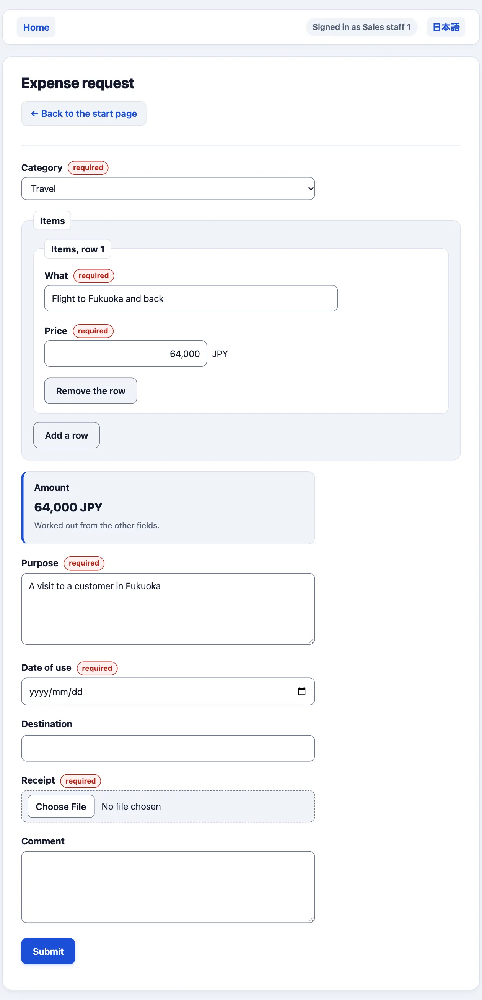

# Making a request

A guide for the people who make requests. The pictures are of the expense request of a sample company. The
request types you have, and the fields in them, differ from company to company. Japanese:
[requester.ja.md](requester.ja.md).

## Signing in

Open the address your company gave you in a browser. When the page of your company's sign-in comes up, sign
in as you always do. After that, the start page opens.

The pages are in English and Japanese. "日本語" or "English" at the top right goes from one to the other.
They work on a computer and on a phone.

After 2 hours in which you did nothing, or 12 hours after you signed in, you sign in again. On a computer
that other people use too, press "Sign out" at the top right when you are done.

## Making a request

1. Choose a request type under "Make a request" on the start page. Only those you can make now are there.
2. Fill in the fields. A field with "required" has to be filled in.
3. Press "Submit".

The page of your request comes up. It has its ID, its state, and whose answer it waits for. Give the ID
when you ask someone about it.

| While you fill it in | What it is |
|---|---|
| A field comes up, or becomes required | It depends on the category or the amount you chose |
| More rows, or fewer | Use "Add a row" and "Remove the row" |
| A field you cannot fill in, such as a total | It is worked out from the others |
| Attaching a file | Choose it with the button for files. PDF, pictures, text, Word, Excel and the like can be attached, as a rule up to 10 MB each |
| Choosing a person or a department | Choose it from the list. In a company with many people, find it by a part of the name or the ID |
| Something to tell the approver | Write it in "Comment" |

If something is missing, the request is not made, and the reason is shown at the field. What you filled in
is still there: put it right, and press "Submit" again.

A request you are still filling in is not kept. If you close the page, or your sign-in ends, what you filled
in is lost.

## Seeing how it goes

When a request is sent back, when it is decided, and when someone comments on it, you are told in the way
your company has chosen, such as mail.

"Your requests" on the start page lists your requests. The mark beside each is its state now.

| Mark | What it means |
|---|---|
| Waiting | It waits for an approver's answer |
| Sent back | An approver gave it back to be put right |
| To be resubmitted | You withdrew it. Submit it again, or discard it |
| On hold | An approver has put it on hold |
| Approved | It was approved at its last stage |
| Rejected | It was not accepted |
| Expired | There was no answer by the deadline, or it was not submitted again in time |
| Withdrawn | You discarded it |

On the page of a request, "Route" says who has approved it, and who is next. "State" there uses slightly
different words: a request marked "Waiting" is "In progress", and one marked "Sent back" or "To be
resubmitted" is "With the requester".

"See the history" shows, in order, who did what, when, and with which comment.

## When it is sent back

A request that was sent back is under "Waiting for you" on the start page.

1. Open it, and read the comment of the person who sent it back in "See the history".
2. Go back to the page of the request, and press "Edit it and submit again".
3. Change it, and press "Submit again".

It starts over at its first approver. Those who approved it before are asked again.

If you do not know what to change, write a question in "Comment" on the page of the request, and press
"Post the comment". It goes to the person who sent it back.

There is a time to submit it again in, after which it expires. How long differs from one request type to
another, and is not on the page.

## Withdrawing a request, and discarding it

If you find a mistake, or no longer need it, press "Withdraw" on the page of the request. It goes from the
approver's list, and comes back to you. Its mark is "To be resubmitted".

- To change it and submit it again, press "Edit it and submit again".
- To end it, press "Discard the request". Its mark becomes "Withdrawn", and nothing more can be done with
  it.

If "Withdraw" is not there, it is too late to withdraw the request. In some request types, a request that is
withdrawn does not come back to you, and ends as "Withdrawn".

## Making a request for someone else

If your company has set you as someone's proxy for making requests, the form has the field "On behalf of".
Choose the person, and it is their request. Leave it empty for your own request.

## When something is wrong

| What happens | Why, and what to do |
|---|---|
| You signed in to your company, but cannot come in | Your mail address is not in this server's data. Tell the people who administer the requests |
| You submitted it, and the page says "You are not signed in, or your sign-in has ended." | Sign in again, and fill it in again. Copy a long text before you submit it |
| A request type is not there | You are not one of those who can make it, or it is no longer used. Ask the department that keeps it |
| "This request may be made from 2027-04-01." | It has not started. Wait until that day |
| "The request changed after this page was shown." | Someone else acted first. The page shows it as it is now: check it, and try again |
| "The request cannot be recorded in the books for you." | As a rule, too little is left of the department's budget or of your days of leave. Open "Details for the people who keep this kind of request" to read the reason |
| "The request cannot be dealt with on this date with the data the company has set up." | The company's data of the organization or of the calendar does not have that day. Tell the department that keeps the request type |
| A second comment is not taken | Leave about 10 seconds between comments on the same request |
| Someone else's request says "Not found" | You are not one of those who can see it, or the ID is wrong |
